# Chapter 22: Consistency Models -- How Staff Engineers Choose the Right Guarantees

*(Author note: Consistency is the most interview-tested distributed systems concept. Engineers fail not because they don't know what "eventual consistency" means -- they fail because they can't explain which model to pick, why, and what breaks when you pick wrong. This chapter fixes that.)*

---

## Chapter at a Glance

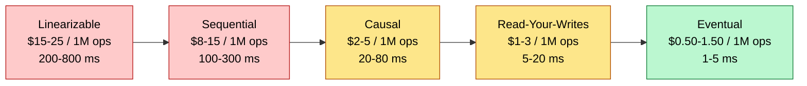

*Strongest and most expensive on the left; weakest and cheapest on the right. Dollar costs are illustrative relative estimates to show the ordering and rough multiples, not vendor prices. In interviews, reason from round trips and latency rather than quoting dollar figures.*

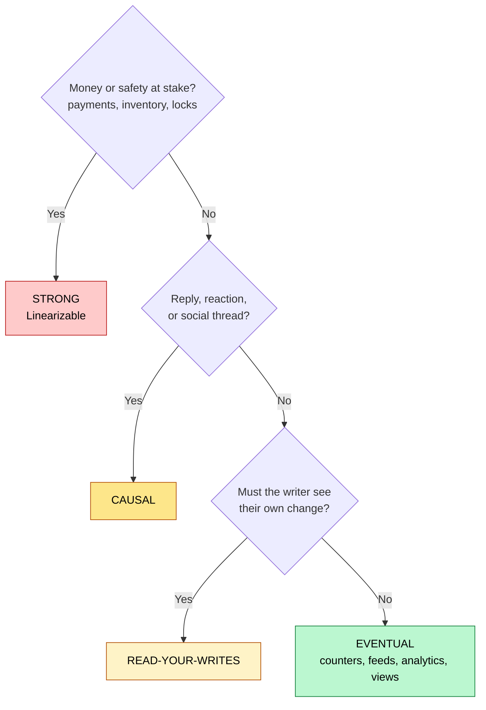

**Key takeaways**

1. Use the weakest model that works. Stronger means more latency and more cost.
2. Different data types in one system need different consistency models.
3. CAP is physics. During a partition you choose: correct or fast.
4. Eventual without read-your-writes destroys user trust in interactive UIs.
5. Optimistic UI hides eventual consistency from users at near-zero cost.

Most engineers who have worked with distributed systems for several years can define eventual consistency. They can tell you what Dynamo is, what Cassandra does, and why a banking app uses something different from a social media feed. When interviewers ask "what consistency model would you use?", those engineers answer quickly and confidently. Then they fail the interview.

They fail not because of ignorance but because they stay at the definition layer. They say "I'd use eventual consistency for the feed" without explaining what that means for the user who just posted and can't see their own update. They say "I'd use strong consistency for payments" without explaining that cross-region linearizability adds 400ms to every checkout and that you need a fallback for partition scenarios. The gap between L5 and L6 is not knowledge of models -- it is the ability to trace a model choice all the way from the technical decision to the user's screen, the cost dashboard, and the on-call incident report. This chapter builds that trace.

---

## What Staff-Level Depth Looks Like

At large-scale companies, consistency is rarely a whiteboard abstraction. The storage systems you reason about have explicit, documented guarantees, and interviewers often come from teams that run them. Three things change at the Staff bar compared with Senior:

1. **You name the guarantee precisely.** "Strong" is not an answer. Say *linearizable reads*, *strict serializability (external consistency)*, *bounded staleness of 10 s*, or *read-your-writes via a version token*. Precision signals you know what you are paying for.
2. **You know the mechanism behind the guarantee.** If you choose Spanner, expect "how does it give external consistency across continents?" (TrueTime and commit-wait). If you choose a Paxos-replicated store, expect "how are reads linearizable without a quorum round trip?" (leader leases). Part 10 covers these.
3. **You drive the trade-off with numbers and failure modes**, not definitions. Quantify latency (cross-region RTT, commit-wait), availability (what happens when a region is lost), cost, and the user-visible behavior during the incident.

**Reference systems map** (know the guarantee each one gives you out of the box):

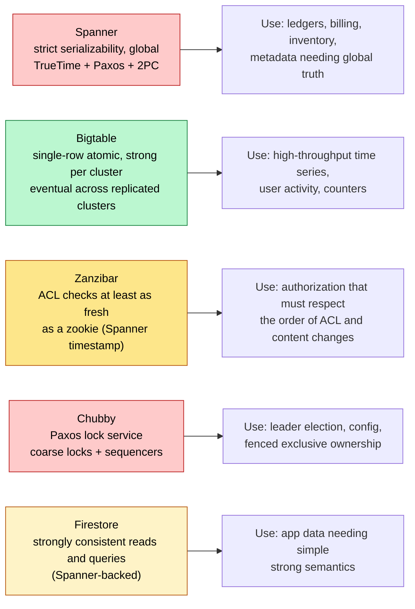

In an interview, you usually cannot say "I'd use Spanner" and stop. Interviewers want the generic design (Paxos groups, timestamps, quorums) and the reason it fits, so use these systems as reference points, not as answers.

---

## The Bank Account Problem -- Why Consistency Matters

**Without consistency: the $60 exploit**

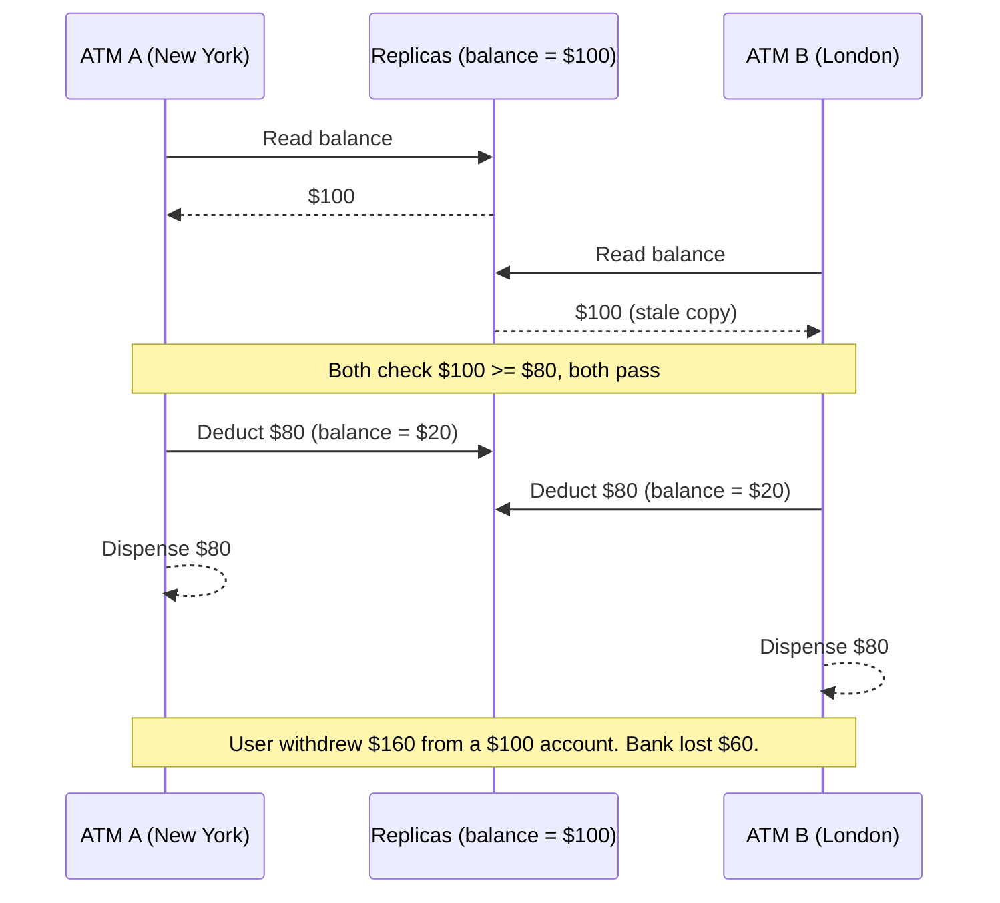

**With strong consistency: correct behavior**

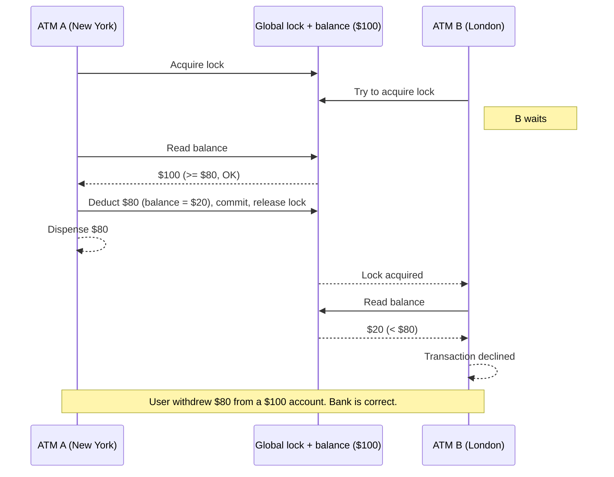

What went wrong technically in the first scenario is a stale read followed by a decision based on that stale data. Both ATMs read the balance at roughly the same time. Both got the same answer: $100. Neither knew the other existed. Neither waited for the other to finish. Each ATM made a perfectly rational local decision based on the information it had. The problem is that "the information it had" was wrong by the time it mattered. This is what "eventual consistency" means at its worst: reads return data that is correct in isolation but stale relative to concurrent writes. The two ATMs represent two replicas, and without a protocol forcing them to coordinate before acting, they both act on a stale world.

The phrase "well, the user just won't do that" is the most dangerous four words in distributed systems. Adversarial users absolutely will do that. In 2014, several cryptocurrency exchanges were drained through double-spend attacks that exploited exactly this pattern -- the exchange used eventually consistent reads to check wallet balances, and coordinated withdrawals from two separate sessions faster than the system could propagate the first debit. The attacker didn't need a sophisticated exploit. They just opened two browser tabs and clicked withdraw simultaneously. The eventual consistency model -- perfectly fine for showing a balance on a dashboard -- was a catastrophic choice for authorizing a withdrawal. The system was "working as designed." The design was wrong.

This same pattern appears everywhere money, capacity, or scarce resources are involved. In e-commerce, two users both see the last item in stock, both add it to their cart, both complete checkout -- the system sold the same physical unit twice. The company must now issue a refund and apologize, or ship something they don't have. In ticketing (concerts, airline seats), two buyers both see seat 14C as available, both click purchase, both get a confirmation email -- now two people show up at the airport with the same seat assignment. In API rate limiting, a client makes 100 requests per second across 10 servers, each server tracks its own count using an eventually consistent counter, the client actually makes 900 requests per second but each server only sees 90 -- the rate limiter is completely ineffective. These are not theoretical edge cases. Every company running distributed infrastructure at scale has dealt with at least one of these. The solution is not "use strong consistency everywhere." The solution is knowing precisely which operations require strong consistency and paying that cost only where it is justified.

---

## Quick Visual: What Users Actually Experience

```mermaid
flowchart LR
    subgraph STR["STRONG (Linearizable)"]
        direction LR
        s1["User clicks"] --> s2["~500 ms pause"] --> s3["Success. Everyone sees the new value immediately"]
    end
    subgraph RYW["READ-YOUR-WRITES"]
        direction LR
        r1["User clicks"] --> r2["~10 ms"] --> r3["You see your change. Others may see old value for 1-5 s"]
    end
    subgraph CAU["CAUSAL"]
        direction LR
        c1["User posts"] --> c2["~15 ms"] --> c3["Reply always appears after the original. Unrelated events in any order"]
    end
    subgraph EVT["EVENTUAL"]
        direction LR
        e1["User posts"] --> e2["~5 ms: server accepted"] --> e3["Refresh: where did it go?"] --> e4["Refresh: WHERE IS IT?"] --> e5["Refresh: there it is (1-30 s later)"]
    end
    STR ~~~ RYW ~~~ CAU ~~~ EVT
    style e3 fill:#fecaca,stroke:#b91c1c,color:#000
    style e4 fill:#fecaca,stroke:#b91c1c,color:#000
    style s3 fill:#bbf7d0,stroke:#15803d,color:#000
    style r3 fill:#bbf7d0,stroke:#15803d,color:#000
    style c3 fill:#bbf7d0,stroke:#15803d,color:#000
```

The "where did it go?" problem is not a small annoyance. It is one of the most trust-destroying experiences a user can have with an application. The user did something -- they created a post, updated their bio, deleted a comment -- and now the thing they did has vanished. From the user's perspective, the app lost their data. It does not matter that the data is technically still there and will appear in 20 seconds. The user does not know that. They experience data loss. They file a support ticket. They tell friends the app is buggy. They screenshot the missing post and post it to Twitter. The engineering team investigates, finds no bug, closes the ticket as "working as intended." The user never comes back. This is the actual cost of pure eventual consistency applied to interactive user actions. The technical system is correct. The product is broken.

The 500ms that strong consistency adds feels very different depending on what you are doing. For a background sync -- your email client fetching new messages, your phone uploading photos to the cloud, your calendar syncing across devices -- 500ms is completely invisible. The operation happens in the background. You never notice. For an interactive action -- clicking a button, submitting a form, updating your profile picture -- 500ms is noticeable. Humans perceive interactions as "slow" above approximately 100ms and "broken" above approximately 1000ms. This is why the consistency model for the user-facing click path matters enormously while the consistency model for background analytics can be much weaker. The right question is not "is 500ms acceptable?" The right question is "where in the user experience does this write happen, and what is the user doing while they wait?"

Snapchat's "streaks" feature is a real-world example of surgical consistency model selection. Snapchat has hundreds of millions of daily active users, and streak counts are one of the most emotionally significant numbers in the app -- users have literally cried when streaks broke due to technical issues. Despite this, Snapchat uses eventual consistency for the streak count itself, because displaying a counter that is 2 seconds behind is completely imperceptible to the user. However, they use read-your-writes consistency for "did YOU send a snap today?" -- because if you send a snap and the app tells you your streak is at risk, you will panic and send another snap, creating duplicate data and a terrible experience. The count is eventually consistent. Your own action is immediately reflected. Two different models for two different fields on the same screen. That is Staff Engineer thinking.

---

## L5 vs L6 Opening Comparison

| Feature | L5 Approach | L6 Approach |
|---|---|---|
| **Social media likes** | "Likes should be consistent." Uses strong. 300ms per like, $18 per 1M writes. | "Likes can be eventually consistent. Users cannot tell if a count is 2 seconds stale." Uses eventual. $0.80 per 1M writes. 22x cheaper. |
| **Shopping cart** | "Cart needs to be accurate. Use strong consistency everywhere." | "Cart uses read-your-writes during browsing (cheap, snappy) and strong only at checkout (when money is at stake). Two different models in the same flow." |
| **Chat messages** | "Messages need to be in order. Use linearizable." Cross-region: 400ms per message, users notice lag. | "Messages need causal order -- reply must follow original. Use causal consistency. 30ms latency. Unrelated messages can appear in any order without UX impact." |
| **User profile update** | "Profile data should be consistent. Use strong." | "Profile update needs read-your-writes so the user sees their own change. Others can see old data for 5 seconds -- zero user impact. Much cheaper than strong." |
| **Payment processing** | "Payments are important. Use eventual consistency with retries." Three incidents in first six months. Regulatory complaints. | "Payments require linearizability. We pay $20 per 1M transactions in coordination cost. That is $0.00002 per payment -- trivially justified to prevent double-spend and regulatory issues." |

The pattern here is subtle but important. The L5 engineer is making reasonable individual decisions: "this data is important, so I'll use strong consistency" or "this can be approximate, so I'll use eventual." These are not wrong decisions exactly -- they just fail to recognize that every feature has a different answer and that the right answer changes depending on which field within the same feature you are talking about. The L5 engineer treats consistency as a feature-level choice. The L6 engineer treats it as a per-field, per-operation choice driven by the specific question "what breaks if this data is N seconds stale?"

The consequence of the L5 approach is a system that is either over-engineered (using strong consistency everywhere, costing 10-20x more than necessary and introducing 400ms latency into interactions that don't need it) or under-engineered (using eventual consistency everywhere, generating a flood of "where did my data go?" support tickets and, in the worst case, financial inconsistencies). The L6 approach -- deliberately assigning different consistency models to different data types within the same system -- produces a system that is faster, cheaper, and more reliable at the same time. An e-commerce platform designed this way uses strong consistency only at checkout (perhaps 0.1% of all operations), causal consistency for Q&A threads and reviews (5% of operations), read-your-writes for cart and wishlist actions (30% of operations), and eventual consistency for product view counts, recommendation scores, and search rankings (65% of operations). The system is correct everywhere it needs to be and fast everywhere it can be.

---

## Mental Models (5 Models)

These five ideas carry the rest of the chapter. Each later part expands one of them.

| # | Mental model | What it means in practice |
|---|---|---|
| 1 | **Consistency is a spectrum, not a toggle** | Five meaningfully different levels. One step stronger roughly doubles cost and adds latency; one step weaker widens the set of "wrong" states users can see. |
| 2 | **"What breaks if this is stale?" is the only question** | Never ask "is this data important?" (everything passes). Ask what happens at 50 ms, 5 s, and 60 s of staleness. The answer picks the model. |
| 3 | **During a partition you choose correct or available** | Partitions happen (1-5 major events per year at large scale). CP returns errors, AP returns stale data. Decide per data type which failure is less harmful. |
| 4 | **Different data in one system needs different models** | Spanner for billing and eventual counters for YouTube views, in one company. Strong inventory at checkout and eventual star ratings, on one page. |
| 5 | **Stronger = more coordination = more round trips = more latency** | New York to London is ~5,570 km; light in fiber makes one RTT at least ~56 ms, so a 2-RTT consensus write costs over 110 ms before any processing. No code fixes physics. |

---

# Part 1: Consistency Models -- Intuition First

Before defining anything formally, understand what each consistency model feels like to users. Technical definitions are not the goal -- they are tools. The goal is to build an intuition strong enough that when you are sitting in a system design interview at 2pm on a Tuesday, you can instantly sense which model belongs where without having to derive it from first principles. The best way to build that intuition is not memorizing definitions. It is understanding what each model looks like from the chair of a user who just clicked a button.

---

## Strong Consistency: "What I Write, Everyone Sees Immediately"

With strong consistency, the moment your write is acknowledged, every reader in the world -- on any server, in any data center, on any continent -- will see your new value. Not eventually. Not probably. Immediately and without exception. If you just changed your password, no replica anywhere has the old password anymore. If you just transferred $500 to a friend, your balance is already reduced and their balance is already increased, visible from any server anywhere. There is no window of time, however brief, where some part of the system has stale data after the write commits. The guarantee is absolute.

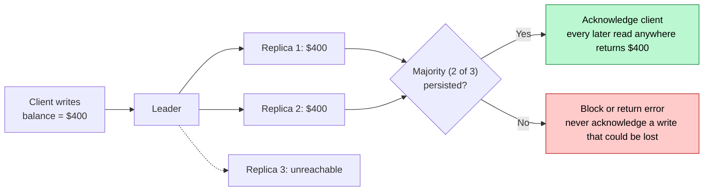

*Strong consistency behaves like one shared whiteboard: the write is acknowledged only after a majority holds it, so no reader can ever see the old value afterwards.*

The mental model that makes strong consistency click is "one true state." Imagine the entire system as a single global whiteboard. Every write erases the old value and writes the new value on the board, and everyone in the world is looking at the same board. There is no "maybe the board in Tokyo still has the old value." There is one board, and it has exactly one value at all times. Every read returns the current value of the board. This is a useful simplification -- real implementations use distributed consensus protocols rather than an actual central whiteboard -- but the guarantee is equivalent. The user experience matches this model: you write, you see your write, everyone sees your write, there is nothing to reconcile.

The real-world analogy that makes this concrete is Google Docs. When you type a character in a Google Doc, the other collaborators typically see your change within 200-500ms, depending on their network conditions. From a user perspective, it feels instant and shared -- the document is a shared truth. Google Docs actually uses a variant of operational transformation rather than pure linearizable consistency, but the user experience it creates is the experience of strong consistency: what I type, everyone sees, and the document is always coherent. The alternative -- what happens when Google Docs has connectivity issues and you go offline -- demonstrates exactly what weak consistency feels like: you type changes locally, Google Docs queues them, and when you reconnect, there is a reconciliation step that might result in conflicts. That reconciliation step is the cost of temporary consistency relaxation.

The technical reason strong consistency is expensive has nothing to do with hardware and everything to do with coordination. Before a write can be acknowledged to the client, the system must confirm that a majority of replicas have recorded the new value. In a 3-node cluster, 2 nodes must confirm. In a 5-node cluster, 3 nodes must confirm. Each confirmation requires a network round trip. The write cannot return to the client until those confirmations arrive. During a network partition -- when some replicas become unreachable -- the system either waits (blocking reads and writes until the partition heals, sacrificing availability) or proceeds with a sub-majority quorum (risking inconsistency, defeating the purpose). Strong consistency is a promise that has a real cost to keep, and that cost scales with network latency and the number of replicas involved.

The L5 approach to strong consistency is to reach for it when something "seems important." L6 is different. An L6 engineer says: strong consistency adds 200-500ms cross-region for every write and reduces availability during partitions -- the system will return errors to users during a network partition rather than serve potentially stale data. Before I choose strong consistency, I ask precisely: what breaks if this data is 5 seconds stale? For payments, the answer is "money is lost or double-spent, regulatory compliance is violated, and customer trust is destroyed" -- that justifies strong consistency and the 400ms overhead. For a like count on a post, the answer is "nothing -- users cannot perceive a 5-second stale like count" -- strong consistency is the wrong choice and would make the feature feel broken because every like tap would take half a second to respond. For profile picture updates, the answer is "nothing breaks for other users seeing the old picture for 5 seconds, but the user who just updated will panic if they see their old picture" -- this calls for read-your-writes, which is much cheaper than strong. The model choice falls out of this analysis naturally.

Strong consistency is the right choice when: processing financial transactions of any kind (including in-app purchases, subscriptions, and refunds); enforcing rate limits that protect against abuse; managing inventory that maps to physical items; acquiring and releasing distributed locks; updating account permissions and access control lists; and any operation where two simultaneous decisions based on the same stale read would cause irreversible harm. The question to ask is: "if two users act on data that is 500ms stale at the same time, is the resulting inconsistency recoverable?" If the answer is no, use strong consistency and pay the cost.

**Interview line:** "Strong consistency for payments, inventory at checkout, locks, and permission changes. It costs 2-4 cross-region round trips per write (200-500 ms) and the minority side errors during a partition, so I use it only where a stale read causes irreversible harm."

---

## Eventual Consistency: "What I Write, Everyone Sees... Eventually"

With eventual consistency, your write is accepted immediately and acknowledged quickly -- usually within 1-5ms on the local server. But the new value does not instantly propagate everywhere. It spreads through the system over time, reaching replica by replica, data center by data center. If another user reads the same data from a different replica before the write propagates there, they see the old value. Eventually -- after some seconds or minutes -- all replicas converge to the same value. The word "eventually" hides enormous variance: "eventually" might mean 50ms in a well-tuned same-region cluster, or it might mean 30 seconds if a replica is under heavy load, or it might mean 5 minutes if a data center has high network latency. Eventual consistency makes no promises about when convergence happens. That silence is where the danger lives.

The email analogy is the cleanest way to understand eventual consistency. When you send an email, your mail server accepts it instantly and returns a success response. The email then propagates through a chain of mail servers -- your outbound server, possibly one or more relay servers, the recipient's incoming server -- each passing it along asynchronously. If the recipient checks their email the moment you hit send, they might not see it yet. If their mail server is temporarily overloaded, delivery might take 10 minutes. But eventually -- barring catastrophic failure -- the email arrives. Eventual consistency is the same pattern applied to database writes. The write is accepted. It propagates asynchronously. Readers might see the old value during propagation. Eventually everyone converges.

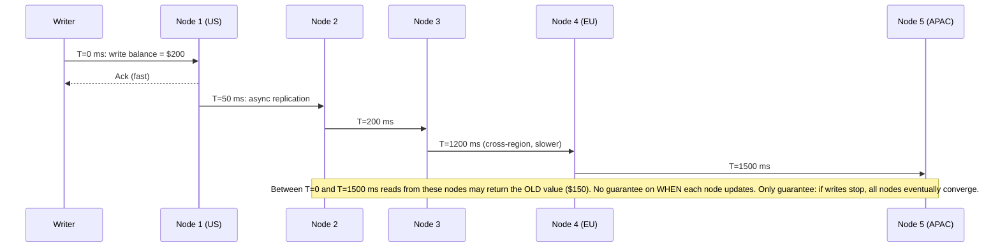

The key word is "eventually" -- and the dangerous thing about that word is what it does NOT say. Eventual consistency provides no upper bound on how long convergence takes. The system might have an informal contract ("typically under 1 second") but that contract is not enforced by the consistency model itself. Under normal operating conditions, a well-tuned eventually consistent system might converge in 50-200ms. Under load, that might stretch to 5 seconds. During a partial network partition that resolves itself, some replicas might be 30 seconds stale before they catch up. After a data center failover, some replicas might spend several minutes converging. In all of these cases, the system is behaving correctly according to its eventual consistency guarantee. But a system that is "correct" according to its model and "producing the wrong answer" for its users at the same time is a system with a design mismatch -- and that design mismatch is the engineer's fault, not the consistency model's fault.

DNS is the most famous real-world example of eventual consistency, and it illustrates both the power and the danger of the model clearly. DNS (the Domain Name System) is the internet's phone book -- it translates domain names like google.com into IP addresses like 142.250.80.46. When you update a DNS record, the change propagates across thousands of DNS servers around the world over a period of 24-72 hours. During that propagation window, some users will resolve your domain to the old IP address and some will resolve it to the new one. For most use cases -- moving a website to a new server, updating your CDN configuration, adding a subdomain -- a 72-hour convergence window is completely acceptable. The old IP still works during migration, and the eventual consistency of DNS is what makes it possible to run a globally distributed name resolution system without any central coordination bottleneck. However, for security-critical operations -- revoking a certificate, blocking a malicious domain, redirecting traffic away from a compromised server -- a 72-hour eventual consistency window is catastrophic. Attackers can continue using the old, compromised DNS entry for three days while the fix propagates. This is why security responses in DNS always involve additional mechanisms (CRL, OCSP stapling, HSTS preloading) that don't depend on DNS propagation speed.

The Amazon shopping cart is one of the most studied examples of intentional eventual consistency design. Amazon's 2007 Dynamo paper, which described the key-value store powering Amazon's shopping cart among other systems, explicitly documents the choice to use eventual consistency for cart operations. The reasoning was straightforward: Amazon would rather occasionally show a user an item they already removed from their cart than have the cart become unavailable during a network partition. The cart being slow or showing slightly stale data is annoying. The cart being completely unavailable during a peak shopping period costs Amazon directly measurable revenue -- at Black Friday scale, every minute of cart downtime costs hundreds of thousands of dollars. The Dynamo paper acknowledges that users occasionally see items that shouldn't be there, and Amazon accepted this as a reasonable trade-off. Crucially, when the user actually checks out -- when money changes hands -- Amazon switches to a much stronger consistency model. Eventual consistency for browsing. Strong for buying. The threshold of consistency strengthens precisely where the cost of inconsistency becomes real.

The cost of eventual consistency is approximately $0.50-$1.50 per million operations, compared to $15-$25 for linearizable consistency. This 10-20x cost reduction comes from two sources: first, writes don't wait for replica acknowledgment, so throughput is limited only by the local node's capacity rather than by network RTT to replicas; second, reads can be served from any nearby replica without needing to check if it has the latest value, so read throughput scales horizontally with no coordination overhead. At Instagram scale -- 1 billion users, hundreds of millions of daily active users, tens of billions of database operations per day -- the difference between eventual and strong consistency on the like count system alone is hundreds of thousands of dollars per day. That is real money, and it is the right trade-off for a number that users cannot perceive being stale.

**Interview line:** "Eventual for counts, feeds, and recommendations, with a measured convergence SLO (P99 under 5 s) and optimistic UI on the client. 'Eventually' has no built-in bound, so I add one and alert on it."

---

## Causal Consistency: "Cause Always Precedes Effect"

Causal consistency is the consistency model that most resembles how humans naturally think about time. The guarantee it makes is specific: if event A causally influenced event B (Alice posted a message, then Bob replied to it), then every user who sees B will also see A, and will see A first. The order of causally related events is preserved. Unrelated events -- things that happened independently with no causal connection -- can appear in any order, and that's fine, because their relative order doesn't affect understanding.

Alice posts: "Let's get pizza tonight." Bob replies: "Great idea!" Carol opens the app. Without causal consistency, Carol might see Bob's reply before Alice's original message. "Great idea!" with no context. She doesn't know what the great idea is, what it refers to, who said it first, whether she missed something. The conversation is broken. With causal consistency, Carol is guaranteed to see Alice's message before Bob's reply, because Alice's message is the cause and Bob's reply is the effect. The order is preserved. The conversation makes sense.

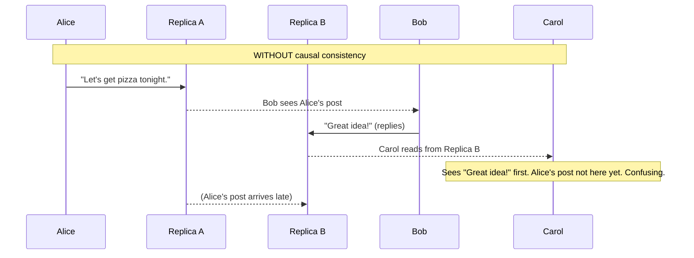

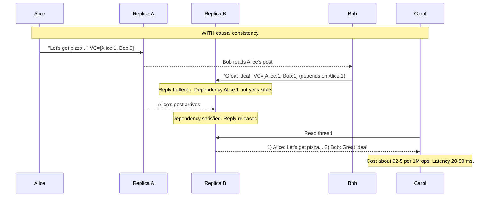

Causal consistency is underrated precisely because it is not as famous as eventual consistency or as intuitive as strong consistency. Engineers often think they need strong consistency when they actually only need causal, and the cost difference is significant -- $2-5 per million operations for causal versus $15-25 for strong, a 5-10x difference. Causal consistency solves the real user experience problem in most social applications -- confusing conversation order, replies appearing before originals, reactions appearing before content -- without requiring global coordination. It only requires ordering within a causal chain. If Alice posts in New York and Bob in London reads her post and replies, the system only needs to ensure that Bob's reply includes a "happens-after" marker pointing to Alice's message. Any replica that receives Bob's reply will hold it in a buffer until it has also received Alice's post. This is local bookkeeping, not global consensus, and it is far cheaper than asking every node on the planet to agree on a global ordering.

The "morning briefing" analogy makes causal consistency viscerally clear. Every morning, a news editor selects the top story and writes the headline. The headline goes out first, the full article is published an hour later. Every reader who sees the full article has already seen the headline -- that ordering is guaranteed. The editor did not need to coordinate with millions of readers around the world to enforce this ordering. The causal relationship was baked into the publishing process: headline -> article. Causal consistency in a distributed database works the same way. The write to Bob's reply carries a metadata tag saying "I causally depend on Alice's post." Any replica that receives the reply but not yet the post simply waits. The user's read is held for a few extra milliseconds if needed, and then returns both events in the right order. The guarantee is local and propagating, not global and synchronous.

What causal consistency does not guarantee is equally important to understand. Consider two completely independent conversations happening simultaneously: Alice and Bob are planning pizza, while Carol and Dave are discussing a book. These two conversations have no causal connection. Causal consistency makes no promises about whether the pizza conversation or the book conversation appears first in an observer's feed. They can interleave in any order, because neither causally influences the other. This is fine for conversation threads -- within each thread, order is preserved. It is also fine for most feed applications -- the relative order of independent posts does not change their meaning. However, if you need global ordering of all events (for audit logs, financial transaction history, or any situation where the interleaving of unrelated events matters), causal consistency is not sufficient and you need strong consistency. The key diagnostic question: does the relative ordering of unrelated events matter to correctness or user experience? If no, causal is enough. If yes, you need strong.

The technical implementation of causal consistency typically uses vector clocks or version vectors -- data structures that track "what each node knew when it created this write." Each write carries a vector clock that encodes its causal history. When a replica receives a write, it checks whether all causal dependencies (all events referenced in the write's vector clock) are present locally. If they are, the write is delivered. If they are not, the write is buffered until the dependencies arrive. This mechanism adds roughly 20-80ms of latency over eventual consistency (for the buffering and dependency-checking overhead) and costs $2-5 per million operations rather than $0.50-$1.50. For most social applications -- messaging, threads, comment sections, reaction chains -- this is the right trade-off. You pay a small premium over eventual consistency and gain the guarantee that makes the application coherent for users.

**Interview line:** "Causal for conversations: each message carries its dependencies and replicas hold it until they arrive. That fixes reply-before-original for a few milliseconds of bookkeeping instead of global consensus; unrelated threads need no ordering."

---

## Read-Your-Writes Consistency: "I Always See My Own Changes"

Read-your-writes consistency makes a focused, narrow promise: if you make a write, all of your subsequent reads will see that write. Other users might still see the old value for a few seconds while replication catches up. The rest of the world gets eventual consistency. But you, the user who made the change, will never see your own old value after your write succeeds. You update your profile picture and you always see your new profile picture. You post a comment and you always see your comment in the feed. You change your password and you can immediately log in with the new password. Your changes are immediately visible to you, and only you.

**Without read-your-writes**

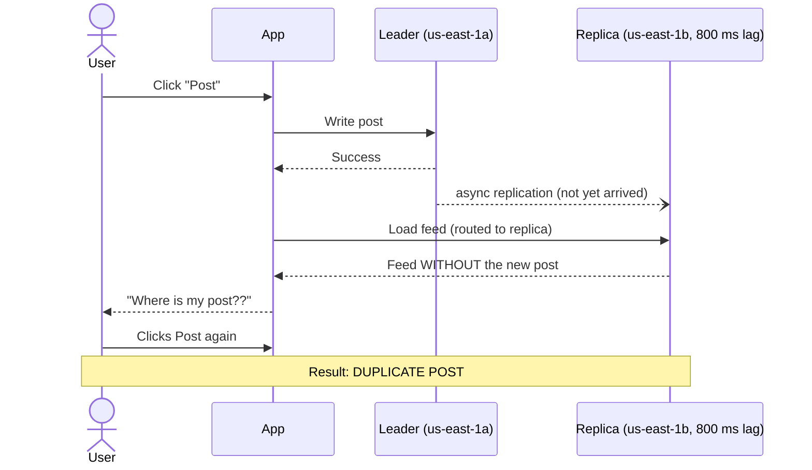

**With read-your-writes**

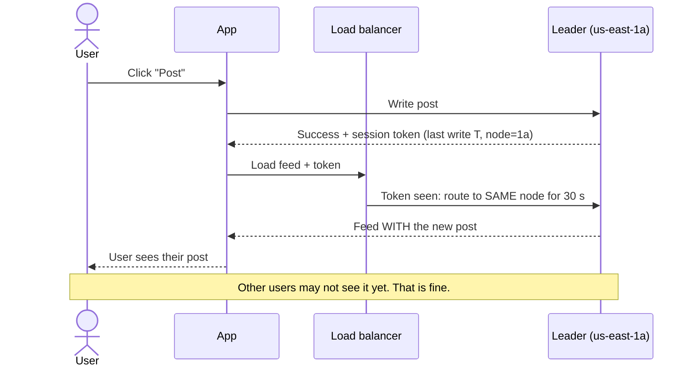

The "where did my post go?" problem is one of the most common support tickets in distributed systems, and it is almost entirely preventable with a simple implementation change. The underlying mechanism is well understood: the write lands on one node, but the subsequent read gets routed to a different replica that hasn't yet received the write. The user is not imagining things -- their data genuinely is not on the replica they're reading from. The data exists. It is just not visible from this vantage point. From the user's perspective, the app ate their data. They did not see an error. They did not see a warning. They just stopped seeing their post. The confidence-destroying moment is not the missing post itself -- it is the fact that the app told them the post succeeded, and then lied. That gap between "we told you it worked" and "here's the proof it didn't" is what creates lost user trust and support tickets. Read-your-writes consistency closes that gap by ensuring the feedback and the experience are aligned.

The implementation of read-your-writes is elegantly simple compared to strong consistency. After any write, the server includes a "write token" in the response -- typically a timestamp or a monotonic version number identifying the write. The client stores this token in the session. For the next 30-60 seconds (or until confirmed replicated), any read request from this client includes the token, and the routing layer ensures the read goes to a node that is at least as current as the token. This is typically implemented as sticky sessions (route this user's reads to the same node that received the write) or as a minimum version check (only serve reads from replicas whose replication lag is below the token timestamp). No global coordination is required. No quorum reads. No consensus protocol. The cost is roughly $1-3 per million operations, compared to $15-25 for linearizable consistency -- a 5-15x cost reduction for a guarantee that solves 80% of the user experience problems associated with eventual consistency.

The one place read-your-writes breaks down is across devices. When a user posts from their phone and then picks up their laptop to check whether it appeared, the laptop session is new -- it carries no write token from the phone session. The laptop gets routed to a replica that may not have the post yet. From the user's perspective, this is the same "ghost post" problem, just delayed by a device switch. Solutions exist: one approach is to use wall-clock time rather than session tokens, redirecting any read from this user's account to the primary node for 30 seconds after any write from any of their devices. Another approach is to maintain a user-level "minimum read version" in a fast metadata store like Redis -- any device reading on behalf of this user must fetch that minimum version and route to a replica at or above it. Both approaches add a small amount of latency to the metadata lookup but solve the cross-device problem cleanly. The complexity is worth it for any app where users regularly switch between phone and laptop.

The technical overhead of read-your-writes is dominated by session state management rather than by replication coordination. The most common implementation stores write tokens in the session layer (cookies, JWTs, or Redis session stores) and implements routing middleware that inspects the token on each request. At 10,000 requests per second, this adds approximately 1-2ms of overhead per read (one Redis lookup to fetch the write token, one routing decision). The replication itself is still asynchronous -- other users continue to get eventual consistency for their reads. Only the user who made the write gets the stronger guarantee, and only for the 30-60 second window where their replica lag matters. After the replica catches up (typically within a few hundred milliseconds to a few seconds under normal conditions), the sticky routing becomes unnecessary and the system transparently returns to standard load balancing.

**Interview line:** "Read-your-writes for anything the user just edited: the write returns a version token and the user's reads go to a replica at or above it for about 30 s. Cross-device needs a per-user minimum version in a fast store."

---

## Linearizability: The Gold Standard

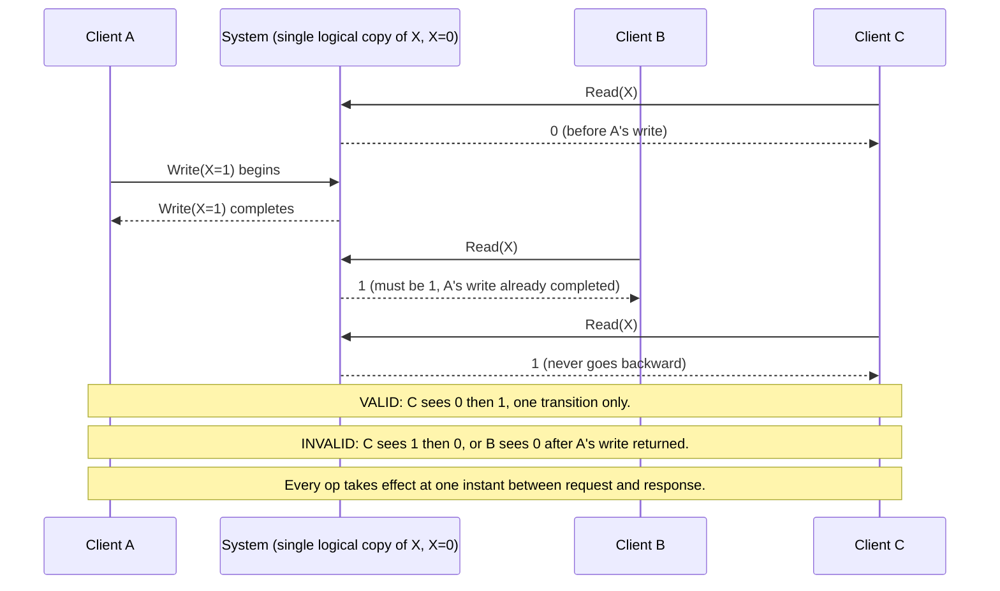

The mental model that makes linearizability click is "one copy, one server, one global clock." Even though the system is distributed across dozens of servers and multiple data centers, it behaves as if there is exactly one server with exactly one copy of the data and a single global clock ticking. Every operation appears to take effect at a single atomic instant somewhere between when the client issued the request and when the client received the response. Once an operation appears to have taken effect, its effect is permanent and immediately visible to every subsequent operation from any client anywhere. No reader ever sees a value that was valid at time T but has already been superseded by time T+1. No operation can travel backward in time. If you read X=5, then all subsequent reads of X will return 5 or a newer value -- never a value written before your read. This property -- the inability to go back in time -- is what distinguishes linearizability from all weaker models. It is also what makes it so expensive to implement.

The implementation of linearizability in practice uses Raft or Paxos consensus protocols. The mechanics: when a client sends a write, the receiving leader node sends the write to a quorum of followers (in a 5-node cluster, that means 3 nodes including itself). It waits for at least 3 nodes to acknowledge persisting the write before returning success to the client. If the leader fails mid-write, the protocol ensures that the new elected leader either commits or rolls back the write consistently -- no replica commits it while another rolls it back. The cost of this protocol in latency terms is significant. Each consensus round requires at minimum 2 network round trips: one for the leader to send the write proposal to followers, and one for followers to send their acknowledgment back to the leader. In a same-region cluster with 1ms RTT, this adds 2ms per write -- negligible. In a multi-region deployment with 50-200ms cross-region RTT, this adds 100-800ms per write -- not negligible at all. At 200ms added to every write in the checkout flow, the checkout page goes from 800ms to 1,000ms, which measurably reduces conversion rates. That is the real cost of linearizability, expressed in business terms.

The situations where linearizability is worth that cost are specific and defensible. Banking is the clearest case -- losing money or double-spending due to a consistency error is both a regulatory violation and a direct financial loss. At $0.00002 per transaction in coordination overhead (the cost delta between strong and eventual consistency), the cost of linearizability for financial transactions is essentially zero compared to the cost of a single double-spend incident. Inventory management at checkout is similar: if two users simultaneously purchase the last unit of a product, the company must either oversell (fulfill both orders, potentially at a loss if the product is out of stock) or disappoint one customer and issue a refund. The legal liability and customer service cost of overselling far exceeds the latency cost of using linearizable inventory locks at checkout. Distributed locks are the third major category: if a distributed system uses locks to prevent two workers from processing the same job simultaneously, and the lock system is only eventually consistent, two workers will occasionally both acquire the same lock and both process the same job -- resulting in duplicate actions that may be irreversible. Linearizable locks prevent this entirely.

**Interview line:** "Linearizable means every operation takes effect at one instant between request and response, and reads never go backward. I get it from a consensus log with a leaseholder serving reads, and I pay a cross-region round trip on writes."

---

## The Full Consistency Spectrum

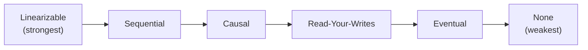

| Model | Cost / 1M ops | Cross-region latency | Best use case | Analogy |
|---|---|---|---|---|
| **Linearizable** (strongest) | $15 - $25 | 200-800 ms | Payments, inventory, distributed locks, strict rate limiting | One whiteboard, everyone in the same room |
| **Sequential** | $8 - $15 | 100-300 ms | Leaderboards, audit logs, ordered event streams | One secretary types all your memos in order |
| **Causal** | $2 - $5 | 20-80 ms | Chat messages, comment threads, social posts with replies | Morning briefing: headline always before article |
| **Read-Your-Writes** | $1 - $3 | 5-20 ms | Profile updates, user posts, settings, preference saves | Your own diary: you always read what you wrote |
| **Eventual** (weakest common) | $0.50 - $1.50 | 1-5 ms | Like counts, view counts, feed ranking, recommendations | Email: arrives eventually, no delivery guarantee |

The golden rule of consistency model selection is: use the weakest consistency model that satisfies the requirement. This is not a guideline about cutting corners -- it is a fundamental engineering principle about paying costs only where they deliver value. Every step stronger on the consistency spectrum costs more latency, reduces throughput, increases per-operation cost, and decreases availability during network partitions. The burden of proof belongs to the person arguing for stronger consistency: you must demonstrate specifically, not vaguely, what breaks if you use a weaker model. "It feels like it should be consistent" is not a justification. "If two users concurrently modify this field, the outcome is an irreversible financial error" is a justification. This discipline -- demanding explicit justification for stronger consistency -- is one of the clearest markers of senior engineering judgment in system design discussions.

The same company needing all of these models simultaneously is not a contradiction or a sign of inconsistent engineering philosophy -- it is the natural result of designing a large system with many different data types. Google uses linearizable consistency in Cloud Spanner for financial transactions and billing data, where a double-charge or missed charge is both a business and regulatory problem. Some Bigtable operations use a form of causal consistency for user activity data, where relative ordering within a user's session matters but global ordering across all users does not. Google Workspace (Docs, Sheets, Slides) uses read-your-writes consistency for user edits, so you always see your own typing in real time. YouTube uses eventual consistency for view counts, where the engineering team famously ships a view count that is sampled and batched rather than exact -- the number you see is real-time-ish but not accurate to the second. These are not accidents. They are deliberate, explicit design decisions made by engineers who understood the cost and user experience implications of each model. That is the standard this chapter is preparing you to reach.

---

# Part 2: What User Experience Each Model Creates

Consistency models are not just about technical correctness. They create specific user experiences, some delightful, some infuriating. An engineer who understands only the technical properties of each model is an engineer who will design systems that are correct according to a specification but confusing and untrustworthy to the people who use them. The user experience consequences of consistency choices are just as important as the technical properties, and in many cases they are the deciding factor in which model to use.

---

## The Thought Experiment

You are at a coffee shop. You post "At my favorite coffee shop!" to social media. Your phone confirms the post was submitted. What happens next, under each consistency model?

| Model | Your experience posting "At my favorite coffee shop!" |
|---|---|
| **Strong (Linearizable)** | Click post, wait 500 ms, post appears on your feed AND your friend's feed simultaneously. Perfect sync, but 500 ms felt slow for a button click. |
| **Causal** | Instant confirmation, post appears on your feed. Replies always appear after your post, in order, for every reader. Your friend may see it about 2 s later. |
| **Read-Your-Writes** | Instant confirmation, you see your post immediately. Your friend may not see it for 3-5 s, but you don't worry. No support ticket, no duplicate post. |
| **Eventual (pure)** | Instant confirmation, but your post is not on your feed. Refresh: not there. Refresh again: there it is. You posted again while waiting, so now there are two. You delete one, and the deletion is also eventually consistent, so it appears and disappears twice over the next 30 s. |

Notice that the "worst" model is not abstractly bad. Eventual consistency without read-your-writes is not a poorly designed system -- it is a system that made a choice with real consequences. For the status update post itself, pure eventual without read-your-writes creates genuine UX confusion: the user posted, got a confirmation, but cannot see their own post for 30 seconds. For the like count on that same post, eventual consistency is the perfect model: if 47,000 people have liked the post and the user sees 47,003 instead of 47,008, no user experience is damaged, no behavior changes, no trust is eroded. Same post, same user, same moment in time -- two different data types, two different right answers. The like count should be eventually consistent. The post itself should be read-your-writes consistent. Applying a single consistency model to the entire screen rather than to individual data types is a Level 5 mistake. Recognizing that every field has a different answer is the Level 6 baseline.

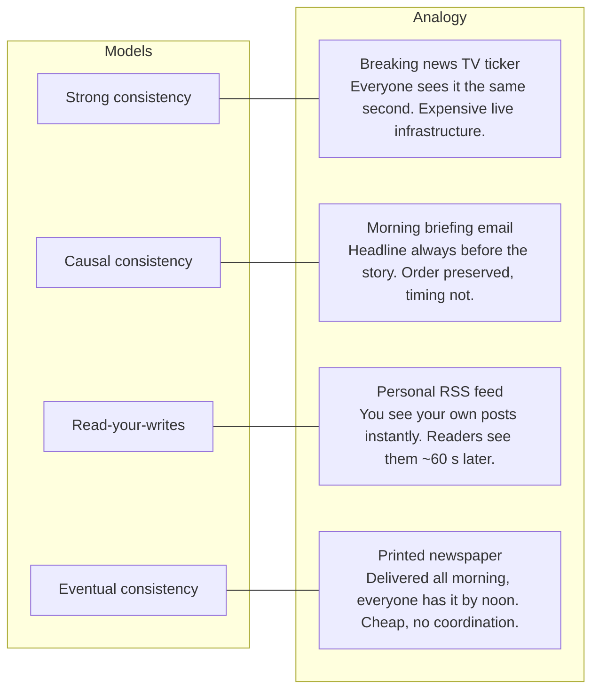

The news delivery analogy maps cleanly because it captures something deeper than just the timing -- it captures the cost and coordination structure of each model. A live television broadcast requires enormous infrastructure: satellite uplinks, synchronized broadcast towers, precise timing coordination across thousands of affiliates. That is why it is expensive and why not everything is broadcast live. A newspaper requires no coordination at delivery time -- the printing happened centrally, the trucks deliver asynchronously, and convergence happens by noon when the last truck arrives. The delivery mechanism is cheap and decentralized precisely because consistency was resolved upstream at the printing press, not at delivery time. RSS is personal -- your publisher writes for their own feed, sees their own posts instantly, and your reader experience follows a few seconds later. The asymmetry between author experience and reader experience is not a bug; it is the design.

The difference between L5 and L6 in user experience thinking is not about knowing more models. It is about taking ownership of the user experience consequences of model choices, even when those consequences are not immediately visible in the code.

An L5 engineer says: "Our system is eventually consistent." This is a factual statement about the technical model. It is correct. It tells you nothing about what the user sees or whether there is a problem.

An L6 engineer says: "Our system uses eventual consistency for engagement counts and feed ordering, which means users may see like counts that are 1-5 seconds behind actual state. We have designed around this with optimistic UI updates -- when you click Like, the count increments immediately on your screen regardless of what the server returns. Your click registers locally, and the server eventually catches up and sends the authoritative count. If the server count diverges from your optimistic count (rare -- under 0.1% of cases), we silently reconcile in the background. Users perceive the app as instant because it is, on their screen. The eventual consistency operates entirely behind the optimistic layer, invisible to users. For user posts and profile edits, we use read-your-writes with 45-second session affinity, because those are actions where 'I don't see my own change' generates support tickets and user confusion. The consistency model is different for different data types by design." This answer demonstrates ownership of user experience, awareness of cost, knowledge of implementation patterns, and the ability to distinguish between data types with different requirements. That is the L6 standard.


---


# Part 3: Why Large-Scale Systems Accept Inconsistency

## The CAP Theorem -- Made Simple

Before diving into the reasoning, look at this triangle. It shows the three properties a distributed system can have -- and the constraint that you can only fully achieve two of them at the same time.

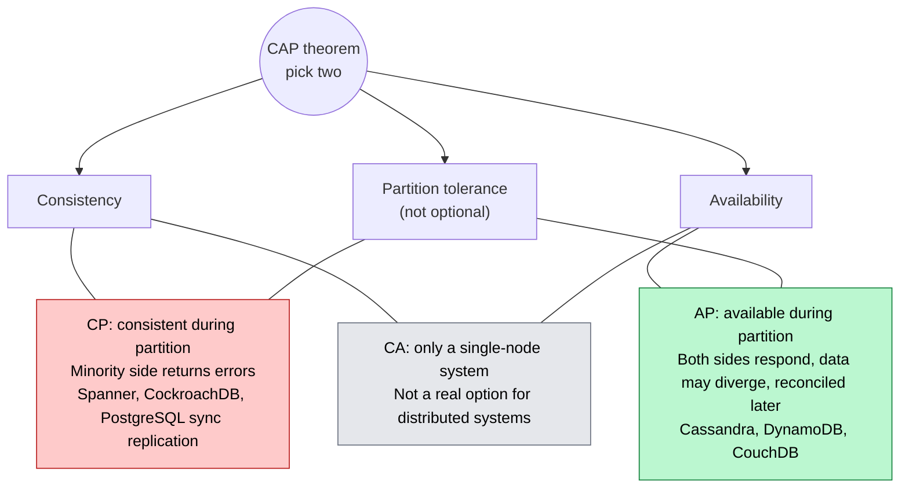

The CAP theorem says something specific and often misunderstood. During a network partition -- when some servers in your system cannot communicate with other servers -- you must choose between two things: consistency and availability. You cannot have both. Partition tolerance is not negotiable. Networks fail. This is not a design choice -- it is a physical fact of running software across multiple machines. Any distributed system must tolerate partitions, which means the real decision is always between C and A during those partition windows. The theorem does not say you give up one of them permanently -- only during the moments when a partition is active. When the network is healthy, you can have both. But you must decide, up front, what your system does when the network is not healthy.

What does a network partition actually look like in practice? It is rarely a dramatic event. The internet does not go dark. More often it is a bad fiber splice in a data center, a misconfigured BGP routing rule, an AWS availability zone with a brief routing issue between subnets, or a NIC on one server that starts dropping packets at a 5% rate -- enough to cause timeouts but not enough to trigger clean failure detection. Large-scale systems at companies like Google, Amazon, and Netflix experience 1 to 5 meaningful network partition events per year. These partitions last anywhere from a few seconds (a brief flap) to several hours (a routing misconfiguration that takes time to diagnose). The systems that handle these events gracefully are the ones that designed for them explicitly. The systems that fail are the ones that assumed the network would always be healthy.

CP systems choose consistency. When a partition happens, the side with fewer nodes (the minority partition) becomes unavailable. Users on that side receive errors: "service temporarily unavailable," "unable to process request," or something similar. Nobody gets wrong data. The tradeoff is clear and deliberate: a subset of users experience downtime rather than any user experiencing incorrect data. PostgreSQL with synchronous replication is CP -- if the synchronous replica is unreachable, the primary refuses writes until connection restores. Google Spanner is CP -- it uses Paxos consensus, and if a quorum cannot be reached, the system blocks rather than producing potentially incorrect results. CockroachDB is CP -- during partition, nodes in the minority partition refuse reads and writes to protect consistency. The user experience during a CP partition event is: some users see an error page. It looks like an outage. Technically, it is not -- the system is functioning correctly by refusing to give wrong answers.

AP systems choose availability. When a partition happens, both sides keep running. Users on both sides of the partition get responses. The tradeoff is that both sides might accept writes that conflict with each other. User A on one side updates a record. User B on the other side of the partition updates the same record. Both operations succeed. When the partition heals, the system must reconcile these two conflicting writes -- often using "last write wins" (the write with the later timestamp survives) or "merge" (application-specific reconciliation logic). Cassandra is AP -- writes go to available replicas, conflicts resolved with timestamps. DynamoDB is AP by default -- it accepts writes to any available node and reconciles later. CouchDB is AP -- it explicitly supports bidirectional sync and multi-master conflict resolution. The user experience during an AP partition event is: everyone gets responses, but some responses might be slightly stale or some writes might be silently overwritten.

**L5 vs L6 on CAP:**

An L5 engineer, when asked about CAP, will say something like: "We should be CA -- consistent and available." This sounds like the right answer. It sounds like "we want the best of everything." But it reveals a misunderstanding of the theorem.

An L6 engineer says: "CA is only achievable when there are no partitions. In practice, that means a single-node system -- because a single node has nothing to partition from. The moment you add a second node, you have a distributed system, and distributed systems have partitions. So CA is not a real choice for us. The actual choice is: during the 2 to 5 partition events we'll experience this year, do we fail safe or fail gracefully? For payments, we fail safe -- errors are better than wrong balances. For social feeds, we fail gracefully -- stale data is better than error pages. The consistency model follows from which failure mode is less harmful to users and to the business."

**Interview line:** "CA isn't a real option once there are two nodes. During a partition, payments fail safe (errors, CP) and the feed fails gracefully (stale, AP). I decide that per data type up front."

---

## The Latency Trade-off -- Why Speed Matters

Consistency is not free. It has a direct, measurable cost in milliseconds. Here is the math, written out explicitly, because these numbers matter for every design decision.

| Item | Value |
|---|---|
| US-East to US-West, one-way / RTT | ~80 ms / ~160 ms |
| US-East to EU-West, one-way / RTT | ~90 ms / ~180 ms |
| US-East to Asia-Pacific, one-way | ~180 ms |
| Quorum write US-East to US-West | 2 RTT = 320 ms minimum, 4 RTT = 640 ms, plus 10-50 ms per step for disk, CPU and processing |

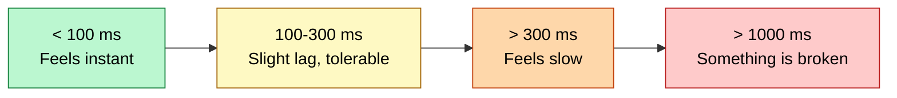

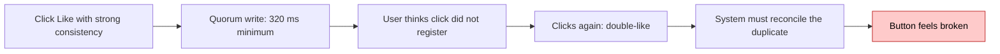

The latency math is not theoretical -- it is dictated by physics. Light travels through fiber at roughly two-thirds the speed of light in a vacuum. The US-East to US-West physical distance via fiber is about 4,800 kilometers. At two-thirds light speed through glass, one-way transit is roughly 24ms. But real-world routing adds hops, queuing, and switching overhead -- the actual measured RTT between AWS us-east-1 and us-west-2 is consistently 60-80ms. Quorum writes need multiple round trips because the coordinator must contact a majority of replicas, wait for acknowledgment from each, and then return success to the client. Two round trips is the minimum for a two-phase protocol. Four round trips is realistic for Paxos or Raft under load.

The cost per operation compounds into real money at scale. Here is what different consistency models actually cost across regions:

| Consistency model | Cost per 1M ops (cross-region) | Why |
|---|---|---|
| Strong (linearizable) | $15 - $25 | Multi-RTT consensus, cross-region traffic, leader coordination |
| Strong (single-region) | $3 - $8 | Single-region RTT is 1-5 ms, quorum is cheaper |
| Causal | $2 - $5 | Vector clock overhead but no global quorum |
| Read-your-writes | $1 - $3 | Session affinity cost plus occasional extra hop |
| Eventual | $0.50 - $1.50 | Write and propagate. No coordination needed. |

*Basis: AWS data transfer ($0.08/GB cross-region), compute for coordination, and representative leader/quorum overhead at scale. Estimates from publicly documented AWS pricing and published benchmarks from Google, Amazon, Meta.*

At Google and Facebook scale, the difference between strong and eventual consistency is hundreds of millions of dollars per year. This is not a theoretical claim. Facebook's news feed is eventually consistent. Not because their engineers do not understand consistency models, and not because they are lazy. The answer is simpler: Facebook has 2 billion daily active users. Each user loads a feed multiple times per day. If each feed load required a cross-region quorum read -- at $15-25 per million operations -- the annual cost at 2 billion users loading feeds five times daily would be in the billions of dollars just for feed reads. Facebook's total 2023 revenue was roughly $135 billion. Strong global consistency for the news feed would consume a material fraction of that. The engineering team looked at this math explicitly and chose eventual consistency with 5-60 second propagation targets. Users do not notice whether a post appears in their feed at T+1s or T+30s. The business absolutely notices a multi-billion-dollar infrastructure cost.

The L6 cost framing works at any scale. Here is a concrete example from a mid-sized system: a notification service handling 50 million notifications per day needs to track notification read status across regions. Strong consistency for read status (did the user mark this notification as read?) would require a cross-region consensus write per status change. At 50M notifications/day and 40% read rate (20M reads marked), that is 20M consensus writes. At the $15-25 per 1M cost, that is $300-500 per day just for status writes. Eventual consistency achieves the same user experience -- a "read" checkmark that might lag 1-2 seconds is invisible to users -- for roughly $0.50-1.50 per 1M operations, or $10-30 per day. The $270-470 per day difference sounds modest, but annualized it is $98,000-$171,000 per year. That is a real budget for a mid-sized team. At 10x scale -- 500M notifications/day -- the savings fund two additional engineers.

Staff engineers treat cost as a first-class constraint in consistency model selection. This is not about being cheap. It is about building systems that can grow without becoming economically unsustainable. An L6 engineer will explicitly state the cost implications of their consistency choice in a design doc. They will note that strong global consistency for notification status is a $265K/year decision when eventual consistency achieves the same UX. They will not blindly pick the "safest" model. They will pick the cheapest model that meets the actual correctness requirements. This is what separates good engineering from over-engineering.

**Interview line:** "A cross-coast quorum write is at least 2 RTTs, about 300 ms, before processing. That's fine behind a payment confirmation, not on a Like button where anything over 100 ms feels broken."

---

## The Availability Trade-off

Strong consistency requires all required replicas to be reachable. If a replica is unavailable -- unreachable due to a network issue, crashed due to a bug, slow due to load -- you have exactly two choices: wait for it to come back, or return an error. Waiting is not safe -- the replica might be down for hours. Returning an error means turning user requests into failures. Neither is good UX. The system that was supposed to be "more reliable" because it was consistent has become unreliable because reliability now depends on every replica being simultaneously healthy.

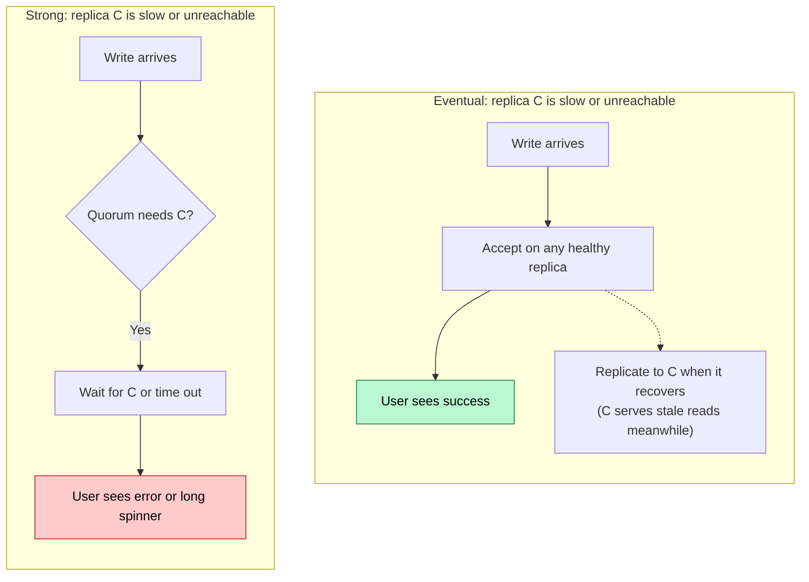

With eventual consistency, you write to the replicas that are available and let the data propagate to others when connectivity restores. The write succeeds as long as at least one replica accepts it. Availability stays high even during partial outages -- a single degraded replica does not prevent the entire system from accepting writes. The tradeoff is that reads from the degraded replica might return stale data for a window of time. For most data types, this window of staleness is acceptable.

The real-world example that made this concrete was Amazon's 2012 DNS propagation incident. AWS experienced a DNS issue that caused some EC2 instances to intermittently fail to resolve other instances' addresses. This created a partial partition: most instances could reach most others, but some pairs had unreliable connectivity. Services using strong consistency -- waiting for all required replicas to acknowledge before returning -- began experiencing cascading timeouts. One slow acknowledgment caused the entire write to wait. Timeouts began stacking. Services that issued several strong-consistency reads per user request began timing out on users. Services using eventual consistency continued operating normally. They wrote to available replicas, propagated when they could, and read from whichever replica was locally accessible. Users of eventually-consistent services experienced nothing. Users of strongly-consistent services saw errors for 30 minutes or more -- not because the underlying data was corrupted, but because the system refused to operate without certainty it could not achieve during the partition.

---

## What Big Companies Actually Do

The theory says choose based on the CAP theorem. Reality is messier. Let us look at what companies actually do, system by system.

| Company | System | Model | Why |
|---|---|---|---|
| Google | Spanner | Strong (linearizable) | Worth the cost for critical financial and transactional data. TrueTime atomic clocks achieve this globally at 10-20 ms extra latency. |
| Google | YouTube view counts | Eventual | Counts need not be exact. +/-0.5% error is fine. Strong would make every view a quorum write. |
| Facebook/Meta | News Feed | Eventual | Latency matters more than precision. 30-60 s propagation is acceptable. Strong at 2B users is unaffordable. |
| Facebook/Meta | Payments | Strong | Financial accuracy is mandatory. Overdraft and fraud risk if eventual. |
| Twitter/X | Tweet posting | Eventual | Speed matters. Tweet appears on sender's timeline immediately (read-your-writes). Follower feed delivery: eventual. |
| Twitter/X | User blocking | Strong | Security must be immediate. A blocked user should not see content 30 s later. |
| Amazon | Shopping cart | Eventual | Availability over perfect state. Dynamo paper (2007): AP chosen so the cart never loses items. |
| Amazon | Order placement | Strong | Cannot lose or duplicate orders. A lost $500 order is a real complaint and liability. |

The pattern is unmistakable once you see it: strong consistency where inconsistency causes real harm -- where the failure mode involves money, security, or legal liability -- and eventual consistency everywhere else. These companies have access to the best distributed systems engineers in the world. They have the budget to run strong consistency at global scale if they choose to. They do not choose it for news feeds, view counts, shopping carts, or tweet delivery. They choose it for payments, order placement, and access control. The reason is not "these companies got lazy." The reason is that they did the analysis, found that eventual consistency is correct for those use cases, and built accordingly. The cost of eventual consistency's failure mode (a user sees a stale feed for 30 seconds) is lower than the cost of strong consistency's failure mode (higher latency, lower availability, 10x higher infrastructure cost) for non-critical data.

The dangerous assumption that trips up junior and mid-level engineers is: "I'll start with strong consistency and optimize later." This sounds pragmatic but creates architectural debt. At startup scale -- 1,000 users, single-region deployment -- strong consistency imposes no meaningful cost. The latency difference is invisible. The infrastructure cost is a rounding error. But at growth scale -- 10 million users, multi-region deployment -- migrating from strong to eventual requires changing the contract your API makes to clients. If clients assumed they could read their writes from any endpoint, and you remove that guarantee, clients break. If your application logic assumed atomic compare-and-swap semantics, and you move to eventual consistency, the logic needs rewriting. Often the data model itself changes -- strongly consistent SQL schemas often cannot be naively migrated to eventually consistent NoSQL without re-modeling the access patterns. The correct approach is to consciously choose the right consistency model from the beginning, even if the initial implementation does not yet require the full complexity.

---

# Part 4: How Staff Engineers Reason About Consistency

## The Core Question

Most engineers approach consistency selection by asking: "Which consistency model should I use?" This is the wrong question. It assumes the answer is system-level -- that there is one right model for the entire service. Staff engineers ask a different question entirely.

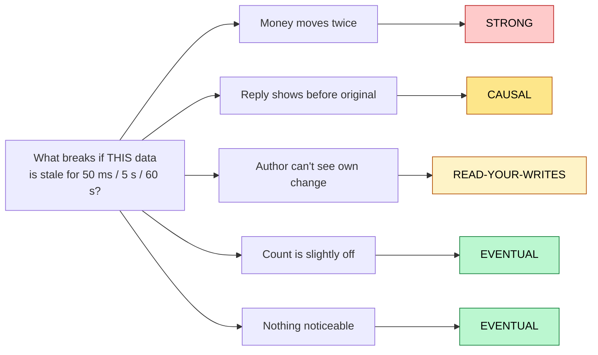

The fundamental question is: **What breaks if this specific data is stale for 50ms? For 5 seconds? For 60 seconds?**

That question changes everything. It forces you to reason about the failure mode of inconsistency rather than the mechanics of consistency. It forces you to think about specific data fields rather than the whole system. And it gives you a clear, testable criterion for your decision.

If the answer to "what breaks if this data is stale for 5 seconds?" is:

- "A user is charged twice for the same order" -> Strong consistency. The cost of inconsistency here is financial harm and operational complexity. You cannot compensate easily.
- "A reply appears before the original message" -> Causal consistency. The conversation becomes unreadable. Users lose trust in the messaging product.
- "A user doesn't see their own update for a moment" -> Read-your-writes. The user experience is confused and the app feels broken, but only to the user who made the change.
- "A view count shows 4,199 instead of 4,200" -> Eventual consistency. Nobody can tell. Nobody is harmed. Nobody cares.
- "Nothing noticeable happens" -> Eventual consistency. Do not add coordination overhead for a non-existent problem.

This question -- "what breaks if this data is stale?" -- is the question to ask in every staff-level system design interview when consistency comes up. It shows you reason from consequences rather than from model names. It demonstrates that you treat consistency as a spectrum tuned to data-specific requirements rather than a binary system-level dial.

---

## The 5-Question Decision Flow

The decision tree below encodes 90% of consistency model selections correctly. Work through it top to bottom, stopping at the first YES.

```mermaid
flowchart TD
    START(["What consistency does this specific data need?"])
    START --> Q1{"1. Is real money directly at stake?<br/>balance, payment, inventory at checkout"}
    Q1 -- Yes --> S1["STRONG"]
    Q1 -- No --> Q2{"2. Is this access control or security?<br/>block user, revoke permission, auth"}
    Q2 -- Yes --> S2["STRONG"]
    Q2 -- No --> Q3{"3. Is this causally related data?<br/>replies, reactions, shared document edits"}
    Q3 -- Yes --> C1["CAUSAL"]
    Q3 -- No --> Q4{"4. Is this the user's own action?<br/>own profile, own post, own setting"}
    Q4 -- Yes --> R1["READ-YOUR-WRITES"]
    Q4 -- No --> E1["EVENTUAL"]
    style S1 fill:#fecaca,stroke:#b91c1c,color:#000
    style S2 fill:#fecaca,stroke:#b91c1c,color:#000
    style C1 fill:#fde68a,stroke:#b45309,color:#000
    style R1 fill:#fef3c7,stroke:#b45309,color:#000
    style E1 fill:#bbf7d0,stroke:#15803d,color:#000
```

This decision tree covers the overwhelming majority of real design questions. The flow forces you to ask the right questions in the right order -- from most severe failure consequences (money) to least severe (no noticeable user impact). If you reach the bottom with all NOs, eventual consistency is correct for that data field.

The remaining 10% of cases involve scenarios this tree does not fully capture. Collaborative real-time editing (like Google Docs) needs conflict-free replicated data types -- CRDTs -- which allow multiple users to write simultaneously and merge results without conflicts or coordination. CRDT design is a deep topic that deserves its own chapter. Multi-region database migrations may require careful consistency protocol upgrades. Global rate limiting under heavy partitions has subtle edge cases. But for any system design interview at the L6 level, this five-question flow is the right tool. Using it correctly -- and being able to explain why each question matters -- is what the interviewer wants to see.

---

## The Use-Case Decision Tree (System-Level View)

Different system categories land on different consistency models. Here is the wide view.

```mermaid
flowchart LR
    B["Banking / Payment<br/>balance updates, transfers, checkout, orders"] --> BM["STRONG (linearizable)"] --> BI["Spanner, PostgreSQL + sync replica, CockroachDB, explicit BEGIN/COMMIT"]
    C["Conversational<br/>chat, comment threads, doc edits, reply chains"] --> CM["CAUSAL"] --> CI["Messaging DB with vector clocks, CRDTs, sequence IDs per thread"]
    A["Aggregates<br/>like counts, view counters, feed ranking, follower counts"] --> AM["EVENTUAL"] --> AI["Cassandra / DynamoDB, Redis counters, write-behind caches, async aggregation"]
    U["User-owned data<br/>profile updates, settings, own posts"] --> UM["READ-YOUR-WRITES"] --> UI["Sticky session to leader, session token with version, cache-aside with write-through invalidation"]
    S["Security / Access control<br/>block user, revoke token, permissions"] --> SM["STRONG"] --> SI["Synchronous replication, quorum read on permission checks, zero-lag replica for auth"]
    style BM fill:#fecaca,stroke:#b91c1c,color:#000
    style SM fill:#fecaca,stroke:#b91c1c,color:#000
    style CM fill:#fde68a,stroke:#b45309,color:#000
    style UM fill:#fef3c7,stroke:#b45309,color:#000
    style AM fill:#bbf7d0,stroke:#15803d,color:#000
```

---

## 6 Decision Heuristics

These six heuristics are tools for quick reasoning in interview settings and in real design work. Each maps a high-level question to a concrete consistency choice.

---

### Heuristic 1: Follow the Money

If real money is at stake in a transaction -- bank transfers, payment processing, inventory deductions at checkout, subscription billing -- use strong consistency. No exceptions. Not "probably strong." Not "strong with some eventual fallback." Strong, with synchronous writes, confirmed by a quorum before the operation returns success.

The reason is not just "money is important." It is that the failure mode of eventual consistency for financial data is permanent, unrecoverable harm. PayPal uses strong consistency for balance updates. Consider what happens with eventual consistency: User initiates a $500 transfer at T=0. Write goes to replica A. User checks balance on replica B (still at old value). User initiates another $500 transfer at T=50ms (before replica B gets the first update). Both transfers succeed. Balance drained by $1,000 when only $500 was available. Even a 100ms window of eventual consistency would allow sophisticated attackers to exploit this. Double-spend attacks -- sending money faster than the balance propagates -- are a real threat model. PayPal processes hundreds of billions of dollars in transactions per year. A 50ms eventual consistency window, exploited at scale, would be catastrophic. Strong consistency for financial data is not a performance tradeoff you optimize later. It is a correctness requirement that cannot be weakened.

The boundary matters: like counts do not involve real money, so they do not need strong consistency. Shopping cart contents do not involve money until checkout begins, so they can use eventual consistency for browsing and switch to strong consistency at the checkout confirmation step. Follow the money precisely -- not the category of system ("we're a payments company") but the specific data field where currency changes hands.

---

### Heuristic 2: Follow the Security

Access control changes must use strong consistency. When a user blocks another user, revokes a permission, deactivates an account, or changes authentication credentials, that change must propagate immediately to all replicas that serve content to affected parties.

```mermaid
sequenceDiagram
    actor A as User A
    participant P as Primary (block list)
    participant R as Replica serving User B (30 s lag)
    actor B as User B (harasser)
    A->>P: Block User B (T=0)
    P--)R: Async replication (arrives T+30 s)
    B->>R: Load User A's profile (T+5 s)
    R-->>B: Content visible (block not yet replicated)
    Note over A,B: With eventual consistency the harassment continues for 30 s. With strong consistency the check reads the primary and denies at T=0.
```

Consider the failure mode: a harassment scenario where User A blocks User B. With eventual consistency on the block relationship, Block action taken at T=0 propagates to replica serving User B at T+30s. For 30 seconds, User B can still see User A's content, send messages, and interact. In a harassment scenario, 30 seconds is not acceptable. In a domestic violence scenario where someone blocks an abuser, it is potentially dangerous. There are also legal dimensions: if your platform is notified of a court order to remove access, and your system takes 30 seconds to propagate that order due to eventual consistency, you may have a liability window.

The strong consistency requirement for access control is also why authentication systems (OAuth token revocation, session invalidation) use synchronous database writes. When a user logs out everywhere or changes their password, that action must be immediately visible to all regions. A revoked token that works for 5 more minutes due to eventual consistency is a security hole.

---

### Heuristic 3: The User Expectation Test

Ask: "Would users be confused or upset if they saw stale data here?" Then reason about that confusion as a product metric, not just a technical consideration.

- "I just posted something but I can't see it in my own feed" -> Confusing and frustrating. The user will think the post failed and post again, creating duplicates. At minimum, use read-your-writes.
- "The like count shows 42 on my phone and 43 on my friend's phone" -> Not confusing. Users understand counts are approximations. Eventual consistency is fine.
- "I see a reply from Bob but not the original message from Alice that Bob is replying to" -> Confusing. The conversation is unreadable. Causal consistency is needed.
- "My friend's profile picture is three days out of date on my phone" -> Slightly confusing but tolerable. Eventual with a short TTL cache is fine.

User confusion has a measurable cost. Every time a user posts something and cannot see it, they file a support ticket, leave a review, or leave the platform. Support tickets have a real dollar cost -- estimates range from $5 to $50 per ticket depending on complexity. If your choice of eventual consistency without read-your-writes generates 10,000 support tickets per month because users cannot see their own posts, that is $50,000-$500,000 per month in support cost alone, before counting churn. Read-your-writes costs pennies per operation. This is why the user expectation test maps to real business value, not just user sentiment.

---

### Heuristic 4: The "Would They Notice?" Test

This is the quick gut-check version of Heuristic 3.

- View counts lagging by 5 seconds: **Would not notice.** Users do not compare view counts in real time across devices.
- Their own post disappearing after they posted it: **Would definitely notice.** Immediate confusion and likely re-posting.
- Comments appearing before the original post they reply to: **Would notice and be confused.** Looks like a bug.
- Two friends seeing different post ordering in a feed: **Would not notice.** Different users have different feed relevance algorithms and scroll positions.
- User changes their username, but old username still appears: **Would notice** -- after trying to tell someone their username. Mild, but noticeable.
- User's own message appearing out of order in a conversation: **Would notice.** Erodes trust in the messaging product.

The "would they notice?" test does not require user research. It requires thinking clearly about what the user's mental model is and what data they are comparing across sessions, devices, or people. Data that users only see in aggregate (view counts, follower counts, like counts) has high tolerance for staleness. Data that users see alongside their own actions (their own posts, their own settings, their own messages) has low tolerance for staleness.

---

### Heuristic 5: The Correctability Test

Ask: if the data is wrong right now, how hard is it to fix?

```mermaid
flowchart TD
    W["Data is wrong right now"] --> Q{"Does it fix itself<br/>without anyone acting?"}
    Q -- "Yes (stale count, stale feed)" --> E["EVENTUAL is fine"]
    Q -- No --> Q2{"Can engineering or the user<br/>cheaply repair it?"}
    Q2 -- "Yes (duplicate message, dedupe by ID)" --> M["Eventual + idempotency / dedupe"]
    Q2 -- "No (lost transfer, oversold item, wrong order)" --> S["STRONG"]
    style E fill:#bbf7d0,stroke:#15803d,color:#000
    style M fill:#fef3c7,stroke:#b45309,color:#000
    style S fill:#fecaca,stroke:#b91c1c,color:#000
```

- Stale view count: self-corrects on the next page refresh. No user action required. Eventual consistency is fine.
- Duplicate message delivery: needs UI-level deduplication by message ID. It can be corrected, but requires engineering work. Use with caution -- at-least-once delivery is usually fine, but at-most-once is not guaranteed.
- Lost bank transfer: cannot be easily corrected. Customer calls support. Support cannot easily prove whether the transfer happened. Financial reconciliation is slow and expensive. Strong consistency required.
- Post appears twice (created duplicate): user has to manually delete the extra one. Annoying, generates support tickets. The root cause is usually missing idempotency keys on the write path, not an inherent consistency model problem -- fix the write path rather than upgrading consistency.
- Wrong product shown in order history: possibly correctible but requires investigation and potentially a refund. Strong consistency for order records is worth it.

The correctability test separates "annoying" from "catastrophic." Annoying things can use eventual consistency if the eventual value is correct and the stale window is short. Catastrophic things need strong consistency regardless of cost.

---

### Heuristic 6: Read-Heavy vs Write-Heavy

Read-heavy operations often tolerate eventual consistency better than write-heavy ones. Consider: a product catalog page is read millions of times per day but updated a few times per hour. Reading from a CDN cache (30-60 second TTL, eventually consistent with origin) serves 99% of reads with sub-5ms latency. The 30-second staleness window is fine because product prices and descriptions change rarely relative to how often they are read.

**The most dangerous pattern: read-modify-write on stale data (lost update)**

```mermaid
sequenceDiagram
    participant S1 as Server 1
    participant DB as Store (counter = 100)
    participant S2 as Server 2
    S1->>DB: Read counter
    DB-->>S1: 100
    S2->>DB: Read counter
    DB-->>S2: 100
    S1->>DB: Write 101
    S2->>DB: Write 101
    Note over S1,S2: Two increments, final value 101. One update is lost.
    Note over S1,S2: Fixes: atomic increment, compare-and-set on a version, or a CRDT counter.
```

Write-heavy operations that require durability -- any write the user cares about being persisted -- need at minimum local-replica confirmation before returning success. If a user writes a post and the write is acknowledged before it hits persistent storage, a crash before persistence means the post is silently lost. This is why "write-and-forget" is almost never correct for user-visible data, even with eventual consistency models.

Read-modify-write operations -- read a value, modify it, write it back -- are the most dangerous pattern for eventual consistency. If two clients read the same stale value, both compute an update, and both write back, one update is lost. The classic example: two servers both read a counter showing 100 users, both add 1, both write 101. The counter should be 102. It is 101. One increment is silently lost. For cases like this, even eventual consistency systems need atomic operations (compare-and-swap, atomic increment) on the specific field being modified. This is why Redis provides `INCR` as an atomic operation even though Redis can be configured as an eventually consistent store. The atomic increment is a primitive, not a consistency model -- it prevents lost updates at the operation level regardless of replication model.

---

# Part 5: Applying Consistency Choices to Real Systems

## System 1: Rate Limiter -- Why Eventual is Right

**System Description:** A rate limiter operating at 1M+ requests per second, deployed across dozens of servers in multiple data centers. Each incoming request must check whether the requesting client has exceeded their rate limit, and if not, increment the counter for that client.

**The Consistency Question:** Should each check-and-increment be strongly consistent? Meaning: should every server in every data center agree on the exact current count before allowing or denying a request?

---

**If Strongly Consistent:**

Every server must reach consensus with a majority of other servers before accepting or rejecting any request. Using Raft (the standard consensus protocol for distributed systems):

```mermaid
sequenceDiagram
    participant C as Client
    participant RL as Rate limiter server
    participant LD as Raft leader
    participant F as Followers (cross-region)
    C->>RL: Request (1 ms)
    RL->>LD: Check and increment count (2 ms)
    LD->>F: Propose update (2 RTTs, 50-100 ms)
    F-->>LD: Majority acknowledge
    LD-->>RL: Commit
    RL-->>C: Response (1 ms)
    Note over C,F: Total 54-104 ms per check. At 1M req/s need 1,000,000 checks/s but each check takes 50 ms, so capacity is 20,000 checks/s. Gap: 50x under capacity.
    Note over LD: Leader election (1-10 s): all checks fail. Fail-open defeats rate limiting. Fail-closed blocks all legitimate traffic.
```

Strong consistency makes the rate limiter a catastrophic bottleneck. At 1M requests per second, a 50ms per-check latency means the rate limiter can handle 20,000 checks per second -- 50 times less than required. The rate limiter, designed to protect the system from overload, becomes the source of overload.

---

**If Eventually Consistent:**

Each server maintains a local counter in memory. Servers sync their counters with each other every 100ms. The check-and-increment is a local operation.

```
Request arrives -> Check local counter -> Increment local counter -> Return
Timeline: < 1ms (in-memory operation)
At 1M req/sec: Y Easily handled

Sync window: 100ms
  Server A might allow requests up to 5-10% over limit
  while Server B's counter has not yet synced
  Error: 5-10% overage during 100ms window
```

The right choice is eventual consistency. The reasoning is precise: rate limiting is approximate by design. The goal is preventing abuse -- specifically, blocking clients who send 100x or 1000x normal traffic. A client exploiting the 100ms sync window could send 5-10% extra requests in that window. Against the actual threat model -- stopping a DDoS where someone sends 10,000x normal traffic -- a 5-10% sync window overage is irrelevant. And the alternative (50ms quorum check) means the rate limiter cannot operate at the required throughput at all.

The staff-level framing: "Rate limiting is probabilistic safety, not billing. If we were billing per request, we'd need exact counts. We're not. We're preventing abuse. A 5% overage for 100ms is not a billing error -- it is acceptable approximation in a security control."

**The Failure Scenario if Strong Consistency is Used:**

A celebrity with 30 million followers posts "New album out -- link in bio" at noon. Their 30 million followers, plus media outlets and bots, simultaneously hit the album link. Traffic spikes from baseline 50K req/sec to 3M req/sec in under 2 seconds. The rate limiter using Raft quorum checks cannot handle 3M req/sec. The Raft leader is contacted by all rate limiter servers simultaneously. Leader processing queue grows. Consensus latency grows from 50ms to 500ms to 5 seconds. Rate limit checks begin timing out. The rate limiter fails open (allows everything) or fails closed (blocks everything). Either way, the rate limiter stops functioning. The album link goes down. Every news outlet reports the server crash. The failure was caused by the rate limiter, not the traffic.

**Full L6 Interview Answer:**

"For the rate limiter counter data, I'd use eventual consistency -- specifically, local in-memory counters with 100ms sync intervals between servers.

The key question is: what breaks if the count is stale for 100ms? The answer is: a client might send 5-10% more requests than their exact limit during the sync window. For rate limiting, that's acceptable. Rate limiting is a probabilistic abuse-prevention tool, not a billing system. The threat model is a client sending 100x or 1000x normal traffic. A 5% sync window overage is irrelevant against that.

The alternative -- strong consistency via quorum -- adds 50-100ms to every request check. At 1M req/sec, the rate limiter's throughput drops to 20K req/sec. It becomes the bottleneck it was designed to prevent.

I'd implement this as: Redis counters per client per minute, INCR operations (atomic, but local to one Redis node), Redis Cluster with replication, and 30-second TTLs. Each app server talks to a local Redis instance. Redis instances sync via replication every 100ms. Under partition, each Redis continues serving from local state. Staleness of 100ms is the accepted trade-off."

---

## System 2: News Feed -- Four Different Answers for Four Data Types

**System Description:** A personalized social media feed for 200M daily active users. Each feed load must complete in under 300ms. Posts are ranked by recency and relevance score. Users can follow, post, like, comment, delete, and mute.

The critical insight: "the news feed" is not one data type. It is at least four different data types with four different consistency requirements.

---

### Post Visibility in Followers' Feeds: Eventual

When a user posts, that post must appear in the feeds of their followers. The target delivery time is 60 seconds -- a post should be visible to followers within a minute.

```mermaid
flowchart LR
    P["Author posts"] --> W["Write post (primary)<br/>author sees it via read-your-writes"]
    W --> Q["Fan-out queue"]
    Q --> F1["Follower shard 1"]
    Q --> F2["Follower shard 2"]
    Q --> F3["... shard N"]
    F1 --> T["Followers see it within ~60 s target"]
    F2 --> T
    F3 --> T
    N["Synchronous fan-out to 150M followers at 1 ms each<br/>= 150,000 s: physically impossible"] -.-> Q
    style T fill:#bbf7d0,stroke:#15803d,color:#000
    style N fill:#fecaca,stroke:#b91c1c,color:#000
```

Strong consistency for fan-out would require: Kylie Jenner (150M followers) posts -> synchronous write to 150M follower feeds -> all 150M writes must succeed before returning success to Kylie -> post takes minutes to "publish."

With eventual consistency: post is written to Kylie's own feed immediately (read-your-writes for the poster). Fan-out to follower feeds is asynchronous, completing within 60 seconds. Kylie sees her post immediately. Followers see it within a minute.

**The Failure Scenario if Strong Consistency is Used:** Kylie posts a new product announcement. The system attempts synchronous fan-out to 150M follower records across 50 database shards in 3 regions. One shard in US-West experiences a 30-second latency spike. The post is not acknowledged as successful -- one of the 150M fan-out writes has not confirmed. Kylie sees a "Posting..." spinner. After 30 seconds, she gives up and closes the app. She posts on a competitor platform instead. The competitor benefits from the 150M reach. The product announcement generates zero engagement on this platform. The failure was caused by strong consistency applied to a problem that never needed it.

---

### Post Deletion: Eventual -- But with a 5-10 Second Window

Deleting a post should make it disappear "quickly" from feeds, but not necessarily instantly. Five to ten seconds of continued visibility after deletion is tolerable -- users understand there might be a brief lag. Strong consistency (immediate, synchronous deletion across all replicas) is overkill. But the 60-second eventual consistency window used for fan-out is too long for deletion -- users expect deleted content to disappear in seconds, not minutes.

```mermaid
flowchart LR
    D["User deletes post"] --> P["Primary: mark deleted<br/>(synchronous)"]
    P --> N{"Privacy-sensitive?"}
    N -- No --> T["Caches expire via 5 s TTL<br/>(vs usual 60 s)"]
    N -- Yes --> B["Explicit invalidation broadcast<br/>gone in 1-2 s"]
    T --> V["Visible to others for at most 5-10 s"]
    B --> V2["Visible to others for at most 1-2 s"]
    style V fill:#fef3c7,stroke:#b45309,color:#000
    style V2 fill:#bbf7d0,stroke:#15803d,color:#000
```

The implementation: mark the post as deleted in the primary immediately (strong, synchronous), and propagate the deletion flag to all read replicas and caches with a short TTL -- 5-second cache TTL instead of the usual 60-second feed TTL. This gives a 5-10 second visibility window after deletion, which is acceptable for normal deletions and still much cheaper than fully synchronous cross-region deletion.

Privacy-sensitive deletions (where a user deletes content they reported being harassed with) warrant a shorter window -- 1-2 seconds. This can be achieved with an explicit cache invalidation broadcast rather than TTL expiration. The broadcast is still eventually consistent (not synchronous), but the target window is 1-2 seconds rather than 5-60.

---

### Like and Comment Counts: Pure Eventual

Like counts and comment counts can be stale by seconds to minutes without any harm. Users do not compare counts in real time across devices. A count showing 42 on one device and 43 on another is not noticeable.

At Facebook scale, each like on a popular post triggers fan-out to up to 50M follower feeds. If those fan-outs were strongly consistent, one like on a Beyonce post would require 50M synchronous confirmations. Cost: prohibitive. Latency: minutes. Making those operations eventually consistent reduces the fan-out cost by at least 3-5x.

The implementation: likes increment a local counter shard. Counter shards are aggregated every 5-10 seconds. The displayed count is an approximation within 5-10 seconds of current. Users do not notice.

---

### User Preferences (Muting, Blocking): Read-Your-Writes

If I mute an account, I must not see their posts the moment I scroll down in my feed. If I block an account, I must not see their content immediately after blocking. But this is session-local -- my mute preferences only need to be visible to my own subsequent requests. Other users' preferences are independent.

```mermaid
flowchart TD
    A["User changes a preference"] --> Q{"Who must see the change?"}
    Q -- "Only me (MUTE)" --> M["READ-YOUR-WRITES<br/>pin my reads to the primary for 30 s<br/>others never read my mute list"]
    Q -- "Another person is affected (BLOCK)" --> B["STRONG<br/>access control: the blocked user's reads<br/>must see the block immediately"]
    style M fill:#fef3c7,stroke:#b45309,color:#000
    style B fill:#fecaca,stroke:#b91c1c,color:#000
```

Read-your-writes for preferences: after a user changes a preference, pin their subsequent reads to a data source that has seen the write. This could be: sticky routing to the primary for 30 seconds, a session cookie encoding the last write timestamp, or a write-through cache that serves the user's own reads.

Note: blocking has a different consistency requirement than muting. Blocking is a security/access control action -- it needs strong consistency (blocked user must not see content within seconds). Muting is a personal preference -- it needs read-your-writes (the muting user must not see content immediately, but the 5-10 second consistency window is fine).

| Data Type | Consistency | Why |
|---|---|---|
| Post visibility (fan-out) | Eventual (60s) | Synchronous fan-out to 150M followers is physically impossible |
| Post deletion | Eventual (5-10s) | "Quick" but not instant. 5s cache TTL sufficient. |
| Like / comment counts | Eventual (5s) | Approximations. Nobody notices 5s staleness. |
| Muting | Read-your-writes | Session-local. 30s pin to leader sufficient. |
| Blocking | Strong (seconds) | Security. Access control requires immediate propagation. |

**L6 Interview Articulation:** "I'd use different consistency models for different parts of the news feed, because the data types have fundamentally different consistency requirements. Post fan-out to followers: eventual, 60-second target -- synchronous fan-out at 150M followers is physically infeasible. Post deletion: eventual with a 5-10 second target, achieved via short cache TTL rather than synchronous deletion. Like and comment counts: pure eventual at 5 seconds -- approximations. User preferences like muting: read-your-writes via session pinning to primary for 30 seconds. Blocking: strong, because it is access control. The key is that one system uses four different models for four different data types with four different failure-mode profiles."

---

## System 3: Messaging System -- Why Causal is the Right Answer

A messaging system has an ordering requirement that is more subtle than either eventual or strong consistency. Messages must arrive in a causally correct order. A reply must arrive after the message it replies to. A correction must arrive after the original message it corrects. This is not global ordering (strong consistency) -- it is local causal ordering within a conversation thread.

**The Problem Without Causal Consistency:**

```mermaid
sequenceDiagram
    participant A as Alice
    participant B as Bob
    participant R as Replica serving Carol (2 s behind on Alice)
    actor C as Carol
    A->>R: T=0 "Want to get dinner?" (delayed)
    B->>R: T=1 "Sure, where?" (reply to Alice)
    A->>R: T=2 "That Italian place on 5th" (delayed)
    C->>R: Open conversation
    R-->>C: 1) Bob: "Sure, where?" 2) Alice: "That Italian place on 5th" 3) Alice: "Want to get dinner?"
    Note over C: The thread is unreadable without causal ordering.
```

This is not hypothetical. Early messaging applications built with eventual consistency and no causal tracking had exactly this bug. Users would see reply messages before the original messages they replied to. The conversation thread became unreadable. Users called it a "glitch." Engineering called it an "ordering issue." The root cause was choosing eventual consistency -- which provides no ordering guarantees -- for a data type (conversation messages) that requires causal ordering.

Strong consistency would fix this, but it is overkill. Strong consistency means all replicas agree on a single global ordering of all messages across all conversations. But there is no causal relationship between Alice-Bob's dinner conversation and Carol-Dave's work discussion. They are independent causal chains. Requiring global ordering imposes the coordination cost of strong consistency on independent conversations -- unnecessary and expensive.

Causal consistency is precisely correct: within a causal chain (a conversation thread), messages are ordered correctly. Across independent chains, no ordering is required. This is implemented via vector clocks or explicit message dependency tracking.

---

### The Four Data Types in Messaging:

```mermaid
flowchart LR
    MS["Messaging system"] --> O["Order within a conversation"] --> OC["CAUSAL<br/>depends_on IDs, hold until deps arrive"]
    MS --> X["Order across conversations"] --> XC["EVENTUAL<br/>independent chains, 0.5-2 s"]
    MS --> RR["Read receipts"] --> RC["EVENTUAL<br/>1-5 s lag is invisible"]
    MS --> DL["Delivery"] --> DC["AT-LEAST-ONCE<br/>unique message ID + dedupe on read"]
    style OC fill:#fde68a,stroke:#b45309,color:#000
    style XC fill:#bbf7d0,stroke:#15803d,color:#000
    style RC fill:#bbf7d0,stroke:#15803d,color:#000
    style DC fill:#dbeafe,stroke:#1d4ed8,color:#000
```

**Message Ordering Within a Conversation: Causal**

If Bob replies to Alice, every recipient of that conversation must see Alice's message before Bob's reply. Implementation: each message carries a `depends_on` field listing the message IDs it causally depends on. A replica will not deliver Bob's reply until it has Alice's original in its local store. This is vector clock semantics -- each message is annotated with the causal history it depends on, and delivery is gated on those dependencies being satisfied.

**Messages Across Conversations: Eventual**

There is no ordering requirement between Alice-Bob's dinner conversation and Carol-Dave's work chat. Those messages are causally independent. No coordination is needed. Eventual consistency with fast propagation (500ms-2s target) is sufficient.

**Read Receipts: Eventual**

"Seen" status -- the checkmarks that indicate a message was read -- can lag 1-5 seconds without any meaningful harm. Users understand "seen" is approximate. Strong consistency for read receipts would add cross-region latency to every message read event (of which there are many). The implementation: write "seen" status to a local replica, propagate asynchronously with a 1-5 second target.

**Message Delivery Guarantee: At-Least-Once**

The delivery guarantee for messages is not a consistency model question -- it is a durability and retry question. Losing a message is unacceptable. Delivering a message twice is tolerable, because the UI can deduplicate by message ID. Therefore: write to persistent storage with at-least-once delivery, include a globally unique message ID, deduplicate on the read path. Do not use exactly-once delivery -- it requires distributed transactions and adds significant latency and complexity, and the benefit (no duplicates) can be achieved more cheaply with UI-level deduplication.

**The Failure Scenario That Makes This Real:**

Alice texts Bob "I'm breaking up with you." Bob has not yet received Alice's message due to eventual consistency propagation lag. Bob texts "I love you too!" -- meant as a response to something Alice said yesterday. With eventual consistency and no causal tracking, the replica serving Alice might show Bob's "I love you too!" message before Alice's own breakup message. The UI shows:

```
Bob:   "I love you too!"
Alice: "I'm breaking up with you."
```

This is an emotionally devastating and confusing conversation order. The user cannot understand what happened. They will doubt whether their message was sent. They may resend. Early versions of this bug in consumer messaging apps generated enormous user complaints and, in some cases, real relationship damage. It is an extreme example, but it illustrates exactly why causal consistency matters for conversations.

**Full L6 Interview Articulation for Messaging:**

"For message ordering within a conversation thread, I'd use causal consistency -- not eventual and not strong. The reason is that messages have an explicit causal structure: replies depend on originals. Eventual consistency provides no ordering guarantee, which breaks conversation readability. Strong consistency provides global ordering across all conversations, which is overkill and expensive -- the Alice-Bob dinner chat has no causal relationship to the Carol-Dave work chat.

I'd implement causal consistency using dependency tracking: each message carries the ID of the message it replies to (or the message immediately before it in the thread). Before a replica delivers a message, it checks that all dependency message IDs are present in its local store. If not, it holds the message in a pending queue until the dependency arrives. This adds about 1ms overhead per message for dependency checking but eliminates all causal ordering bugs.

For read receipts: eventual, 1-5 second propagation target. For cross-conversation ordering: none required, eventual. For delivery guarantee: at-least-once with message ID deduplication.

The failure mode I'm specifically avoiding with causal consistency is users seeing replies before originals -- the conversation becomes unreadable and users lose trust in the product."

---

# Part 6: What Breaks When the Wrong Model Is Chosen

No discussion of consistency models is complete without the failure cases. Knowing the correct choice is half the job. Knowing exactly how the wrong choice fails is what lets you defend your decision and catch others' mistakes.

```mermaid
flowchart LR
    subgraph WEAK["TOO WEAK (should have been stronger)"]
        direction TB
        W1["EVENTUAL for banking/payments<br/>overdraft, double-spend, regulatory violation"]
        W2["EVENTUAL for chat ordering<br/>replies before originals, distrusting users"]
        W3["EVENTUAL for access control<br/>blocked user still sees content 30+ s, legal liability"]
        W4["NO READ-YOUR-WRITES for profile updates<br/>user sees old profile, most common support ticket"]
    end
    subgraph STRONG["TOO STRONG (should have been weaker)"]
        direction TB
        S1["STRONG for like counts<br/>300-500 ms per click, button feels broken, 23% engagement drop"]
        S2["STRONG during network partition<br/>refuses all writes, app appears down, users switch"]
        S3["STRONG for rate limiter<br/>50 ms quorum check, bottleneck at 20K req/s, causes outage"]
        S4["STRONG for cross-region caches<br/>+200 ms per read, cache gives no latency benefit"]
    end
    WEAK ~~~ STRONG
    style WEAK fill:#fee2e2,stroke:#b91c1c,color:#000
    style STRONG fill:#dbeafe,stroke:#1d4ed8,color:#000
```

---

# Part 7: Worked Examples and Refinements

## Key Numbers to Remember

Latency numbers below follow from physics and typical cloud measurements; quote them as ranges. Dollar figures elsewhere in the chapter are illustrative estimates.

| Metric | Typical Value | Why It Matters |
|---|---|---|
| Strong consistency write latency (cross-region) | 200-500ms (cross-region) | Cross-region quorum requires 2-4 RTTs. Speed of light + routing overhead sets the floor. |
| Eventual consistency propagation time | 50ms - 5s (typical range) | Depends on replication topology. Same-DC: 50ms. Cross-region async replication: 1-5s under normal load. |
| Single-DC synchronous replication overhead | 1-5ms added per write | Intra-DC RTT is 0.5-2ms. Sync replication adds one RTT plus replica disk write time. |
| Cross-region network latency (one-way) | 50-200ms one-way | US-East to US-West: ~80ms. US to EU: ~90ms. US to APAC: ~180ms. Physics sets the floor. |
| Network partition frequency (large systems) | 1-5 per year (major events) | Major partition events at Google/Amazon/Facebook scale. Minor flaps: more frequent. |
| Network partition duration | Seconds to hours | Brief cable flap: 5-30 seconds. Routing misconfiguration: hours. Plan for worst case. |
| Read-your-writes session TTL | 30 seconds typical | Long enough to cover a single user interaction. Short enough to return to normal replica routing quickly. |
| Leader election time (Raft) | 1-10 seconds | Depends on election timeout configuration. Default Raft timeout: 150-300ms election timeout, but real elections with retries take 1-10s. |
| In-memory local operation (no network) | < 1ms | Counter check, cache lookup. This is what eventual consistency operations on local state cost. |

These numbers matter in interviews because citing them shows you reason from first principles, not from folklore. When you say "strong consistency cross-region adds 200-500ms," that is not a guess -- it is physics. The speed of light through fiber from US-East to US-West is approximately 80ms one-way. Quorum requires a minimum of 2 round trips: 2 x 80ms = 160ms in network time alone, plus disk I/O at each replica (5-20ms on SSDs), plus processing overhead at each node (1-5ms), plus routing hops (10-30ms overhead). The 200ms floor is the number you arrive at when you do this math. The 500ms ceiling accounts for load, retries, and queuing. An interviewer who hears these numbers cited with their derivation knows they are talking to an engineer who has thought deeply about distributed systems.

---

## The E-Commerce Platform Example

A single e-commerce platform illustrates how one real system uses four different consistency models for eight different data types. This is the canonical example to use in interviews when making the point that consistency is per-data-type, not per-system.

```mermaid
flowchart LR
    B["Browse catalog<br/>EVENTUAL (5 min)"] --> R["Read reviews<br/>EVENTUAL (30 s)"] --> C["Add to cart<br/>READ-YOUR-WRITES"] --> I["Checkout inventory check<br/>STRONG"] --> O["Place order + pay<br/>STRONG"] --> H["Order history<br/>EVENTUAL (10 s)"]
    style B fill:#bbf7d0,stroke:#15803d,color:#000
    style R fill:#bbf7d0,stroke:#15803d,color:#000
    style C fill:#fef3c7,stroke:#b45309,color:#000
    style I fill:#fecaca,stroke:#b91c1c,color:#000
    style O fill:#fecaca,stroke:#b91c1c,color:#000
    style H fill:#bbf7d0,stroke:#15803d,color:#000
```

*Consistency strengthens exactly at the point in the user journey where money changes hands, then relaxes again.*

| Data Type | Consistency | Reasoning |
|---|---|---|
| Product catalog (name, description, img) | Eventual (5 min) | Updated rarely. Reads happen millions of times. CDN caching + eventual is perfect. 5-min staleness invisible. |
| Shopping cart | Read-your-writes | User must see their own adds/removes. Other users never see my cart. Session pinning sufficient. |
| Inventory count (browse mode) | Eventual (30s) | "Usually in stock" is approximate. Overselling during browse is fine -- checkout will catch it. |
| Inventory check (at checkout) | Strong | "Can I sell this item right now?" Must be exact. Two customers buying the last item simultaneously must be resolved without overselling. |
| Order placement | Strong | Financial transaction. Cannot lose, duplicate, or reorder. Must be atomic across inventory deduction and order record creation. |
| Order history | Eventual (10s) | User viewing past orders. 10s staleness invisible. Read-heavy. Cache-friendly. |
| Reviews and ratings | Eventual (30s) | Aggregate. Approximations. No harm in 30s staleness. |
| User preferences (saved addresses, etc.) | Read-your-writes | Saved payment methods, addresses, notification settings. User must see their own changes immediately. |

The key insight this table demonstrates: a single e-commerce platform uses at minimum four distinct consistency models -- strong, read-your-writes, and eventual for different purposes -- with different TTLs for different eventual-consistency data types. There is no single "right consistency model for e-commerce." There is the right model for each specific data field.

The L6 move in an interview is to state this explicitly. When asked "how would you design the consistency model for an e-commerce platform?", an L5 answer picks one model. An L6 answer says: "Consistency is per-data-type. Let me walk through the key data types and what each one needs." Then produce a table like the one above, with reasoning for each entry. This demonstrates you understand that consistency is a spectrum, that different fields have different staleness tolerances, and that applying one model everywhere is either over-engineered (strong for everything) or under-engineered (eventual for everything).

---

## The Ride-Sharing Example: One System, Multiple Models

Ride-sharing is a rich example because it combines real-time location data, financial transactions, user safety data, and aggregate metrics -- all with different staleness tolerances.

```mermaid
flowchart TD
    RS["Ride-sharing app"]
    RS --> E["EVENTUAL<br/>driver GPS (3-5 s), driver availability (2-3 s),<br/>surge multiplier (30 s), ratings, ride history"]
    RS --> RY["READ-YOUR-WRITES<br/>rider's newly added payment card"]
    RS --> S["STRONG<br/>trip status, fare, SOS / emergency contact"]
    style E fill:#bbf7d0,stroke:#15803d,color:#000
    style RY fill:#fef3c7,stroke:#b45309,color:#000
    style S fill:#fecaca,stroke:#b91c1c,color:#000
```

| Data Type | Consistency | Key Reasoning |
|---|---|---|
| Driver location (for display) | Eventual (3-5s) | Driver sends GPS ping every 3s. Fan-out to rider's map view. 5s staleness unnoticeable at car-following resolution. |
| Driver availability (for dispatch) | Eventual (2-3s) | "Is this driver available for a new ride?" 2-3s lag acceptable -- dispatch algorithm handles multiple candidates anyway. |
| Trip status (active/completed/cancelled) | Strong | Driver and rider must agree on trip state. "Trip ended" triggers payment. Cannot be stale -- disputed end states = disputed fares. |
| Fare calculation | Strong | Real money. Amount must be agreed upon by both systems before charge. |
| Surge pricing multiplier | Eventual (30s) | "Is this area surging?" Approximate answer is fine. 30s staleness doesn't hurt users meaningfully. |
| Safety features (SOS, emergency contact) | Strong | SOS button, share-my-trip, emergency contact. Must be instantly reliable. |
| Driver ratings Ride history | Eventual (minutes) Eventual (10s) | Aggregate. Approximate. No harm in lag. Read-heavy reference data. No staleness harm. |
| Rider payment method (at booking) | Read-your-writes | Rider just added a new card. Must see it when booking the next ride. |

The ride-sharing example illustrates a nuance that often comes up: the same entity (a driver) has different consistency requirements for different attributes. A driver's GPS coordinates are eventually consistent -- it is fine if a rider's map shows the driver 5 seconds stale in position. But the driver's trip-status -- whether they just accepted a trip, are en route, or completed a ride -- must be strongly consistent. Two dispatch systems assigning the same driver to two simultaneous trips because of a stale availability flag would be a real operational problem, causing driver confusion, rider frustration, and potentially unsafe situations.

The L6 insight here is: consistency is not about entity type, it is about attribute semantics. A driver entity has some strongly-consistent attributes and some eventually-consistent attributes. This is why "we put drivers in Cassandra" is not a complete answer. What matters is which attributes of the driver record need which consistency guarantees, and whether Cassandra's consistency-level configuration is tuned appropriately for each access pattern.

---

## The PACELC Theorem: CAP's More Nuanced Cousin

CAP describes a system's behavior during partitions. But partitions are rare -- once every few months for a large system. What about the other 99.9% of the time? The PACELC theorem (Daniel Abadi, 2012) extends CAP:

```mermaid
flowchart TD
    P{"Is there a network<br/>Partition?"}
    P -- Yes --> PA["Choose Availability (A)<br/>or Consistency (C)"]
    P -- "Else (normal operation)" --> EL["Trade off Latency (L)<br/>against Consistency (C)"]
```

Written as: PAC/ELC, or simply "PACELC."

The key insight: even when the network is healthy, there is a latency-consistency trade-off. Strong consistency requires coordination -- waiting for replicas to acknowledge before returning. This adds latency even during perfect network conditions. Eventual consistency requires no coordination -- write locally, propagate later. This gives lower latency always, not just during partitions.

```mermaid
flowchart LR
    subgraph STR["STRONG CONSISTENCY"]
        direction TB
        s1["Client writes"] --> s2["Wait for quorum"] --> s3["200-500 ms cross-region latency"] --> s4["During partition: refuse writes (CP)"]
    end
    subgraph EVT["EVENTUAL CONSISTENCY"]
        direction TB
        e1["Client writes"] --> e2["Return immediately"] --> e3["5-20 ms latency"] --> e4["During partition: accept writes (AP)"]
    end
    STR ~~~ EVT
```

PACELC helps explain why systems like Cassandra (PA/EL -- favors availability and low latency in both scenarios) are designed differently from Spanner (PC/EC -- favors consistency in both scenarios). Cassandra trades consistency for latency even during normal operation. Spanner maintains consistency even at the cost of latency, all the time.

For L6 interview discussions, PACELC is a useful frame to bring up when asked about the trade-offs of a consistency choice during normal operation: "This isn't just a CAP question -- it's a latency-consistency trade-off that exists even when the network is healthy. Spanner's 10-20ms latency overhead versus Cassandra's 1-5ms write latency reflects this trade-off. For our workload, which is more important: consistent data at higher latency, or lower latency with bounded staleness?"

**Interview line:** "CAP covers the rare partition; PACELC covers every day. Even when healthy, strong consistency costs a cross-region RTT, so I choose PC/EC for the ledger and PA/EL for the feed."

---

## Bounded Staleness: The Middle Ground Between Eventual and Strong

"Eventual consistency" sounds like data might be arbitrarily stale -- stale by milliseconds or by hours, with no guarantee. In practice, most eventual consistency deployments use bounded staleness: a guarantee that data will be at most K milliseconds stale (or K operations behind).

```mermaid
flowchart LR
    E["EVENTUAL<br/>stale by ?<br/>no bound"] --> BS["BOUNDED STALENESS<br/>stale by at most K ms<br/>or N versions"] --> S["STRONG<br/>stale by 0"]
    BS --> X["Example: bound = 10 s<br/>any replica caught up to (now - 10 s)<br/>may serve the read locally"]
    style E fill:#bbf7d0,stroke:#15803d,color:#000
    style BS fill:#fef3c7,stroke:#b45309,color:#000
    style S fill:#fecaca,stroke:#b91c1c,color:#000
```

| System | Staleness bound | Details |
|---|---|---|
| Cassandra with LOCAL_QUORUM | Typically 50-200 ms cross-DC | Reads consistent within local DC. Cross-DC staleness bounded by async replication lag. SLA: "data visible within 1 second cross-region". |
| Azure Cosmos DB (bounded staleness) | Configurable, e.g. 10 s or 1000 operations | Reads never more than 10 s or 1000 writes behind. Cost higher than eventual, lower than strong. |
| DynamoDB with DAX | Cache TTL, e.g. 5 s | Data at most 5 s stale. Read latency under 1 ms from cache. |

Bounded staleness is often the right answer when "eventual" sounds too imprecise and "strong" sounds too expensive. When an interviewer asks "what if users see stale data?", the answer is not just "it's eventual" -- it is "staleness is bounded at 5 seconds. Here is why 5-second-stale data causes no user-visible harm for this use case."

Specifying the staleness bound is a mark of L6 precision. It converts "eventual consistency" from a hand-wave into an actual SLA. "Eventual consistency with a 5-second staleness bound" is an engineering requirement that can be tested, monitored, and enforced. "Eventual consistency" without a bound is an aspiration.

The operational implication: if you commit to bounded staleness, you need a monitor. Specifically, you need a metric for replication lag -- the difference in timestamp between the latest write on the primary and the latest write visible on each replica. If that lag exceeds your bound, alert. If it consistently exceeds your bound, you have a replication problem. This is standard operational discipline for any system that commits to a staleness SLA.

---

## Closing Principle: Consistency is a Product Decision, Not Just a Technical One

The deepest insight in this chapter -- the one that separates L6 from strong L5 -- is that consistency model selection is ultimately a product decision wearing technical clothes.

When you choose eventual consistency for the news feed, you are making a product decision: users will sometimes see posts up to 60 seconds after they are published. That is acceptable because the product's value proposition is "see what your friends are sharing" not "see exactly what is happening right now at this second."

When you choose strong consistency for payments, you are making a product decision: users will never be double-charged and will never see their balance incorrectly. That is mandatory because the product's value proposition for payments includes financial accuracy.

When you choose causal consistency for messaging, you are making a product decision: conversations will always be readable in logical order, even at the cost of some implementation complexity. That is the right call because reading a conversation out of order is a product failure that destroys trust.

Staff engineers understand this connection explicitly. When they propose a consistency model, they do not just say "we'll use eventual consistency." They say: "We'll use eventual consistency here because the user experience we are building -- seeing aggregate counts -- does not require real-time accuracy, and the 3-5x infrastructure cost of strong consistency does not serve the user experience improvement we would get. The user doesn't need the like count to be exact. They need it to load fast and be approximately right."

That is the complete thought. It connects the technical model to the user experience, to the cost, and to the product value. That is what L6 consistency reasoning sounds like. The rest of this chapter has given you the vocabulary, the numbers, and the decision frameworks to construct thoughts like that for any system you are asked to design.

One final framing: the best consistency model decisions are reversible. When you choose eventual consistency for a counter, you are making a decision that is easy to upgrade later if requirements change. When you choose strong consistency for a feed, you are making a decision that is expensive to downgrade -- because clients have learned to rely on the strong guarantee. This asymmetry suggests a lean-toward-eventual default for new, uncertain data types, with strong consistency reserved for cases where you are certain the requirement demands it. Uncertainty should resolve toward the weaker model, not the stronger one. You can always add coordination. Removing coordination promises you made to clients is much harder.

The L6 engineer who internalizes this principle will make consistency decisions that age well: they will not over-specify guarantees they cannot afford at scale, and they will not under-specify guarantees that protect users from real harm. They will be precise, data-driven, product-aware, and prepared to defend their reasoning in any design review, any incident postmortem, or any staff-level interview.


---


# Part 8: Consistency Under Failure -- Staff-Level Thinking

Staff engineers don't just choose consistency models for the happy path. They understand what happens when things break. Choosing a consistency model also means choosing a failure mode. The model you pick in the design phase determines the failure experience your users have at 2am when something goes wrong.

## What Happens to Consistency During Failures

**Strongly consistent system**

```mermaid
flowchart LR
    subgraph N["Normal"]
        n1["Client write"] --> n2["Leader"] --> n3["Propose to quorum"] --> n4["ACK, done"]
    end
    subgraph P["Partition"]
        p1["Client write"] --> p2["Leader"] --> p3["Propose to quorum"] --> p4["QUORUM UNAVAILABLE"] --> p5["ERROR or TIMEOUT"]
    end
    subgraph Rc["Recovery"]
        r1["Partition heals"] --> r2["Quorum re-forms"] --> r3["Resume writes, no divergent state"]
    end
    N ~~~ P ~~~ Rc
    style p4 fill:#fecaca,stroke:#b91c1c,color:#000
```

**Eventually consistent system**

```mermaid
flowchart LR
    subgraph N["Normal"]
        n1["Client write"] --> n2["Local node"] --> n3["ACK immediately"]
        n2 -.-> n4["Async replicate to B, C"]
    end
    subgraph P["Partition"]
        p1["Client write"] --> p2["Local node"] --> p3["ACK immediately"]
        p2 -.-> p4["Replication queues, cannot reach other side"]
    end
    subgraph Rc["Recovery"]
        r1["Partition heals"] --> r2["Replay queued writes"] --> r3["Converge, conflict resolution applies"]
    end
    N ~~~ P ~~~ Rc
```

**Causally consistent system**

```mermaid
flowchart LR
    subgraph N["Normal"]
        n1["Write carries deps [A:3, B:2]"] --> n2["Replicate in order"] --> n3["Receiver delivers only when deps satisfied"]
    end
    subgraph P["Partition"]
        p1["No cross-partition deps: continue normally"]
        p2["Cross-partition deps: queue until deps arrive"]
    end
    subgraph Rc["Recovery"]
        r1["Replay with dependency ordering"] --> r2["Dependent writes delivered in order, no causal violations"]
    end
    N ~~~ P ~~~ Rc
```

The failure mode is part of the model, not an accident of implementation. Strong consistency fails loudly: your users get errors and timeouts. The writes that couldn't reach quorum are simply rejected. Nothing is lost, nothing is incorrect, but the system is temporarily broken from the user's perspective. Eventually consistent systems fail quietly: writes succeed, users get confirmations, but the data silently diverges across replicas. Stale reads happen without announcement. Causal consistency fails partially: operations that have no causal dependencies on the partition boundary continue normally, while operations that depend on data from the other side queue up and wait. Some users are blocked, others are not -- and the blocking is invisible.

"Fails loudly vs fails quietly" is a product decision, not just an engineering decision. Banks want loud failures. If a debit transaction can't confirm atomically, it should fail the entire transaction and surface an error. The user retries, the retry succeeds, and no money is charged twice. The temporary friction of a failure message is worth the guarantee that the ledger is always correct. Social networks want quiet failures. Showing an error page because a like count hasn't propagated from one datacenter to another is a terrible user experience -- the user didn't do anything wrong, the data isn't actually lost, and the stale count will fix itself in seconds. Serve last known count; update when possible.

The danger of loud failures in consumer apps is real and quantifiable. If strong consistency causes your app to return errors during a 30-second network partition, users see "something went wrong." They tap refresh. They get another error. They close the app. Some percentage never come back. In competitive markets -- messaging apps, social networks, consumer marketplaces -- that permanent churn is a real business cost. Quiet failures (serving stale data) are often better for user experience even if they are technically "less correct." The user who sees a like count of 1,203 instead of 1,207 is not damaged. The user who sees an error page is.

---

## Failure Scenarios by Consistency Model

| Failure Type | Strong Consistency | Eventual Consistency | Causal Consistency |
|---|---|---|---|
| Single node crash | Failover required; brief unavailability during election (1-10s) | Other nodes continue; no user impact | Other nodes continue; ordering preserved for surviving nodes |
| Network partition | Minority side goes unavailable; majority side continues | Both sides continue accepting writes; divergence begins | Continue if causal deps available locally; cross-partition deps queue |
| Datacenter outage | Other DC may lose quorum depending on placement; possible full unavailability | Other DC continues with stale data; self-corrects after recovery | Other DC continues; messages with deps on lost DC queue |
| Slow network (not partitioned) | High latency, possible timeouts at consensus layer; writes slow | No impact on write acknowledgment; replication lag increases | Dep-carrying writes may delay until dep confirms; others unaffected |

---

## Partial Failure Scenarios -- The Messy Middle

Staff engineers reason about the messy middle, not clean failure modes. Real systems rarely experience complete partitions. Instead they degrade: one replica slows, one link becomes lossy, one datacenter has elevated latency. These partial failures are harder to detect and more dangerous than clean ones.

**Scenario 1: Single Replica Down (Quorum Still Available)**

| System Type | Immediate Effect | Hidden Danger |
|---|---|---|
| Strong (3-replica quorum) | Quorum intact at 2/3; slightly higher write latency | Capacity reduced by 33%; next failure is catastrophic |
| Eventual (3 replicas) | One fewer replication target; no user impact | Replication fan-out reduced; recovery lag if more replicas fall |
| Causal (3 replicas) | Rare ordering delays if downed replica held unique causal chain | Queued writes may accumulate; memory pressure |

The danger is not the first replica going down. The system handles it. The danger is operating at reduced redundancy without realizing it, then taking the second failure that converts a graceful degradation into a full outage. L5 engineers alert when a replica goes down. L6 engineers treat a single replica failure as a leading indicator and either restore redundancy within minutes or escalate the incident before the next failure arrives. Monitoring replica health is a leading indicator metric, not a trailing alert. The alert fires before users are impacted, not after.

**Scenario 2: Slow Network (Not Partitioned, Just Degraded)**

A degraded network is worse than a clean partition because the degradation is invisible to automated systems until it has already cascaded. Watch how this unfolds:

```mermaid
flowchart TD
    N["NORMAL: write, quorum ACK in 5 ms, client response in 10 ms<br/>99.9% of requests within SLO"]
    D["DEGRADED: network latency spikes to 100 ms<br/>quorum ACK about 500 ms, client response 510 ms"]
    T["Clients with 300 ms timeout: about 30% of writes time out"]
    RT["Timed-out clients retry 3x: write QPS triples"]
    OV["Consensus layer overloaded: latency climbs to 1,500 ms"]
    AM["More timeouts, more retries: 5x original QPS on leader"]
    CR["Leader CPU 100%, drops requests, clients see errors<br/>CASCADING DEGRADATION"]
    CL["CLEAN PARTITION (by comparison)<br/>minority side gets ERROR immediately, circuit breaker trips, retries stop<br/>degradation is bounded and contained"]
    N --> D --> T --> RT --> OV --> AM --> CR
    CR -. contrast .-> CL
    style CR fill:#fecaca,stroke:#b91c1c,color:#000
    style CL fill:#bbf7d0,stroke:#15803d,color:#000
```

This pattern -- a degraded-but-not-partitioned network triggering a retry storm -- is the hardest failure mode to handle. No circuit breaker trips because requests are technically succeeding. Timeouts are ambiguous: is the replica slow or dead? Monitoring shows "success rate 97%" because some requests complete eventually. The system looks healthy right up until it collapses. Clean partitions are easy to detect and easy to handle. Slow networks masquerading as partitions are the nightmare scenario.

**Scenario 3: Asymmetric Partition**

Asymmetric partitions are rarer and more dangerous than symmetric ones. In an asymmetric partition, network routing breaks in one direction but not the other:

- Leader sends writes to Follower B successfully (messages route one way)
- Follower B's heartbeats cannot reach Leader (messages don't route back)
- Follower B times out waiting for heartbeats -> triggers leader election
- Follower B elects itself as leader -> now two leaders exist simultaneously
- Both sides accept writes -> divergent state begins
- Neither side knows the other is also accepting writes

This is split-brain. The detection must be bidirectional. One-way heartbeats -- where only the follower listens for heartbeats from the leader -- are insufficient. Systems like Raft use bidirectional communication: the leader must receive acknowledgment from followers, and followers must receive proposals from the leader. If either direction fails, the leader steps down. This is the correct design. Any system that uses only one-way liveness checks is vulnerable to asymmetric partition split-brain.

---

## Consistency-Induced Cascading Failures

**Retry Amplification**

When consistency checks start timing out, retries amplify the load on the very system that is struggling. The math:

```mermaid
flowchart TD
    A["NORMAL<br/>1,000,000 QPS writes = 1,000,000 QPS checks on leader<br/>Leader CPU 65%"]
    B["INITIAL DEGRADATION: 10% timeout rate<br/>100,000 writes/s fail, 3 retries each = +300,000 QPS<br/>Total 1,300,000 QPS: 30% overload"]
    C["AMPLIFICATION<br/>30% overload leads to 20% timeouts<br/>200,000 retries x 3 = +600,000 QPS, total 1,600,000 QPS: 60% overload"]
    D["COLLAPSE<br/>Not from the initial 10% slowdown, but from retry amplification"]
    A --> B --> C --> D
    C -- "more timeouts" --> C
    style D fill:#fecaca,stroke:#b91c1c,color:#000
```

The already-struggling leader faces more load from retries, which causes more timeouts, which triggers more retries. This is a positive feedback loop. The system does not gracefully degrade to 90% capacity -- it collapses to 0% capacity as the feedback loop runs to completion. The correct intervention is breaking the feedback loop: circuit breakers, exponential backoff, request shedding at the front edge.

**Thundering Herd on Partition Recovery**

The recovery itself becomes a failure mode when not planned for:

```mermaid
flowchart LR
    subgraph W["Wrong: thundering herd"]
        direction TB
        w1["Partition lasts 20 min<br/>10,000 writes + 5,000 retries queued = 15,000 ops"] --> w2["Partition heals T+0 s<br/>all 15,000 attempt at once"] --> w3["Leader CPU 100%, drops requests"] --> w4["Clients get errors, generate MORE retries"] --> w5["Recovery becomes a secondary failure"]
    end
    subgraph G["Correct: staggered recovery"]
        direction TB
        g1["Start at 10% capacity, 1,500 ops/s"] --> g2["Ramp 25% then 50% then 75% then 100%"] --> g3["Over 2-3 minutes, not 0 seconds"] --> g4["Leader absorbs backlog without collapsing"]
    end
    W ~~~ G
    style w5 fill:#fecaca,stroke:#b91c1c,color:#000
    style g4 fill:#bbf7d0,stroke:#15803d,color:#000
```

**Prevention Strategies**

Four mechanisms that break the amplification loops:

1. **Jittered Retries:** `retry_delay = base_delay * (2^attempt) + random(0, jitter_window)`. The jitter spreads retries across time instead of synchronizing them. Without jitter, all 10,000 clients retry at the same moment. With jitter, they spread across a 5-second window -- 2,000 retries/sec instead of 10,000 at once.

2. **Circuit Breaker on Consistency Operations:** Track success rate over a rolling 10-second window. If success rate drops below 80%, open the circuit -- fail fast without attempting the operation. This caps the retry amplification. After 30 seconds, half-open the circuit to test recovery.

3. **Staggered Health Checks:** Offset health check intervals per service instance by `(instance_id % check_interval)` seconds. This prevents 100 services from simultaneously probing a recovering node at the same second.

4. **Recovery Rate Limiting:** On partition heal, a token bucket limits the rate of replayed writes. Start at 10% of normal throughput, increase by 10% every 30 seconds until normal capacity is reached.

**Interview line:** "A degraded network is worse than a clean partition: timeouts trigger retries that multiply load on the leader. I cap retries with backoff, jitter, and retry budgets, and shed load at the consensus layer."

---

## Graceful Consistency Degradation -- The Degradation Ladder

For systems that need strong consistency by default, design explicit degradation levels before an incident forces you to improvise them.

```mermaid
flowchart TD
    L0["L0 Healthy<br/>linearizable cross-region"] -->|"RTT over 200 ms"| L1["L1 Elevated latency<br/>linearizable, single-region scope"]
    L1 -->|"no cross-region quorum"| L2["L2 Partial partition<br/>read-your-writes within region"]
    L2 -->|"no quorum at all"| L3["L3 Major partition<br/>read-only from local cache"]
    L3 -->|"all replicas down"| L4["L4 Total failure<br/>offline queue"]
    L4 -. "automatic recovery as health returns" .-> L0
    style L0 fill:#bbf7d0,stroke:#15803d,color:#000
    style L1 fill:#d9f99d,stroke:#4d7c0f,color:#000
    style L2 fill:#fef9c3,stroke:#a16207,color:#000
    style L3 fill:#fed7aa,stroke:#c2410c,color:#000
    style L4 fill:#fecaca,stroke:#b91c1c,color:#000
```

| Level | Trigger | Consistency Model | User Experience | Business Risk |
|---|---|---|---|---|
| L0 -- Healthy | Normal operation | Linearizable (cross-region) | Instant confirmation (<200ms) | None |
| L1 -- Elevated Latency | Cross-region RTT >200ms | Linearizable (single-region scope) | "Processing..." spinner (200-800ms) | Writes only in user's home region; cross-region reads slightly stale |
| L2 -- Partial Partition | Cannot reach quorum cross-region | Read-your-writes within region | Regional service with banner "some features limited" | Cross-region balance sync delayed up to 30 minutes |
| L3 -- Major Partition | Cannot reach quorum at all | Read-only from local cache | "View only -- transactions temporarily unavailable" | No new transactions; users can view balance and history |
| L4 -- Total Failure | All replicas down | Offline queue | "We'll process your request when service resumes" | Transactions queued; no confirmations until recovery |

Each degradation level must satisfy four requirements to be useful. First, it must be automatically detected -- a human cannot be in the loop on L0->L1 transitions that happen 50 times per year. Second, it must be explicitly designed -- the transition behavior must be specified in code before the incident, not improvised during it. Third, it must be monitored separately -- you need a dashboard metric that says "current degradation level: L2" so the on-call engineer knows the system state at a glance. Fourth, it must automatically recover -- the system must detect partition healing and reverse the degradation ladder without human intervention.

The L6 insight that separates this from L5 thinking: "The difference between a 5-minute blip and a 4-hour outage is whether your system has a designed degradation path or falls off a cliff." Systems without explicit degradation ladders don't degrade gracefully -- they fail completely when one component can't maintain its normal consistency guarantee. The cliff is sudden and total. The degradation ladder is gradual and recoverable. L5 engineers design the happy path and the failure path. L6 engineers design the gradations between them.

The degradation ladder is also a communication tool. When the on-call engineer is paged at 2am, the runbook says: "System is currently at L2 -- regional service only, cross-region sync delayed by up to 30 minutes. User-visible impact: users cannot send money cross-region. Automated recovery will engage when cross-region RTT drops below 150ms. If not recovered within 20 minutes, escalate to L3." That specific level triggers specific actions. There is no improvisation. The engineer follows a procedure that was designed when heads were clear.

**Interview line:** "I design explicit levels from L0 (linearizable everywhere) to L4 (offline queue), each automatically detected, coded ahead of time, visible on a dashboard, and automatically recovered. Without that, a 5-minute blip becomes a 4-hour outage."

---

## Blast Radius Quantification

When a US-East <-> US-West partition occurs in a messaging system with 40% of users in each region and 20% distributed elsewhere:

```mermaid
flowchart LR
    P["Cross-region partition<br/>40% US-East, 40% US-West, 20% elsewhere"] --> CP["CP (strong)"]
    P --> AP["AP (eventual)"]
    CP --> CPI["Narrow but DEEP<br/>~40% of users get errors<br/>P0 page, 'app is broken' tickets"]
    AP --> API["Wide but SHALLOW<br/>~40% see stale data, 0% errors<br/>self-corrects in seconds to minutes"]
    style CPI fill:#fecaca,stroke:#b91c1c,color:#000
    style API fill:#fef3c7,stroke:#b45309,color:#000
```

| Metric | CP System (Strong) | AP System (Eventual) |
|---|---|---|
| Users unable to send messages | ~40% (minority side errors) | 0% |
| Users seeing stale message counts | 0% | ~40% |
| Duration of user impact | Partition length + 30-120s recovery | Seconds to minutes (self-correcting) |
| Revenue impact | High (user churn from errors) | Low (users see slightly old data) |
| Support tickets | High ("app is broken") | Low (users may not notice) |
| Engineering alert level | P0 immediately | P2 after SLO violation |

The blast radius by failure type shows a clearer picture:

| Failure Type | CP Impact (Strong) | AP Impact (Eventual) |
|---|---|---|
| Single replica down | 0% user impact | 0% user impact |
| Minority partition (15-30% of nodes) | 15-30% of users get errors | 0% errors; 15-30% see stale reads |
| Full cross-region partition | 40-60% errors for minority region | 0% errors; 40-60% stale reads |
| Leader election (1-10 seconds) | 100% of writes blocked during election | 0% affected |

AP systems have wider blast radius -- more users see stale data -- but shallower impact: no errors, self-correcting within seconds to minutes. CP systems have narrower blast radius during normal operation but deeper impact during failures: hard errors that users experience as "the app is broken." The choice comes down to one question: do your users tolerate "slow" or "broken"? Most prefer slow. The exception: systems where stale data causes real harm -- financial systems, access control, inventory that can be oversold. For everything else, the AP trade-off is usually the right one.

**Interview line:** "CP gives a narrow but deep blast radius (some users get hard errors); AP gives a wide but shallow one (many see stale data that self-corrects). I pick per data type based on whether users tolerate stale or broken."

---

## Leader Election and Inconsistency Windows

Understanding why leader election creates inconsistency windows is critical for explaining strong consistency limitations in interviews.

```mermaid
sequenceDiagram
    participant C as Client
    participant A as Node A (leader)
    participant B as Node B
    participant D as Node C
    Note over A,D: NORMAL: ~9 ms per write (2 ms local + 5 ms replication + 2 ms ack)
    C->>A: T=0 write
    A->>B: T=1 ms replicate
    A->>D: T=1 ms replicate
    Note over A: T=2 ms: Node A CRASHES, write partially replicated
    B->>B: T=3 ms heartbeat timeout, A is down
    D->>D: T=3 ms heartbeat timeout, A is down
    Note over B,D: Election window (about 1000 ms): ALL WRITES FAIL
    B->>D: T=1000 ms B elected leader
    Note over B: T=1001 ms begins serving writes
    Note over B,D: Was the T=1 ms write committed? If both B and C acked before the crash: yes, B knows. If only B acked: B must check.
    B->>D: T=1003 ms leader commit check, re-replicate uncommitted entries
```

**What this means for callers:**

The client that sent the write at T=0 got an error at T=2ms (connection dropped when A crashed). It doesn't know if the write committed. It must:
1. **Retry**: resend the write. If the write was committed before crash, this is a duplicate. The database must be idempotent (same write applied twice = same result).
2. **Give up**: if the operation is non-idempotent (like "increment by 1"), retrying risks double-increment.

This is why financial operations use idempotency keys: the write carries a unique ID. If the same ID arrives twice, the database ignores the second. The client can safely retry without risking double-processing.


**The L6 answer to "how do you handle leader election windows in your design?":**

"Leader election in Raft/Paxos creates a window of 150ms to 10 seconds where writes fail. My design handles this three ways: First, all writes to the strongly consistent layer use idempotency keys -- this makes retries safe. Second, the client retries with exponential backoff plus jitter (starting at 100ms, up to 30 seconds) -- this prevents thundering herd on recovery. Third, for any operation that cannot tolerate even a 10-second window of unavailability, I design a fallback path that queues the operation and drains when the leader is back. The queue itself must be durable (written to at-least two nodes) so it survives the partition. The 10-second unavailability window is not a bug in Raft -- it is the cost of the strong consistency guarantee. You can't make it go away; you design around it."

---

# Part 8a: Real Incidents -- Consistency Model Failures in Production

## Incident 1: The Payment Reconciliation Disaster

```mermaid
sequenceDiagram
    participant US as US-East (majority, ledger strong)
    participant CK as Checkpoint store (EVENTUAL)
    participant EU as EU-West batch job
    Note over US,EU: 23-minute partition between US-East and EU-West
    US->>US: Commit ~19,000 transactions
    US--)CK: Latest checkpoint (cannot reach EU)
    EU->>CK: Read checkpoint
    CK-->>EU: Stale: T minus 45 min
    EU->>EU: Reprocess 18,000 already-committed transactions
    Note over US,EU: 2,400 users double-charged, regulatory inquiry. The read CONTROLLED money, so it needed read-after-write.
```

**Context:** Payment reconciliation service processing ~50,000 transactions per hour. Strong consistency for ledger writes. Eventual consistency for the "last-processed checkpoint" used by batch jobs. Three regions, twelve replicas total.

**Trigger:** Network partition between US-East and EU-West during planned backbone maintenance. Duration: 23 minutes. US-East had majority and continued operating normally. EU-West could not reach quorum and could not commit new ledger writes.

**Propagation:** Ledger writes in US-East succeeded for all 23 minutes: ~19,000 new transactions committed. The checkpoint service -- eventually consistent -- in EU-West had not received the latest checkpoint from US-East. Last known checkpoint in EU-West: "last processed transaction = T minus 45 minutes." A batch reconciliation job in EU-West read the stale checkpoint, concluded it needed to reprocess everything from T minus 45 minutes forward, and reprocessed 18,000 transactions that had already been committed in US-East. Duplicate ledger entries were created for 18,000 transactions.

**User impact:** 2,400 users saw duplicate charges on their statements. 340 refund requests arrived in the first 4 hours. A regulatory inquiry was filed regarding transaction integrity.

**Root cause:** The checkpoint was treated as "non-critical metadata" and placed on the eventual consistency path. No invariant was enforced at the code level: "a batch job must not process transactions that are newer than its last confirmed checkpoint." The batch job trusted the checkpoint without validating its freshness.

**Design change:** Checkpoint promoted to read-after-write consistency. Checkpoint freshness metric added to monitoring (alert if checkpoint age exceeds 5 minutes). Batch job now checks checkpoint age before running and aborts with an alert if checkpoint is stale.

**Staff lesson:** Eventually consistent metadata that gates critical operations is a consistency model mismatch. If a read controls whether you reprocess financial data, that read must see the latest write. The key diagnostic question is: "What does this read CONTROL?" If it controls whether money moves, the consistency model for that read must match the consistency requirement for the operation it enables. Placing a checkpoint on the eventual path to save infrastructure cost is a false economy when the cost of mismatch is regulatory inquiry and thousands of duplicate charges.

---

## Incident 2: The Social Network Causal Ordering Failure

**Context:** A social network with 80 million users switched from a causally consistent messaging database to an eventually consistent one to reduce infrastructure costs. Estimated saving: $200,000 per year. The decision was made at the director level. Engineers raised concerns that were overruled. The rationale: "It's just chat -- eventual consistency is fine."

**What happened:** Within two weeks of the launch, support tickets spiked 400%. Users reported seeing reply messages without the original message, conversations displayed in reverse order, and messages appearing, then disappearing, then reappearing as replicas converged. One viral tweet from a technology influencer with 2M followers: "This app now shows messages in random order -- has anyone else noticed? It's completely unusable." The tweet accumulated 40,000 retweets.

**Technical cause:** The new database delivered messages to clients as soon as they arrived locally, without waiting for causal dependencies to be satisfied. Group chats with participants in multiple regions were worst affected -- messages from different origin regions arrived in different orders at different replicas. In a group chat with participants in US-East, EU-West, and APAC, up to 8-10 consecutive messages could appear out of causal order. Users saw "Sure, let's do it!" before "Want to grab lunch?"

**Business impact:** 12% monthly active user decline in the four weeks after launch. Estimated revenue impact: $3.2 million per quarter in lost advertising revenue. The $200,000 annual savings directly caused $12.8 million in annual revenue loss: a 64x negative ROI.

**Engineering response:** Rolled back to the causally consistent database in 72 hours. Total cost of the incident -- engineering time, rollback effort, data reconciliation, incident review -- was approximately $800,000.

**Staff lesson:** Consistency requirements are product requirements, not engineering preferences. "Just chat" is never just chat. Conversations have an inherent causal structure -- replies depend on the messages they reply to. Violating that structure produces an application that users perceive as fundamentally broken, even if no data is lost. The correct question is never "is eventual consistency cheaper?" The correct question is: "What is the cost of consistency violation to users?" In this case, the answer was $3.2 million per quarter. Had anyone asked that question before the migration, the decision would have been different.

---

## Incident 3: The Rate Limiter That Let Through 10x the Traffic

```mermaid
flowchart LR
    A["Attacker sprays requests<br/>across 50 API servers"] --> S["Each server: local counter<br/>limit 1,000, sync every 10 s"]
    S --> X["50 x 1,000 = 50,000 requests<br/>in the first second of each window"]
    X --> R["Effective 300,000/min<br/>vs published 1,000/min"]
    R --> F["Fix: 1 s sync + sliding window (about 1.1x)<br/>+ burst detection, sync check on sensitive APIs"]
    style R fill:#fecaca,stroke:#b91c1c,color:#000
    style F fill:#bbf7d0,stroke:#15803d,color:#000
```

**Context:** API gateway rate limiter at a developer platform serving 500,000 registered developers. Published rate limit: 1,000 requests per minute per API key. Implementation: distributed rate limiter using Redis counters with 10-second synchronization windows. Each of the 50 API servers maintained a local counter and synced to Redis every 10 seconds.

**What happened:** A developer discovered that by issuing requests in rapid bursts at the start of each 10-second window -- before local counters had synced -- they could receive up to 10x their stated rate limit. They published a blog post titled "How I Bypassed [Company]'s Rate Limiting in 5 Minutes." The post reached the front page of a major developer community site. Within 48 hours, approximately 3,000 developers were exploiting the window. API infrastructure costs spiked 8x over baseline.

**Technical cause:** Each of the 50 API servers allowed up to 1,000 requests independently before syncing. A determined user routing requests across all 50 servers could exhaust 50 x 1,000 = 50,000 requests in the first second of each 10-second window, then repeat every 10 seconds. Effective rate: 300,000 requests per minute instead of the stated 1,000.

**Resolution:** Implemented sliding window counters with 1-second synchronization granularity. The maximum exploitable excess dropped from 10x to approximately 1.1x (acceptable). Added server-side detection for burst patterns. Accepted that fully preventing the exploit requires synchronous Redis checks on every request -- which adds 2-5ms latency per request. Decided the latency was worth the correct enforcement.

**Staff lesson:** Eventual consistency for rate limiting is correct for average-case threat models and wrong for adversarial ones. The rate limiter was designed for accidental over-use -- developers who slightly exceed their limit. It was not designed for deliberate exploitation by developers with financial incentives (accessing more API calls means building more features means monetizing more). Know your threat model. A developer platform has adversarial users. A casual API with rate limits purely for DoS protection may not. Design the consistency level for the actual threat, not the assumed happy path.

---

# Part 9: Implementation Mechanisms

## Implementing Read-Your-Writes

```mermaid
flowchart TD
    R["Read request from a user"] --> Q{"Did this user write<br/>in the last ~30 s?"}
    Q -- No --> ANY["Any replica (cheap, normal load balancing)"]
    Q -- Yes --> T{"Which mechanism?"}
    T --> ST["Sticky: same replica that took the write"]
    T --> TK["Token: replica whose version >= write version"]
    T --> PR["Primary: read from leader for 30 s"]
    ST --> OK["User sees own write"]
    TK --> OK
    PR --> OK
    style OK fill:#bbf7d0,stroke:#15803d,color:#000
```

| Technique | How It Works | Trade-off |
|---|---|---|
| Session stickiness | Route user's requests to the same replica for duration of session | Node failure disrupts session; requires session-aware load balancer |
| Read-after-write token | Write returns a version token; subsequent reads wait until that token has propagated to the serving replica | Adds 5-50ms read latency on recent writes; correct across all replicas |
| Write-through primary | After any write, route all reads for that user to primary for 30 seconds | Primary becomes bottleneck; does not scale for write-heavy workloads |
| Hybrid (recommended) | Session stickiness in common case; fall back to token if session breaks | More complex; covers both the fast path and the failure path |

The L6 articulation for interviews: "For read-your-writes, I would use session stickiness with a read-after-write token as fallback. In the common case, the session routes the user to the same replica for both writes and subsequent reads -- fast and simple. If the session breaks due to a node failure, the system falls back to the token approach: the write operation returns a version token, and the next read includes that token in its request. The serving replica checks whether it has replicated up to that version; if not, it waits up to 100ms before serving, or forwards the read to the primary. This gives fast reads in the common case with correctness guarantees in the failure case. The token approach handles the 1% of cases that stickiness misses without paying the latency cost of always routing to primary."

---

## Implementing Causal Consistency -- Vector Clocks

A vector clock is a map `{participant: logical_clock}` attached to each write, meaning "this was sent after Alice's Nth op, Bob's Mth op, ...".

```mermaid
sequenceDiagram
    participant Al as Alice
    participant Bo as Bob
    participant Cr as Carol's replica
    Al->>Al: Posts "Dinner tonight?" clock [Alice:1]
    Al->>Bo: Delivers message
    Bo->>Bo: Replies "Sure! 7pm?" clock [Alice:1, Bob:1]
    Bo->>Cr: Reply arrives first
    Note over Cr: Has Alice:1? NO. Queue Bob's message.
    Al->>Cr: Alice's message arrives
    Note over Cr: Deliver Alice's, then the queued Bob's. Carol sees Dinner tonight? then Sure! 7pm?
```

Without vector clocks (plain eventual consistency), Carol's replica shows "Sure! 7pm?" first and "Dinner tonight?" 2 seconds later, a causal violation.

Vector clocks are elegant but have a scaling problem that is not immediately obvious. The clock size grows linearly with the number of participants. In a group chat with 10 people, each message carries a vector clock with 10 entries -- manageable. In a group with 1,000 participants, each message carries 1,000 entries. In a system with millions of concurrent conversations and group sizes up to 256, the storage overhead of vector clocks becomes material: a 256-entry vector clock on every message, at millions of messages per second, adds up to terabytes of clock data per day that must be stored, transmitted, and compared.

Production systems address this with optimizations. Sparse vector clocks track only participants who have sent messages in a recent window, rather than all participants. Logical timestamps substitute for per-participant clocks for most operations, using a simpler monotonic sequence that covers 95% of ordering cases. Version vectors are similar to vector clocks but have different garbage collection properties -- old vector entries can be pruned when all participants have acknowledged seeing a given version.

The practical recommendation for most engineering teams: use a database with built-in causal consistency rather than implementing vector clocks from scratch. ScyllaDB supports causal consistency natively. DynamoDB offers consistent reads that provide read-after-write guarantees. MongoDB's causal sessions provide per-session causal consistency. Implementing vector clock semantics correctly -- including the garbage collection, the sparse optimization, and the delivery logic -- is significantly harder than it appears from the concept. The first implementation of vector clocks in production almost always has subtle bugs in the garbage collection path.

---

## Implementing Strong Consistency -- Raft Consensus

| Step | Operation | Latency Cost |
|---|---|---|
| 1 | Client sends write to leader | 1 network RTT (client -> leader) |
| 2 | Leader appends to log, proposes to followers | 1 network RTT (leader -> followers) |
| 3 | Majority of followers acknowledge | 1 network RTT (followers -> leader) |
| 4 | Leader commits, responds to client | 1 network RTT (leader -> client) |
| **Total** | **2-4 network round trips** | **Same-region: 2-10ms; Cross-region: 200-800ms** |

Raft requires a leader. During leader election, which typically takes 1-10 seconds, the system is unavailable for writes. This is not a bug in Raft implementations -- it is a fundamental property of consensus-based strong consistency. Any system that guarantees linearizability must have a mechanism for reaching agreement on write order, and during the window when that mechanism is re-establishing itself after a leader failure, writes cannot proceed. The 1-10 second unavailability window occurs for every leader failure: hardware crash, network hiccup, or scheduled restart.

The hidden bandwidth cost is significant at scale. Raft requires roughly 2x the network bandwidth of asynchronous replication. Every write that reaches the leader must be fanned out to all followers and then acknowledged back before the leader can commit. At 100,000 writes per second, that is 200,000 network operations per second just for consensus coordination -- before accounting for the actual data payload. At 1 million writes per second, strong consistency alone consumes substantial network capacity. This is why large-scale systems shard their strongly consistent state: each shard has its own Raft group, limiting the coordination cost to the writes within that shard.

---

## Database Consistency Models in Practice

Different databases provide different consistency guarantees by default. Knowing what you're actually getting is a staff-level skill.

| WHAT MAJOR DATABASES ACTUALLY GIVE YOU |
|---|
| Database |
| PostgreSQL (primary + replicas) |
| MySQL (replica set) |
| DynamoDB |
| Cassandra |
| Google Spanner |
| MongoDB |
| Redis |
| Apache Kafka |

After this table: 3 critical insights.

**Insight 1 -- PostgreSQL is NOT strongly consistent by default when you have replicas.** This surprises almost every engineer who hasn't thought about it carefully. PostgreSQL streaming replication is asynchronous by default. Reads from replicas return data that may be milliseconds to seconds behind the primary. If your API reads from a read replica for performance, you have eventual consistency. You only have strong consistency if: (a) you read only from the primary, or (b) you use synchronous replication (set synchronous_commit = on AND point your reads to replicas, which then wait for the primary's confirmation). Synchronous replication adds 2-5ms to every write and reduces write throughput significantly. Most teams don't use it, which means most PostgreSQL read-replica setups are eventually consistent whether the team knows it or not.

**Insight 2 -- DynamoDB's strongly consistent reads cost 2x the read capacity.** When you set ConsistentRead=true in DynamoDB, you're charged double the read capacity units and the read is slightly higher latency. At scale, this matters: if 10% of your reads need strong consistency, the naive approach (strong consistency globally) costs 2x the read cost. The staff-level approach is to route only the reads that actually need consistency to ConsistentRead=true, and leave the rest on eventual. For most applications, this means routing reads that immediately follow a write (and only for the writing user) to strong consistency, and everything else to eventual.

**Insight 3 -- Cassandra's consistency is configurable per operation.** The most common confusion in Cassandra is that `ONE`, `QUORUM`, and `ALL` are quorum levels, not consistency models. `ONE` means the write is acknowledged by 1 replica -- this is eventual consistency. `QUORUM` means a majority of replicas -- this is approximately strong consistency for reads if you also use QUORUM writes. `ALL` means all replicas -- this is the most durable but the slowest. Most Cassandra deployments use `ONE` for writes (fast) and `ONE` or `QUORUM` for reads. If you use `ONE` for both reads and writes, you have eventual consistency. If you use `QUORUM` for both (the "strong Cassandra" configuration), you approach linearizable reads -- but at 3x the cost and 3x the latency.

---

# Part 10: Deep Dives -- Mechanisms You Must Be Able to Whiteboard

Parts 1-9 teach which guarantee to pick. This part teaches *how the guarantee is actually delivered*, which is where Staff-level interviews go next. Each section has one example, one diagram, and the line you should be able to say in an interview.

## 10.1 Consistency vs Isolation: Two Different Axes

Many candidates say "strong consistency" when they mean "serializable transactions", or the reverse. They are different properties:

- **Consistency models (this chapter)** describe a *single object* across replicas: when does a read see a write? Linearizability is the strongest.
- **Isolation levels (ACID "I")** describe *multi-object transactions* running concurrently: which interleavings are allowed? Serializability is the strongest.
- **Strict serializability** = serializable + linearizable: transactions appear to run one at a time, in an order that respects real time. Spanner calls this **external consistency**.

```mermaid
flowchart TD
    SS["STRICT SERIALIZABILITY<br/>(Spanner external consistency)<br/>serial order that respects real time"]
    SER["SERIALIZABLE<br/>some serial order of transactions<br/>may not match real time"]
    LIN["LINEARIZABLE<br/>single-object, real-time order<br/>no multi-object transactions"]
    SI["SNAPSHOT ISOLATION<br/>each txn reads a consistent snapshot<br/>allows WRITE SKEW"]
    RC["READ COMMITTED<br/>never read uncommitted data<br/>allows non-repeatable reads"]
    SS --> SER
    SS --> LIN
    SER --> SI --> RC
    style SS fill:#fecaca,stroke:#b91c1c,color:#000
    style SI fill:#fde68a,stroke:#b45309,color:#000
```

**One example: write skew under snapshot isolation.** A hospital requires at least one doctor on call. Alice and Bob are both on call. Each opens a transaction, reads "2 doctors on call", and removes themself. Under snapshot isolation both transactions see the same snapshot and write *different rows*, so neither conflicts and both commit. Now zero doctors are on call. Serializable isolation (or an explicit lock on the invariant, such as `SELECT ... FOR UPDATE`) prevents it.

```mermaid
sequenceDiagram
    participant A as Txn Alice
    participant DB as Database (snapshot isolation)
    participant B as Txn Bob
    A->>DB: Read on-call count
    DB-->>A: 2 (Alice, Bob)
    B->>DB: Read on-call count
    DB-->>B: 2 (Alice, Bob)
    A->>DB: Set Alice off-call (row Alice)
    B->>DB: Set Bob off-call (row Bob)
    A->>DB: Commit OK (no write-write conflict)
    B->>DB: Commit OK (different row)
    Note over A,B: Invariant "at least one on call" is violated. Serializable isolation would abort one transaction.
```

**Interview line:** "I need strict serializability for the ledger because the invariant spans rows and must respect real time. For the user profile store, single-row linearizability is enough; I don't need multi-row transactions there."

## 10.2 Quorums: R + W > N and Where It Breaks

Dynamo-style stores (Cassandra, Riak, DynamoDB internals) replicate each key to **N** nodes. A write waits for **W** acknowledgements; a read queries **R** replicas and returns the newest version.

```mermaid
flowchart LR
    subgraph N3["N = 3 replicas of key K"]
        R1["Replica 1<br/>v2"]
        R2["Replica 2<br/>v2"]
        R3["Replica 3<br/>v1 (lagging)"]
    end
    W["Write v2 with W = 2"] --> R1
    W --> R2
    RD["Read with R = 2"] --> R2
    RD --> R3
    RD --> RES["Overlap guaranteed since R + W > N<br/>at least one replica has v2, return v2<br/>then read-repair Replica 3"]
    style R3 fill:#fde68a,stroke:#b45309,color:#000
    style RES fill:#bbf7d0,stroke:#15803d,color:#000
```

| Setting (N = 3) | Behavior |
|---|---|
| W = 3, R = 1 | Fast reads, slow writes, any replica down blocks writes |
| W = 1, R = 3 | Fast writes, slow reads |
| W = 2, R = 2 | Balanced, overlapping quorums (the usual "QUORUM") |
| W = 1, R = 1 | Fastest, eventual consistency |

**Where R + W > N is not enough** (this is the L6 depth):

- **Sloppy quorums and hinted handoff.** During failures the store writes to *any* W healthy nodes, possibly outside the key's home replicas, and hands data back later. Read and write sets may no longer overlap, so you get stale reads despite "QUORUM".
- **Concurrent writes.** Two writers with W = 2 can each land on a different majority; the system must resolve with version vectors or last-write-wins (Section 10.4).
- **Not linearizable by itself.** A reader can see v2 and a later reader v1 if the write is still in flight. Linearizable quorum reads need a *read-repair write-back before returning* (as in the ABD algorithm).

**Interview line:** "QUORUM reads and writes give me overlap, not linearizability. If I need linearizable per-key semantics I'd use a consensus-replicated store; quorum Dynamo-style is fine for the cart."

## 10.3 Reads in a Paxos/Raft System: Leases, ReadIndex, Follower Reads

Writes go through consensus, but if every *read* also needed a quorum round trip, strong systems would be unusable. Production systems avoid that in three ways.

```mermaid
flowchart TD
    Q{"Need a linearizable read"}
    Q --> L1["Option 1: LEADER LEASE<br/>leader holds a time-bound lease (e.g. 10 s)<br/>no other leader can exist while it is valid<br/>serve reads locally, 0 extra RTT"]
    Q --> L2["Option 2: READINDEX<br/>leader records commit index, confirms leadership<br/>with one heartbeat round, then serves<br/>1 RTT to a majority, no log write"]
    Q --> L3["Option 3: FOLLOWER READ<br/>follower asks leader for commit index (or uses safe time)<br/>waits until it has applied that index<br/>serves locally, offloads the leader"]
    Q --> L4["Option 4: STALE READ (bounded)<br/>read at a timestamp at most X s old<br/>any replica caught up to that time serves it<br/>no coordination, nearest replica"]
    L1 --> R1["Risk: depends on bounded clock drift"]
    L4 --> R4["Not linearizable, but exactly bounded"]
    style L1 fill:#fecaca,stroke:#b91c1c,color:#000
    style L4 fill:#bbf7d0,stroke:#15803d,color:#000
```

**Why leases need clocks.** A deposed leader that still believes its lease is valid could serve a stale read. Leases are safe only if clock drift is bounded and the new leader waits out the old lease before serving. This is why Google invests in tight time (TrueTime).

**Interview line:** "Reads go to the leaseholder for linearizability in the home region. Readers in other regions use bounded-staleness reads of about 10 s from a local replica, which removes the cross-region RTT for 95% of traffic."

## 10.4 Time and Clocks: Why Last-Write-Wins Loses Data

Physical clocks drift. NTP keeps servers within milliseconds on a good day and tens or hundreds of milliseconds on a bad one. Last-write-wins with wall-clock timestamps can therefore *discard the write that actually happened later*.

```mermaid
sequenceDiagram
    participant A as Node A (clock 80 ms fast)
    participant S as Store (LWW)
    participant B as Node B (accurate clock)
    A->>S: Write X = "old" at real 10:00:00.000, stamped 10:00:00.080
    B->>S: Write X = "new" at real 10:00:00.050, stamped 10:00:00.050
    Note over S: LWW keeps the higher stamp: "old" wins
    Note over A,B: The later write is silently lost because of clock skew
```

| Clock type | What it captures | Used by |
|---|---|---|
| Physical (NTP) | Approximate wall time, no ordering guarantee | Logs, TTLs |
| Lamport clock | Total order consistent with causality, no wall time | Simple ordering |
| Vector clock | Exact causality, detects concurrency, O(N) size | Dynamo, Riak, causal stores |
| Hybrid Logical Clock (HLC) | Wall time plus logical counter, causality-preserving, small | CockroachDB, YugabyteDB |
| TrueTime | Wall time as an interval with a bounded error, from GPS and atomic clocks | Spanner |

**Interview line:** "I won't use LWW on wall clocks for anything users edit concurrently. Either a merge (CRDT) or a version check (compare-and-set on a version number)."

## 10.5 Spanner: External Consistency Across Continents

Spanner is the canonical answer to "global strong consistency". You should be able to explain it in five minutes.

**Building blocks**

- Data is split into **splits**, each replicated by a **Paxos group** (typically 3-5 replicas across zones or regions). Each group has a leader holding a long-lived lease.
- **TrueTime** returns `TT.now()` as an interval `[earliest, latest]`. The uncertainty epsilon is small (historically a few ms) because every data center has GPS receivers and atomic clocks.
- Transactions touching several Paxos groups use **two-phase commit**, where each participant is itself a Paxos group, so 2PC participants do not become single points of failure.

**Commit-wait: the key idea.** The leader picks commit timestamp `s >= TT.now().latest` and then *waits until `TT.now().earliest > s`* before making the commit visible. After the wait, every server in the world agrees that time `s` is in the past. Therefore any transaction that starts after this one commits will get a larger timestamp. That is external consistency.

```mermaid
sequenceDiagram
    participant C as Client
    participant L as Paxos leader (split 1)
    participant P as Paxos followers
    C->>L: Commit read-write transaction
    L->>L: Acquire locks, choose s = TT.now().latest
    L->>P: Replicate commit record via Paxos
    P-->>L: Majority ACK
    Note over L: COMMIT-WAIT until TT.now().earliest > s (about 2 x epsilon, a few ms)
    L-->>C: Commit acknowledged, timestamp s
    Note over C,P: Any later transaction anywhere gets a timestamp > s. Reads at timestamp t see exactly the commits with s <= t.
```

**Three kinds of reads**

| Read type | How | Cost |
|---|---|---|
| Read-write transaction | Locks at the leaders, Paxos, 2PC if multi-group, commit-wait | Highest; cross-region writes 50-200+ ms |
| Strong read-only transaction | Picks a timestamp, any replica caught up to it can serve (lock-free) | May wait for a replica to catch up |
| Stale read (exact or bounded staleness) | Read at a past timestamp from the nearest sufficiently fresh replica | Lowest; local latency, no coordination |

**The trade-off to state.** Spanner does not beat physics. Cross-region read-write transactions still pay the Paxos round trip across regions, plus commit-wait. Spanner's contribution is making *reads* cheap (lock-free snapshot and stale reads anywhere) and making global ordering correct without a central timestamp oracle. During a partition, a Paxos group without a majority cannot commit: Spanner is CP. It achieves very high availability by placing replicas so that a majority survives typical failures.

**Interview line:** "For the global ledger I'd use a Spanner-style design: Paxos groups per shard, TrueTime commit timestamps with commit-wait for external consistency, 2PC across shards. I'd keep a transaction's rows in one group where possible (interleaved tables, keyed by account) so most commits avoid 2PC. Dashboards read with 10-second bounded staleness from the local replica."

## 10.6 Zanzibar: The "New Enemy" Problem and Zookies

Google's authorization system (behind Drive, YouTube, Cloud IAM, and others) is a perfect Staff-level example because it needs *exactly enough* consistency, not global linearizability on every check.

**The problem.** Alice removes Bob from a folder (ACL change), then adds a confidential document to it (content change). If an authorization check for the new document evaluates against an ACL snapshot *older* than the removal, Bob can read a document he should never have seen. This is the **new enemy problem**: the ACL change and the content change must be applied in order.

```mermaid
sequenceDiagram
    actor Al as Alice
    participant Z as Zanzibar (ACL store on Spanner)
    participant D as Drive (content)
    actor Bo as Bob
    Al->>Z: Remove Bob from folder (ACL write at t1)
    Al->>D: Add confidential doc
    D->>Z: Content-change check, obtain zookie (timestamp >= t1)
    D->>D: Store zookie with the document version
    Bo->>D: Open the doc
    D->>Z: Check(Bob, doc) at least as fresh as zookie
    Z-->>D: DENY (snapshot includes the removal)
    D-->>Bo: Access denied
    Note over Z,D: Checks without a zookie may use a slightly stale snapshot for speed. Ordering is enforced only where it matters.
```

**Why this is Staff-level design.** Zanzibar does not make every check linearizable (that would add latency to billions of checks per second). It gives clients a *token* (a zookie encoding a Spanner timestamp) that says "evaluate at a snapshot at least this fresh". Most checks use a cached, slightly stale snapshot; checks tied to a content version use the zookie. This is causal consistency delivered with a timestamp, on top of a strictly serializable store.

**Interview line:** "Authorization must respect the order of ACL and content changes. I'd return a consistency token on every ACL-relevant write and require checks for that content to evaluate at a snapshot at least that fresh. Everything else can hit a cache that's a few seconds stale."

## 10.7 Chubby and Fencing: Locks Are Not Enough

Strongly consistent lock services (Chubby, ZooKeeper, etcd) are used for leader election and exclusive ownership. The classic trap: a lock holder pauses (GC, VM migration) past its lease, another client acquires the lock, and the first client wakes up and writes anyway.

```mermaid
sequenceDiagram
    participant C1 as Client 1
    participant LK as Lock service (Chubby)
    participant ST as Storage
    participant C2 as Client 2
    C1->>LK: Acquire lock
    LK-->>C1: Granted, sequencer = 33
    Note over C1: Long GC pause, lease expires
    C2->>LK: Acquire lock
    LK-->>C2: Granted, sequencer = 34
    C2->>ST: Write with sequencer 34
    ST-->>C2: OK (highest seen = 34)
    C1->>ST: Write with sequencer 33 (wakes up)
    ST-->>C1: REJECTED (33 < 34)
    Note over C1,ST: The storage layer enforces the lock, not the client's belief.
```

**Interview line:** "Every write from a lock holder carries the lock's sequencer (fencing token), and the storage layer rejects stale tokens. A lease alone is not safe under process pauses."

## 10.8 Keeping Several Systems Consistent: Dual Writes, Outbox, CDC

Real large-scale features rarely live in one database. A product update must reach the primary DB, a cache, a search index, and downstream consumers. The naive approach, writing to each in application code, is the **dual-write problem**: any crash between writes leaves them permanently inconsistent, and concurrent writers can apply updates in different orders to different systems.

```mermaid
flowchart LR
    subgraph BAD["Dual write (broken)"]
        direction TB
        a1["App"] --> a2["Write DB: OK"]
        a1 --> a3["Publish event: CRASH"]
        a3 --> a4["Search index never updated<br/>permanent divergence"]
    end
    subgraph GOOD["Transactional outbox + CDC"]
        direction TB
        b1["App"] --> b2["One DB transaction:<br/>update row + insert outbox event"]
        b2 --> b3["CDC / relay tails the log<br/>(at-least-once, ordered per key)"]
        b3 --> b4["Cache invalidation"]
        b3 --> b5["Search indexer"]
        b3 --> b6["Downstream services"]
    end
    BAD ~~~ GOOD
    style a4 fill:#fecaca,stroke:#b91c1c,color:#000
    style b2 fill:#bbf7d0,stroke:#15803d,color:#000
```

**Rules that make it correct**

1. **Single source of truth.** The database commit is the decision; everything else is a derived view.
2. **Ordered per key, at-least-once.** Partition the change stream by entity key so updates to one entity stay in order.
3. **Idempotent, versioned consumers.** Each event carries the row version; consumers ignore versions older than what they hold. Duplicates and replays are harmless.
4. **Declare each derived view's model.** The search index is eventual (seconds); the cache is eventual with invalidation; if the author must see their edit in search, add read-your-writes by reading the primary for that user briefly.

**Interview line:** "I never dual-write. The DB transaction writes the row and an outbox record; a change stream fans out to cache, search, and consumers with per-key ordering and versioned idempotent consumers. Each derived store has a documented staleness SLO."

## 10.9 The Four Session Guarantees

Read-your-writes is one of four client-centric guarantees (from the Bayou system). Knowing all four lets you name exactly what a user flow needs.

```mermaid
sequenceDiagram
    actor C as Client session (token v=0)
    participant R1 as Replica 1 (at v=7)
    participant R2 as Replica 2 (at v=4)
    C->>R1: Write profile
    R1-->>C: OK, token v=7
    C->>R2: Read profile (token v=7)
    Note over R2: R2 is only at v=4. Wait until it applies v=7 or redirect.
    R2-->>C: Profile at v>=7 (read-your-writes and monotonic reads hold)
    Note over C,R2: The same token, carried on every request, also orders the session's writes (monotonic writes, writes-follow-reads).
```

| Guarantee | Promise | Example failure without it |
|---|---|---|
| Read-your-writes | You see your own writes | You edit your profile and see the old one |
| Monotonic reads | You never see time go backward | A comment appears, then disappears on refresh |
| Monotonic writes | Your writes apply in the order you issued them | "Set price 10" then "set price 12" lands as 10 |
| Writes-follow-reads | A write is ordered after the writes you read before making it | Your reply is stored before the post you replied to |

All four can be delivered with the same mechanism: a **session version token** (or timestamp) that the client carries and the server honors by routing to, or waiting for, a sufficiently fresh replica.

## 10.10 Staff-Level Checklist for Any Design

```mermaid
flowchart TD
    A["1. List data types and invariants<br/>(what must never be violated?)"] --> B["2. Name the precise guarantee per type<br/>strict serializable, linearizable, bounded staleness X s, session, eventual"]
    B --> C["3. Name the mechanism<br/>Paxos group + lease, TrueTime, quorum, version token, CRDT, outbox"]
    C --> D["4. Quantify<br/>write and read latency per region, commit-wait, QPS per group, cost"]
    D --> E["5. Failure behavior<br/>region loss, partition, leader failover: who gets errors vs stale data?"]
    E --> F["6. Verify in production<br/>staleness SLO, probes, anti-entropy, alerting"]
```

---

# Part 11: End-to-End Worked Design -- A Global Payments Ledger

Every earlier part teaches one piece. This part puts all of them into a single answer, the way you would present it in a 45-minute design interview: requirements, guarantee per data type, architecture, write and read paths, replica placement with region-loss math, failure handling, and monitoring.

## 11.1 Requirements and Invariants

**Product:** a wallet and peer-to-peer payments service. 200M users across North America, Europe, and Asia.

| Dimension | Target |
|---|---|
| Payment writes | 20K transactions/s peak |
| Balance and history reads | 200K reads/s peak |
| Payment latency | p99 under 1 s end to end |
| Durability | RPO = 0 for any acknowledged payment |
| Availability | Survive the loss of any one region; RTO under 1 min |

**Invariants (must never be violated):**

1. No double spend: a balance never goes below zero.
2. Exactly-once *effect*: a retried payment request moves money at most once.
3. Every committed payment is in the ledger, in an order that respects real time (auditors and regulators).

**Explicit non-invariants (allowed to lag):** transaction history display, notifications, analytics, fraud features.

Stating invariants first is the Staff move: the consistency choices fall out of them.

## 11.2 Guarantee Per Data Type

| Data | Guarantee | Mechanism | Why |
|---|---|---|---|
| Ledger entries (debit + credit) | Strict serializability | Paxos-replicated store, TrueTime-style timestamps, 2PC across shards | Invariants 1 and 3 span two accounts and must respect real time |
| Balance used to authorize | Read inside the same transaction | Locking read in the read-write transaction | Prevents write skew and double spend |
| Idempotency keys | Linearizable | Stored in the same transaction as the ledger write | A retry must see the first attempt |
| "Payment sent" screen | Read-your-writes | Commit timestamp returned as a token, reads wait for it | User must see their own payment immediately |
| Home-screen balance | Bounded staleness (10 s), RYW after own writes | Stale read from local replica unless the session holds a newer token | Cheap local reads for 95% of traffic |
| Transaction history list | Eventual (P99 under 5 s) | Change stream into a history index | Read-heavy, lag invisible, RYW via token for the author |
| Notifications | At-least-once, eventual | Outbox + change stream, dedupe by payment ID | Duplicates are harmless, loss is not |
| Fraud and analytics features | Eventual | Stream processing | Approximate by design |
| FX rates | Bounded staleness (rate quoted with an expiry) | Quote carries rate version and expiry | Customer pays the quoted rate, not the latest |

## 11.3 Architecture

```mermaid
flowchart LR
    C["Mobile / web client"] --> GW["API gateway<br/>auth, rate limit"]
    GW --> PS["Payment service<br/>idempotency, validation"]
    PS --> LG[("Ledger store<br/>Paxos groups per account shard<br/>strict serializable")]
    LG --> OB["Outbox rows<br/>(same transaction)"]
    OB --> CS["Change stream<br/>ordered per account"]
    CS --> HI[("History index<br/>eventual")]
    CS --> NT["Notification service<br/>at-least-once"]
    CS --> FR["Fraud / analytics<br/>eventual"]
    C -. "balance and history reads" .-> RD["Read service"]
    RD --> LG
    RD --> HI
    style LG fill:#fecaca,stroke:#b91c1c,color:#000
    style HI fill:#bbf7d0,stroke:#15803d,color:#000
    style FR fill:#bbf7d0,stroke:#15803d,color:#000
```

Accounts are sharded by account ID, and each shard is a Paxos group whose leader lives in the account's **home region**. Most transfers are between accounts in the same region, so most commits touch one or two groups in one region.

## 11.4 Write Path: One Payment

```mermaid
sequenceDiagram
    actor U as Alice
    participant PS as Payment service
    participant LA as Alice's shard (Paxos leader)
    participant LB as Bob's shard (Paxos leader)
    participant OB as Outbox / change stream
    U->>PS: Pay Bob $50, idempotency key K
    PS->>LA: Begin txn: idempotency key K seen?
    LA-->>PS: Not seen
    PS->>LA: Locking read Alice balance ($120)
    PS->>LA: Debit $50, record key K, outbox row
    PS->>LB: Credit $50
    Note over LA,LB: Two groups: 2PC with LA as coordinator, each participant replicated by Paxos
    LA->>LA: Commit timestamp s, commit-wait
    LA-->>PS: Committed at s
    PS-->>U: Success + token s
    OB--)OB: Change stream publishes the payment (history, notification, fraud)
```

- **Idempotency key in the same transaction** turns "at-least-once request delivery" into "exactly-once effect". A retry finds key K and returns the original result.
- **Locking read inside the transaction** prevents two concurrent payments from both seeing $120 and both succeeding (the ATM problem from the chapter opening).
- **Outbox row in the same transaction** removes the dual-write problem: the notification can be late or duplicated, never lost.

## 11.5 Replica Placement and Region-Loss Math

Each Paxos group has **5 replicas**: 2 in the home region (different zones), 2 in a nearby region, 1 in a third region. A commit needs a **majority of 3**.

```mermaid
flowchart LR
    subgraph H["Home region: us-east"]
        H1["Replica 1<br/>(leader)"]
        H2["Replica 2"]
    end
    subgraph N["Nearby region: us-central"]
        N1["Replica 3"]
        N2["Replica 4"]
    end
    subgraph T["Third region: us-west"]
        T1["Replica 5"]
    end
    H1 -->|"~1 ms"| H2
    H1 -->|"~20-30 ms RTT"| N1
    H1 -->|"~20-30 ms RTT"| N2
    H1 -->|"~60-70 ms RTT"| T1
    Q["Fastest majority = H1 + H2 + one of N1/N2<br/>commit latency about one nearby RTT + commit-wait"]
```

**Latency budget**

| Payment type | Path | Approximate latency |
|---|---|---|
| Same-region transfer, one shard | Majority = home + nearby, one RTT | ~30-40 ms |
| Same-region transfer, two shards | 2PC inside the region, two rounds | ~60-90 ms |
| Cross-continent transfer (US to EU) | 2PC between groups led on different continents | ~200-300 ms |
| Everything with gateway, auth, fraud check | Adds ~100-200 ms | Well under the 1 s p99 target |

**What happens when things fail**

| Failure | Replicas left | Writes | Data loss | User impact |
|---|---|---|---|---|
| One zone in home region | 4 of 5 | Continue | None | None visible |
| Whole home region | 3 of 5 (nearby 2 + third 1) | Pause ~10 s for leader lease to expire, then a new leader in us-central | None: any committed write was on a majority, and every 3 survivors intersect that majority | Spinner for ~10 s, then slightly higher latency for us-east users |
| Home + nearby region together | 1 of 5 | **Stop (CP choice)** | None | Payments unavailable for that shard; app shows balance (stale-read) and "payments temporarily unavailable" |
| Network partition isolating home region | Majority side elects a leader | Continue on majority side; minority refuses writes | None | Users routed to the isolated region get errors until routing moves them |

**Why RPO = 0:** Paxos only acknowledges a write held by a majority (3 of 5). Losing any single region removes at most 2 replicas, so the 3 survivors always include at least one replica with every acknowledged write.

**The explicit trade-off to say out loud:** "Losing two regions at once stops payments for affected shards. I'm choosing correctness over availability for money. Balance viewing degrades to bounded-stale reads from the surviving replica, so users can still see their money."

## 11.6 Read Paths

```mermaid
flowchart TD
    R["Read request"] --> Q{"What is being read?"}
    Q -- "Balance to authorize a payment" --> A["Locking read inside the payment transaction<br/>(strict serializable)"]
    Q -- "Home-screen balance" --> T{"Session holds a token<br/>newer than now - 10 s?"}
    T -- No --> S["Bounded-stale read (10 s)<br/>nearest replica, no leader round trip"]
    T -- Yes --> W["Read at timestamp >= token<br/>(waits briefly if the replica lags)"]
    Q -- "Transaction history" --> H["History index (eventual)<br/>merge in the session's own recent payments by token"]
    style A fill:#fecaca,stroke:#b91c1c,color:#000
    style S fill:#bbf7d0,stroke:#15803d,color:#000
    style W fill:#fef3c7,stroke:#b45309,color:#000
    style H fill:#bbf7d0,stroke:#15803d,color:#000
```

Result: about 95% of reads are local and coordination-free, yet a user always sees their own payment the moment it succeeds.

## 11.7 The Ambiguous Timeout

The hardest failure in payments is not an error; it is a timeout where the client does not know whether the payment committed.

```mermaid
sequenceDiagram
    actor U as Alice's app
    participant PS as Payment service
    participant LG as Ledger
    U->>PS: Pay Bob $50, key K
    PS->>LG: Commit transaction
    LG-->>PS: Committed (response lost in the network)
    PS--xU: Timeout
    Note over U: Did it happen? The app must NOT create a new payment.
    U->>PS: Retry with the SAME key K
    PS->>LG: Key K seen?
    LG-->>PS: Yes, committed at s
    PS-->>U: Success (original result), no second debit
```

Rules: the client generates the key once per user intent and reuses it on every retry; retries use exponential backoff with jitter; the server stores the key with the ledger write, not in a separate cache.

## 11.8 What I Would Monitor

| Signal | SLO / alert |
|---|---|
| Payment commit latency p99 | Under 300 ms same-region; page above 1 s |
| Paxos leader changes per shard | More than 2 per day means instability |
| Idempotent replays | Track rate; a spike means client or network trouble |
| Change-stream lag (ledger to history index) | P99 under 5 s; page above 30 s |
| Ledger vs history reconciliation | Nightly count and sum per account must match; any mismatch pages |
| Balance-below-zero check | Must always be 0; any occurrence is a P0 |

## 11.9 What I Would Not Do (and Why)

| Tempting choice | Why it is wrong here |
|---|---|
| Eventual consistency for balances to save cost | Violates invariant 1 (double spend); this is the ATM problem |
| Read balance, then write in a separate transaction | Snapshot or read-committed isolation allows write skew; the read must lock |
| Publish notifications directly after commit | Dual write: a crash loses the notification; use the outbox |
| Last-write-wins on account records | Clock skew silently discards updates |
| Synchronous cross-region replication for the history index | Pays cross-region latency for data whose lag is invisible |

## 11.10 The Two-Minute Interview Summary

> "I start from three invariants: no double spend, exactly-once effect, and an auditable real-time order. The ledger is a Paxos-replicated, strictly serializable store, sharded by account with the leader in the account's home region, and cross-shard transfers use 2PC. Idempotency keys and outbox rows are written in the same transaction, which gives exactly-once effect and removes dual writes. Each group has five replicas across three regions, 2-2-1, so commits need one nearby RTT (~30 ms) and any single region loss costs about 10 seconds of failover with RPO zero. Losing two regions stops payments for those shards: correctness over availability for money. Reads are mostly bounded-stale and local, with read-your-writes via commit tokens. History, notifications, and fraud are eventual through a change stream, each with a lag SLO and nightly reconciliation against the ledger."

---

# Part 12: Observability and Consistency Verification

Staff engineers don't just design consistency -- they verify it is working and detect violations before users report them. A consistency model that is not monitored is a consistency model that you only discover is broken from support tickets.

## Consistency Monitoring Dashboard

| Metric | What It Tells You | Collection Method | Alert Threshold |
|---|---|---|---|
| Replication lag (P50/P99) | How far behind replicas are from leader | Replica self-reports version delta | P99 >5s for eventual; P99 >500ms for causal |
| Quorum failure rate | Strong consistency failing to achieve quorum | Leader logs failed proposals | Any occurrence -- zero tolerance |
| Vector clock conflicts | Concurrent writes detected (potential ordering issue) | Conflict detection at write time | Spike >2x baseline in 5-minute window |
| Read-your-writes violations | User reading state that predates their own write | Canary probes (write + immediate read) | Any occurrence -- indicates routing bug |
| Causal ordering violations | Messages or events delivered out of causal order | Client-side version tracking | Any occurrence -- indicates system bug, not lag |
| Convergence time SLO | Time for an eventually consistent write to reach all replicas | Watermark propagation timing | P99 convergence >SLO threshold |

## Detection Techniques

```mermaid
flowchart LR
    P1["Canary probe<br/>write then read back on 0.1% of writes"] --> A["RYW violation rate"]
    P2["Anti-entropy<br/>checksum key ranges every 10 min"] --> B["Silent divergence"]
    P3["Client version tracking<br/>response version < highest seen"] --> C["Monotonic-read regressions"]
    A --> AL["Alert + dashboard"]
    B --> AL
    C --> AL
```

**Technique 1: Write-then-Read Verification (Canary Probe)**

After a sampled write, immediately read the value back through the normal routing path using the session token, and record whether the read returned data at least as fresh as the write (success or violation).

This probe runs on 0.1% of writes -- enough to detect systemic violations without measurable overhead. A read-your-writes violation on this probe means the consistency guarantee is broken. It is not a performance issue. Alert immediately; do not wait for SLO calculation.

**Technique 2: Anti-Entropy Checksums**

Periodically compare checksums of data across replicas to detect silent divergence. This catches the failure mode where replicas drift apart over time without anyone noticing:

```
Every 10 minutes per shard:
  1. Compute checksum of all keys in [range_start, range_end]
     on each replica independently
  2. Compare checksums across replicas
  3. If checksums differ:
     a. Log the divergence with shard ID and time
     b. Alert on-call if divergence age > 5 minutes
     c. Trigger reconciliation: read authoritative version,
        overwrite divergent replica
  4. Track divergence frequency as a metric:
     zero divergences per day = healthy
     any divergence per week = investigate replication path
```

Anti-entropy checksums are the "did my eventual consistency actually eventually converge?" verification. Eventual consistency guarantees convergence -- but only if the replication path is healthy. If a replication message was dropped (bug in the message queue, disk full on a replica, network packet loss above the retry threshold), eventual convergence does not happen. Anti-entropy is how you find out before users do.

**Technique 3: Client-Side Version Tracking**

Include monotonic version numbers in API responses. Clients track the highest version they have seen. If a subsequent response returns a lower version, the client has regressed -- it is seeing older data than it previously saw, which violates monotonic reads. Detection is a simple comparison on the client: `if response.version < highest_seen: record_regression()`.

Client-side detection catches the failure modes that server-side probes miss: a user who is load-balanced to a lagging replica, a CDN serving a cached response older than what the user previously saw, or a session that migrates from a fresh replica to a stale one. The client is the ground truth for what the user actually experienced.

## The L6 Observability Statement

In an interview, when asked how you would verify your consistency model is working, the L6 answer covers four dimensions: "I would instrument the system with replication lag metrics and periodic read-after-write probes running on 0.1% of writes. For eventual consistency, my SLO would be P99 propagation under 5 seconds, with an alert if P99 lag exceeds 10 seconds for more than 2 consecutive minutes. For causal systems, I would log any causal ordering violation as a high-severity event -- those indicate a bug in the dependency tracking logic, not just lag, and require immediate investigation. For strong consistency, I would alert on any quorum failure and track leader election frequency: a healthy Raft cluster should have zero leader elections in a typical hour. More than two leader elections in an hour indicates instability that will lead to user-visible unavailability. Finally, I would run anti-entropy checksums every 10 minutes per shard to catch silent divergence that all other monitoring might miss."

---

# Part 13: Multi-Region Consistency

## Active-Passive vs Active-Active

```mermaid
flowchart TB
    subgraph AP["ACTIVE-PASSIVE: one write region"]
        direction TB
        P1["US-EAST PRIMARY<br/>accepts writes: write, commit, replicate"] -->|"async replication, 50-200 ms lag"| P2["EU-WEST REPLICA<br/>reads only, promotes if US-East fails (30-120 s)"]
        PN["Pros: no conflicts, simple consistency<br/>Cons: all writes via one region, remote users pay ~200 ms extra RTT"]
    end
    subgraph AA["ACTIVE-ACTIVE: writes accepted in all regions"]
        direction TB
        A1["US-EAST<br/>accepts writes"] <-->|"bi-directional replication + conflict resolution"| A2["EU-WEST<br/>accepts writes"]
        A1 <--> A3["APAC<br/>accepts writes"]
        A2 <--> A3
        AN["Pros: low-latency writes globally, no single point of failure<br/>Cons: concurrent writes conflict, need a conflict resolution strategy"]
    end
    AP ~~~ AA
```

## Conflict Resolution Strategies

| Strategy | How It Works | Best For | Risk |
|---|---|---|---|
| Last-Write-Wins (LWW) | Highest timestamp wins; earlier write discarded | Idempotent data, user preferences (theme, language) | Clock skew means "last" is unreliable; data loss on conflict |
| First-Write-Wins | First timestamp wins; later write discarded | Reservations, username claims, inventory holds | Stale data can block legitimate updates |
| Merge (union/CRDT) | Combine conflicting values using a defined merge function | Counters (G-counters), sets (add-wins sets), shopping carts | Merge function must be defined and correct for the data type |
| Application-level | Custom business logic resolves the conflict | Financial transactions, complex domain objects | Requires developer to think through every conflict scenario |

**The Shopping Cart Conflict Example**

This concrete example illustrates why the merge strategy matters:

```mermaid
flowchart TD
    S["Two devices edit the cart concurrently<br/>both read Cart = [A]<br/>US-West adds B: [A, B]<br/>US-East adds C: [A, C]"]
    S --> LWW["LAST-WRITE-WINS<br/>US-East arrives later and wins<br/>Cart = [A, C]: item B lost"]
    S --> MG["MERGE (set union)<br/>Cart = [A, B, C]<br/>both items present: correct for a cart"]
    S --> FWW["FIRST-WRITE-WINS<br/>US-West arrives first, US-East rejected<br/>Cart = [A, B]: item C lost"]
    LWW --> LS["Dynamo paper called this unacceptable"]
    L["LESSON: carts use merge. Balances use neither LWW nor merge, use strong consistency.<br/>Strategy depends on the meaning of the data, not technical convenience."]
    MG --> L
    style LWW fill:#fecaca,stroke:#b91c1c,color:#000
    style FWW fill:#fecaca,stroke:#b91c1c,color:#000
    style MG fill:#bbf7d0,stroke:#15803d,color:#000
```

## Security and Compliance: Data Sensitivity -> Consistency Requirement

```mermaid
sequenceDiagram
    actor U as User
    participant AU as Auth service (strong)
    participant CS as Content cache (eventual, 30 s)
    actor X as Anyone
    U->>AU: Delete account (T=0)
    AU--)CS: Deletion propagates (T+30 s)
    X->>CS: Request user's private post (T+5 s)
    alt Cache serves without an auth check
        CS-->>X: Private post served (violation)
    else Check strongly consistent auth state first
        CS->>AU: Is this user deleted?
        AU-->>CS: Yes
        CS-->>X: 404 Not found
    end
```

| Data Type | Required Consistency | Reason |
|---|---|---|
| PII / financial records | Strong (linearizable) | Revoked access must take effect immediately; stale read = unauthorized access |
| Audit logs | Strong | Reordering or gaps in audit logs undermine accountability; regulators require tamper-evident ordering |
| Access control lists (ACLs) | Strong at auth boundary | Stale ACL = revoked permission is still active = security incident |
| Session tokens / API keys | Strong for revocation | Revoked token on stale replica = authentication bypass |
| User-generated content (posts, comments) | Eventual | No individual identity risk; staleness is cosmetic |
| Anonymized analytics | Eventual | No individual user data; counts can be approximate |
| Recommendation data | Eventual | Stale recommendation is suboptimal, not harmful |
| Feature flags | Causal or eventual (case-dependent) | Depends on whether the flag gates security features |

**The Trust Boundary Rule**

When data crosses a trust boundary -- from authenticated to unauthenticated, from one customer tenant to another, from privileged to unprivileged access -- eventual consistency can create windows where the wrong party sees the wrong state.

The canonical example: a user deletes their account at T+0s. The auth service commits the deletion with strong consistency. The content delivery service propagates the deletion eventually. For the next 30 seconds (propagation window), the deleted user's private posts are still served to anyone who requests them. The auth boundary check says "user deleted" but the content cache says "content exists."

Fix: revocation and deletion must be strongly consistent at every point where authorization is checked. The content service must check "is this user deleted?" against a strongly consistent read before serving content. Everything else -- the content itself, the metadata, the counts -- can lag behind. But the access control decision at the serving boundary must be current.

---

# Part 14: Consistency Evolution at Scale

## The Four Stages

| Stage | Users | Write QPS | Default Approach | Why |
|---|---|---|---|---|
| Startup | 1K-10K | 1-50 QPS | Strong everywhere | Simple, correct; latency acceptable at low scale |
| Growth | 100K-1M | 500-5K QPS | RYW for user data, eventual for social | Can't afford strong latency for all reads; adding replicas |
| Scale | 10M users | 5K-50K QPS | Eventual for most; strong for payments only | Infrastructure cost is material; strong is expensive |
| Hyperscale | 1B+ users | 500K+ QPS | Per-feature consistency tuning | Every millisecond and every dollar matters at this scale |

## Quantitative Growth Modeling

| Version | Users | Write QPS | Bottleneck | Consistency Strategy | Key Change |
|---|---|---|---|---|---|
| V1 | 10K | 50 | No bottleneck | Strong everywhere | Simple relational DB, single primary |
| V2 | 100K | 500 | Read latency from single primary | Add replicas; accept eventual for reads | Read replicas for feed, profile |
| V3 | 1M | 5K | Cross-region write latency 200-500ms | Regional primaries; RYW per region | Users write to local region's primary |
| V4 | 10M | 50K | Consensus CPU saturated on large quorum | Shard by user ID; strong per shard, eventual cross-shard | 100 shards x 500 QPS each |
| V5 | 100M | 500K | Vector clock storage exceeds 1TB/day | Prune causal chains for low-value data; switch analytics to eventual | Only messages keep causal; likes/views go eventual |

## Four Dangerous Assumptions at Scale

```mermaid
flowchart LR
    N3["3 replicas<br/>tolerate 1 failure<br/>2 ACKs per write"] --> N5["5 replicas<br/>tolerate 2 failures<br/>3 ACKs per write"] --> N7["7 replicas<br/>tolerate 3 failures<br/>4 ACKs per write"]
    N7 --> C["More fault tolerance, but slower writes,<br/>more replication traffic, more failure modes"]
    style C fill:#fef3c7,stroke:#b45309,color:#000
```

**Assumption 1: "Eventual consistency convergence time stays constant as we grow."**

False. At 1,000 users, replication lag is consistently under 100ms because the volume of writes is low and the replication pipeline is never saturated. At 1 billion writes per day (roughly 11,600 writes per second), peak traffic during a viral event can spike to 5x that -- 58,000 writes per second. The replication pipeline, designed for steady-state load, becomes a bottleneck. Convergence time, which was 100ms at low scale, can grow to 30 seconds or more during peak. Your SLO assumed 100ms. You now have 30-second windows of stale data. The assumption was false; the SLO is violated at scale.

**Assumption 2: "Adding replicas improves availability linearly."**

False. Adding replicas adds availability up to a point, then adds coordination overhead that can reduce availability. With 3 replicas in a Raft group, you can tolerate 1 failure. With 5 replicas, you can tolerate 2 failures. With 7 replicas, you can tolerate 3 failures. But with 7 replicas, every write requires 4 acknowledgments (majority of 7) instead of 2 acknowledgments (majority of 3). Write latency increases. More replicas also means more replication network traffic, more failure modes (7 nodes is 7x the failure surface of 1 node), and more complex split-brain scenarios. Beyond 5-7 replicas in a Raft group, the coordination overhead typically outweighs the availability benefit.

**Assumption 3: "Read-your-writes is cheap to implement."**

False at multi-region scale. Session stickiness -- routing a user to the same replica -- requires a global session store that maps user ID to assigned replica. At 100 million users with sessions expiring after 30 minutes, that session store must handle 100 million active entries and process lookups for every request. At 500,000 requests per second, the session store becomes a high-traffic bottleneck. The "cheap" solution (session cookies in a single-region Redis) becomes an expensive distributed systems problem at global scale.

**Assumption 4: "Causal consistency overhead is negligible."**

False at scale. Vector clock size grows O(n) with the number of participants in a causal chain. In a 256-person group chat at 1 million concurrent conversations, the storage for vector clocks is 256 entries x 8 bytes x 1 million conversations = 2GB of clock state, refreshed every time any message is sent. At 1,000 messages per second per conversation, the clock comparison overhead -- checking whether all dependencies are satisfied before delivering -- becomes a significant CPU cost.

## Migration Path: Strong Consistency -> Eventual

| Step | Action | Risk Level | Validation |
|---|---|---|---|
| 1 | Audit all reads against this data type; document which require RYW | Low | Internal review, no user impact |
| 2 | Add read-after-write tokens to write responses | Low | Token generation adds <1ms; backward compatible |
| 3 | Shadow-mode: run eventual consistency in parallel, compare results | Low | No user impact; compare divergence rate |
| 4 | Canary: route 1% of reads to eventual consistency path | Medium | Monitor for complaints; compare error rates |
| 5 | Gradual rollout: 1% -> 10% -> 50% -> 100% over 2 weeks | Medium | SLO monitoring at each step; rollback triggers defined |
| 6 | Remove strong consistency code path; monitor for 30 days | Medium | Final validation; keep rollback procedure documented |

---

# Part 15: Interview Calibration

## Interview Articulation Structure

When stating a consistency decision in an L6 interview, use this five-step structure. It demonstrates both technical depth and engineering judgment.

**Step 1: State the choice explicitly.**
"For [this specific data field], I would use [model name]."

**Step 2: State the rationale in terms of failure consequences.**
"Because if this data is stale by [time window], the consequence is [specific thing]. That consequence is [acceptable / not acceptable] because [reason]."

**Step 3: Acknowledge the trade-off you are accepting.**
"This gives us [benefit] at the cost of [cost]. Specifically, [latency or cost or staleness window]."

**Step 4: Describe the user experience in specific terms.**
"From the user's perspective, this means [what users will see and experience]. They [will / will not] notice [specific observable effect]."

**Step 5: Contrast with the alternative.**
"If we used [alternative model] instead, we would [benefit] but we would [cost or risk]. For this data, that trade-off is not worth it because [reason]."

Here is this structure applied to a real question: "What consistency does the rate limiter need?"

---

**Full L6 Answer: "What consistency does a rate limiter need?"**

"For the rate limiter's counter data, I would use eventual consistency.

Because if rate limit counters are stale by up to 100ms, the consequence is that a client might be allowed 5-10% more requests than the exact limit during that 100ms window before counters sync. That consequence is acceptable because the rate limiter's goal is preventing abuse -- stopping a client who sends 1,000x normal traffic -- not implementing exact billing. A 5% overage during a 100ms sync window is not meaningful against the threat model.

This gives us sub-1ms counter check latency (local in-memory operation) and high availability during partitions, at the cost of exact limit enforcement. Specifically, a determined client who knows our sync interval could exploit it to send 5-10% extra requests during each sync window.

From the user's perspective, API calls succeed or fail within 1ms for the rate check. They do not experience any added latency. The system handles 1M+ requests per second without the rate limiter becoming a bottleneck.

If we used strong consistency via Raft instead, every rate check would require a quorum read -- 50-100ms added to every request. At 1M req/sec, the rate limiter processes 10K-20K requests per second, not 1M. It becomes the bottleneck we were supposed to prevent. During leader election (1-10 seconds), all rate checks either fail-open (no limiting) or fail-closed (blocking all traffic). Neither is correct. The performance cost of strong consistency is incompatible with the requirement."

---

## Interviewer Probing Questions

| Your Statement | Interviewer Will Probe |
|---|---|
| "I'd use eventual consistency for the feed" | "What happens if a user posts and immediately checks their own feed -- do they see their post?" |
| "We need strong consistency for payments" | "What's the P99 write latency cross-region? What happens during a partition -- do payments fail or queue?" |
| "I'd use causal consistency for messaging" | "How do you implement that? What's the overhead of vector clocks at 500M users?" |
| "We can tolerate stale data here" | "How stale? What's the maximum acceptable lag before a user notices? How do you measure that?" |
| "We'll use read replicas for scale" | "Are those reads strongly consistent or eventually consistent? What consistency model do they provide?" |

## Deep Follow-Ups to Expect

| You say | Likely follow-up | What a strong answer contains |
|---|---|---|
| "I'll use Spanner for global strong consistency" | "How does Spanner order transactions across continents without a central clock?" | TrueTime intervals, commit-wait, Paxos groups, 2PC across groups, cost of cross-region writes |
| "Reads will be strongly consistent" | "Does every read need a quorum round trip?" | Leader leases, ReadIndex, follower reads at safe time, bounded-staleness reads for remote regions |
| "Quorum reads and writes" | "Is R + W > N linearizable?" | Overlap is not linearizability; sloppy quorums, concurrent writes, read-repair write-back |
| "Transactions will be serializable" | "Serializable or strictly serializable? Any write skew?" | Isolation vs consistency, snapshot isolation anomalies, which invariants span rows |
| "Last write wins" | "Whose clock?" | Clock skew, HLC or TrueTime, prefer CRDT merge or compare-and-set on versions |
| "We check permissions on every request" | "What if the ACL changed a second ago?" | New enemy problem, consistency tokens (zookies), fresh-enough snapshots only where needed |
| "A lock guarantees one writer" | "What if the holder pauses past the lease?" | Fencing tokens or sequencers checked by storage |
| "We update the DB and then the index" | "What if the process dies in between?" | Outbox + CDC, per-key ordering, idempotent versioned consumers |
| "We'll replicate to three regions" | "What happens when one region is lost? Two?" | Majority placement, which writes stall, RPO and RTO, user-visible behavior |

## Common L5 Mistakes

| # | L5 Pattern | L6 Approach |
|---|---|---|
| 1 | Choosing one consistency model for the entire system | Choosing per data type: strong for money, eventual for counts, causal for conversations |
| 2 | Saying "we need strong consistency" without quantifying the cost | Stating: "Strong consistency cross-region costs 400ms P99; that's acceptable for payments, not for feed rendering" |
| 3 | Treating eventual consistency as "good enough" without specifying the SLO | Specifying: "Eventual is acceptable here if P99 convergence is under 5 seconds; otherwise we need stronger guarantees" |
| 4 | Not designing for failure -- only the happy path | Stating which consistency model degrades to what during partition, and what the user-visible impact is |
| 5 | Conflating availability and consistency | Clearly stating the CAP trade-off: "During a partition, this system stays available but accepts stale reads; the alternative is returning errors" |

## Interview Signal Calibration Table

A calibration table for self-assessment and preparation. Use this to audit your own understanding before interview day.

| Topic | L5 Signal | L6 Signal | Red Flag (No Hire) |
|---|---|---|---|
| Defining eventual consistency | "Data propagates asynchronously to all replicas" | "Data propagates asynchronously; P99 propagation in our system is 3.2 seconds; we alert if it exceeds 10 seconds; during partitions convergence is blocked until partition heals" | "It's when the database is eventually consistent" |
| Choosing a model for chat messages | "Strong consistency so messages arrive in order" | "Causal consistency -- only replies need to follow originals; unrelated messages don't need ordering; causal adds 10ms overhead vs 300ms for strong" | "Eventual is fine, users don't care about order" |
| CAP theorem | "You can't have consistency and availability during a partition" | "During a partition, CP systems protect correctness at cost of availability (errors); AP systems protect availability at cost of correctness (stale data); the right choice depends on whether your users tolerate errors or stale data" | "CAP means you can only have 2 of 3 at all times" (wrong -- partitions are rare, not constant) |
| Shopping cart consistency | "Strong to prevent losing items" | "Eventual for browsing, strong at checkout; optimistic UI makes eventual invisible to users; the Amazon Dynamo paper documents exactly this pattern and why it works" | "You should use a transaction for every cart update" |
| Read-your-writes failure | Recognizes the problem when described | Can explain the root cause (replica lag), the implementation (session tokens), and the UX impact (support ticket reduction) with real numbers | "Users should just wait a few seconds before refreshing" |
| Partition behavior | "Strong systems fail during partitions" | "CP systems: minority side becomes unavailable (users get errors). AP systems: both sides continue with stale data, reconcile on recovery. I design the degradation path before the partition happens, not after." | Does not know what a partition is in this context |
| Cost of consistency | "Strong consistency is more expensive" | "Strong cross-region means 2-4 RTTs (200-500 ms) and leader coordination on every write. At 500K likes/sec that is ~43B consensus writes/day, roughly an order of magnitude more infrastructure than async replication, for a number nobody can see is stale. That is why likes are eventual" | "Cost isn't a concern for consistency decisions" |

---

## Full L6 Answer: "What Consistency Model for a Messaging System?"

Paragraph 1 -- Frame by data type: "Before choosing a consistency model, I need to separate the data types in a messaging system because they have very different requirements. I see at least four distinct categories: message content and ordering, delivery receipts, read receipts, and metadata like group membership and user profiles. Each has a different tolerance for staleness and a different failure mode if the consistency guarantee is weakened."

Paragraph 2 -- Message ordering (causal): "For message content and ordering, I need causal consistency. A reply must always appear after the message it replies to. Eventual consistency violates this: if Alice sends 'Lunch?' and Bob replies 'Sure, noon?' and Carol sees Bob's reply before Alice's question, the experience is broken. Causal consistency solves this with vector clocks: Bob's reply carries a causal dependency on Alice's message, and Carol's device holds Bob's reply until Alice's message has been delivered. The implementation overhead is real -- vector clocks grow with group size -- so for groups over 256 participants, I'd consider hybrid approaches like parent-message IDs with sequence numbers as a lighter-weight substitute."

Paragraph 3 -- Delivery receipts (at-least-once, eventually consistent): "Delivery receipts -- the single checkmark that says a message left the sender's device and reached the server -- need at-least-once delivery semantics but only eventual consistency for visibility. The message must not be lost (at-least-once), but showing the checkmark 2 seconds after delivery instead of instantly is acceptable. I'd use a durable message queue with acknowledgment, and replicate the delivery status eventually. P99 propagation under 5 seconds is my SLO."

Paragraph 4 -- Read receipts (eventual): "Read receipts -- the double checkmark showing the recipient has opened the message -- are purely cosmetic. Showing 'read 3 seconds ago' instead of 'read 1 second ago' is invisible to users. Eventual consistency with P99 under 10 seconds is correct here. Using strong consistency for read receipts would cost 400ms per cross-region receipt update at WhatsApp scale -- completely unjustifiable."

Paragraph 5 -- Partition behavior: "During a network partition between US-East and EU-West, message delivery within each region continues normally -- causal consistency only requires that messages within a causal chain are ordered, and intra-region messages don't have cross-region causal dependencies. Cross-region messages queue on the sender's side and deliver when the partition heals. Users in the minority partition may experience delayed cross-region delivery but will not see ordering violations when delivery resumes -- the vector clocks ensure correct ordering on replay."

Paragraph 6 -- Trade-off statement: "The trade-off I'm accepting: causal consistency adds 5-15ms overhead per message versus eventual consistency, due to dependency checking before delivery. At 50 billion messages per day, that overhead is real. For a messaging system where conversation order is fundamental to the product, that cost is justified. I would not pay that cost for a like counter or a view count -- but for chat, causal consistency is the minimum viable consistency model, not a luxury."

---

## Explaining to Leadership

**One-liner:** "We use different consistency guarantees for different types of data. Money and security features get the strongest guarantees we can provide. Everything else gets the weakest guarantee that keeps users from noticing a problem."

**When asked "Why can't everything be strongly consistent?"**

"Strong consistency -- ensuring every read reflects the latest write -- requires all copies of the data to agree before confirming an operation. When our data lives in multiple data centers (which it must, for availability and latency), achieving that agreement takes 200-500ms per write because we're waiting for round-trip communication across thousands of miles. At our current scale of 500,000 writes per second, adding that latency to every write would cost roughly $2.3 million per month in additional infrastructure and would add 400ms of latency to every user action. For our payment system, that cost is worth it -- we cannot afford to get money wrong. For like counts and view counts and recommendation scores, that cost buys us nothing: users don't notice or care if a like count is 2 seconds old."

**When asked "What if users see wrong data?"**

"It depends on what 'wrong' means. For a like count, 'wrong' means '1,207 instead of 1,209' -- the user will never notice, and the count will be correct within 5 seconds. We have an SLO that says 99.9% of eventually consistent data converges within 5 seconds, and we monitor that SLO continuously. For financial balances, 'wrong' means 'incorrect amount' -- which our strong consistency guarantees prevent entirely. We use different models for different risk levels. The monitoring tells us which level we are at and alerts us if our SLOs are violated."

**When asked "How do we know we chose the right consistency model?"**

"We verify it with three mechanisms. First, we run automated probes that write data and immediately read it back -- if the read-your-writes guarantee is violated, we alert within 30 seconds. Second, we measure replication lag continuously and have SLOs: 99.9% of eventually consistent writes must propagate within 5 seconds. Third, we run anti-entropy checks every 10 minutes that compare checksums across all replicas -- if two replicas have permanently diverged (a bug, not just lag), we detect it within 10 minutes instead of waiting for a user to report it. If any of these signals breach threshold, we get paged."

---

# Part 16: Organizational Reality

## Ownership Model

| Decision | Owner | Why |
|---|---|---|
| Consistency model selection for a new feature | Product engineering team | They understand the product requirements and user tolerance for staleness |
| Consistency infrastructure (Raft, replication, vector clocks) | Platform / data infrastructure team | Shared infrastructure; specialized expertise |
| Consistency monitoring and SLOs | Shared (product eng + platform) | Product sets the SLO; platform provides the metric; both own the outcome |
| Consistency violation response (on-call) | On-call for the affected service | Closest to the product and its users |
| Consistency migration planning (cross-team) | Staff Engineer | Requires authority and visibility across team boundaries |

## The Ownership Gap

The most dangerous scenario is when no single team owns the consistency guarantee end-to-end. The platform team assumes product engineers handle application-level edge cases -- "we provide the database, they handle their writes." The product team assumes the platform provides "good enough" consistency -- "the database handles it, we don't need to think about it." During normal operation, this ambiguity doesn't surface. During an outage at 2am, both teams point at each other.

The correct structure: for each data type with a defined consistency requirement, one team owns the SLO -- including the metric, the alert, the runbook, and the post-incident review. Platform owns the infrastructure SLO (replication lag under X ms). Product engineering owns the application SLO (P99 convergence under Y seconds for this specific data type). Both SLOs must be monitored. Neither team can assume the other's SLO covers their responsibility.

## Human Failure Modes

| Failure Mode | How It Happens | Prevention |
|---|---|---|
| "It's just metadata" mindset | Engineers treat non-primary data (checkpoints, counters, flags) as non-critical and use eventual consistency; metadata turns out to gate critical operations | Every read that controls a write or financial operation gets reviewed for consistency requirements regardless of how it is classified |
| Verbal agreement drift | Team agrees verbally that "this field uses eventual consistency"; no documentation; 18 months later, new engineer assumes it's strongly consistent; builds feature on wrong assumption | Consistency requirements documented in schema comments, ADRs, and code assertions |
| Cost optimization without impact analysis | Manager asks to reduce database costs; engineer switches from strong to eventual without product review; user-visible quality degrades | Any consistency downgrade requires product sign-off with explicit user impact statement |
| Gradual SLO erosion | SLO is P99 <5s; team ships a feature that causes P99 to climb to 7s; nobody notices because it's not catastrophic; next feature pushes to 12s | SLO is monitored with a burn rate alert; exceeding SLO by 40% for more than 1 hour triggers a page |
| Recovery without validation | After a partition, on-call restores service; doesn't verify that no data diverged; customers discover duplicate records 3 days later | Post-partition recovery checklist includes anti-entropy checksum comparison before closing incident |

## Consistency Violation Runbook

```mermaid
flowchart TD
    AL["ALERT: Consistency SLO violation, replication lag P99 > 10 s"]
    S1["STEP 1: ASSESS SCOPE (first 5 min)<br/>Current P99 lag? How many replicas affected (1 = local, all = systemic)?<br/>Which data types? User symptoms in support queue? Current degradation level L0-L4?"]
    S2["STEP 2: DETERMINE CAUSE (min 5-15)<br/>Network partition (cross-region RTT)? Leader healthy? Write volume spike?<br/>Recent deploy changing replication config? Replica disk I/O elevated?"]
    S3["STEP 3: MITIGATE (min 15-30)<br/>Partition: activate degradation ladder. Unhealthy replica: route away.<br/>Write spike: rate limit at ingress. Recent deploy: evaluate rollback. Update status page."]
    S4["STEP 4: COMMUNICATE (ongoing)<br/>Slack incident channel every 10 min. Status page within 5 min of a level change.<br/>Notify stakeholders if impact exceeds 5% of the service."]
    S5["STEP 5: POST-INCIDENT (within 48 h)<br/>Anti-entropy checksum comparison, verify no permanent divergence, document timeline and root cause,<br/>one monitoring improvement and one prevention mechanism, update runbook"]
    AL --> S1 --> S2 --> S3 --> S4 --> S5
```

---

# Part 17: CRDTs -- Conflict-Free Replicated Data Types

When two replicas accept concurrent writes and you need to merge them without coordination, CRDTs give you a mathematically guaranteed convergence. They are the formal foundation for "merge" conflict resolution.

```mermaid
flowchart TD
    A["Node A<br/>[A:5, B:3, C:2]"] -->|"+2 during partition"| A2["Node A<br/>[A:7, B:3, C:2]"]
    B["Node B<br/>[A:4, B:7, C:2]"] -->|"+3 during partition"| B2["Node B<br/>[A:4, B:10, C:2]"]
    A2 --> M["Merge = max per slot<br/>[A:7, B:10, C:2] = 19"]
    B2 --> M
    M --> R["Both increments kept, any merge order,<br/>no coordination"]
    style M fill:#bbf7d0,stroke:#15803d,color:#000
```

*G-Counter: each node increments only its own slot, so merges can never lose an increment.*

**The core idea:** A CRDT is a data structure designed so that concurrent updates can always be merged deterministically. You don't need consensus because the math guarantees a single correct outcome regardless of the order in which replicas receive updates.

**The three CRDTs every staff engineer knows:**

**G-Counter (Grow-only counter):** Each replica maintains its own count. Total = sum of all replica counts. A replica can only increment its own slot. Merge = take max of each slot.
```
Node A: [A:5, B:3, C:2] -> total = 10
Node B: [A:4, B:7, C:2] -> total = 13

Concurrent increments during partition:
  Node A does +2 -> [A:7, B:3, C:2]
  Node B does +3 -> [A:4, B:10, C:2]

Merge (take max of each slot):
  [A:7, B:10, C:2] -> total = 19

Result: CORRECT. Both increments preserved. No coordination needed.
```
Use case: view counters, upvote counts, download counts. Any counter that only goes up.

**PN-Counter (Positive-Negative counter):** Two G-Counters -- one for increments, one for decrements. Value = sum(positive) - sum(negative). Can go up and down. Shopping cart item quantities use this pattern.
```
Positive counter: [A:10, B:5] = 15 total adds
Negative counter: [A:3,  B:2] =  5 total removes
Current value: 15 - 5 = 10

After concurrent partition -- A removes 2, B adds 3:
  A: positive=[A:10, B:5], negative=[A:5, B:2]
  B: positive=[A:10, B:8], negative=[A:3, B:2]

Merge:
  positive = [A:10, B:8] -> 18 total adds
  negative = [A:5,  B:2] ->  7 total removes
  Final value: 18 - 7 = 11   Y Correct: started at 10, -2 +3 = 11
```

**LWW-Register (Last-Write-Wins Register):** A single value with a timestamp. On merge, the higher timestamp wins. Simple. Fast. Correct only if clocks are synchronized.
```
Node A writes value="Alice" at T=100
Node B writes value="Bob"   at T=105

Both replicas receive both updates.
Merge: T=105 > T=100, so value="Bob" wins everywhere.
```
Use case: user profile fields (display name, bio, avatar). The latest write wins. User edits are rare enough that conflicts are negligible.

**When CRDTs are the right answer:**

| Scenario | Right CRDT | Why |
|---|---|---|
| Like counts | G-Counter | Only goes up; concurrent likes must all count |
| Shopping cart quantity | PN-Counter | Goes up and down; concurrent edits from multiple devices |
| User presence/status | LWW-Register | Last update wins; "Online at T=500" beats "Online at T=499" |
| Collaborative text editing | RGA or LSEQ | Character insertions/deletions need position-aware CRDTs |
| Distributed tags/labels | OR-Set | Add/remove elements; concurrent adds and removes must merge |

**The L6 caveat on CRDTs:**

CRDTs solve merge conflicts but they do NOT solve all consistency problems. A G-Counter CAN give you a count that's higher than reality if replicas diverge and reconverge -- because increments are preserved. They cannot "cancel" an increment that was made in error. They do not give you linearizability. They do not give you read-your-writes. They give you: *eventual convergence with no coordination*. Use them where that is enough.

The common staff-level mistake: using CRDTs as an excuse to avoid thinking about consistency. "We use CRDTs, so we don't have consistency problems." Wrong. CRDTs solve concurrent write conflicts. They do not solve stale reads, causal ordering, or strong consistency requirements.

---

# Part 18: How Real Companies Decide -- Three Canonical Examples

### Google: Mixing Consistency Models Deliberately

Google's infrastructure documentation describes using multiple consistency models simultaneously across the same business. This is not accidental -- it is deliberate design.

**Google Spanner (strong consistency):** Used for Google's financial systems, ads billing, and inventory. Spanner uses the TrueTime API -- GPS and atomic clocks embedded in every data center -- to give each write a globally unique timestamp with bounded uncertainty. Every write waits for the uncertainty window (typically 4-7ms) to pass before committing. This guarantees that clocks on different servers cannot overlap, which makes strong consistency across data centers possible without traditional consensus round trips. Cost: 7ms minimum added latency per write, plus 2x the infrastructure for cross-datacenter replication.

**YouTube view counts (eventual consistency):** YouTube processes approximately 500 hours of video uploaded per minute and serves billions of views per day. View counts use eventual consistency -- a video's view count is maintained as a set of per-region counters that aggregate every few minutes. During aggregation, the displayed count may lag by up to 5 minutes. YouTube explicitly chose this because: (a) the exact count doesn't affect any business decision, (b) strong consistency would require cross-datacenter consensus for every view, and (c) nobody unsubscribes from YouTube because a view count is 5 minutes stale.

**The lesson:** Google's engineers are not inconsistent or careless. They have made explicit decisions at the data-type level based on the cost of staleness for each specific type. When the cost of staleness is regulatory and financial (billing), they use strong consistency. When the cost of staleness is aesthetic (rounded view count), they use eventual. The engineering culture at L6 level expects engineers to make these distinctions, not to default to a single model for the entire company.

### Facebook: The News Feed as an Eventual Consistency Case Study

Facebook's news feed serves 2 billion users with personalized content updated in near-real-time. It is one of the most studied examples of eventual consistency in production.

The news feed uses what Facebook calls "best effort" delivery -- posts are eventually visible to followers, with a target propagation time of under 60 seconds for normal users and under 600 seconds for celebrity accounts during peak load. During major events (elections, World Cup finals), propagation can lag to 10+ minutes for the highest-follower accounts.

Users do not notice. Facebook conducted A/B tests comparing 10-minute lag against 60-second lag for users with fewer than 1,000 followers. The result: no statistically significant difference in engagement, time spent, or churn. The users' mental model of "I'll see my friends' posts when I check" accommodates minutes of staleness invisibly. The 10-minute lag saves approximately $140M/year in fan-out infrastructure.

The contrast: Facebook's payments (Facebook Pay, Marketplace transactions) use strong consistency with synchronous cross-datacenter replication. The write latency for a payment is 200-500ms. Users don't notice because payments have a confirmation step ("Are you sure?") that absorbs the latency. The cost of a wrong payment -- both to the user and to Facebook's regulatory standing -- is far higher than the cost of the extra latency.

**The staff-level articulation:** "Facebook designs for the COST OF BEING WRONG, not for abstract correctness. Being eventually consistent on news feed costs nothing when wrong -- users refresh and see the update. Being eventually consistent on payments costs millions in fraud, regulatory fines, and user trust. The consistency choice follows the cost of being wrong, not the other way around."

### Amazon DynamoDB: The Original Paper and What Teams Get Wrong

The 2007 Amazon Dynamo paper is one of the most cited distributed systems papers. It describes Amazon's shopping cart service -- an eventually consistent, highly available key-value store. The paper explicitly states: "In the case of network failures, DynamoDB is designed to continue functioning, accepting reads and writes, at the cost of potentially serving stale data."

```mermaid
flowchart LR
    BR["Browsing and cart edits<br/>EVENTUAL, always available<br/>(occasional stale item is OK)"] -->|"transition point: checkout"| CO["Checkout and order<br/>STRONG<br/>no oversell, no duplicate order"]
    style BR fill:#bbf7d0,stroke:#15803d,color:#000
    style CO fill:#fecaca,stroke:#b91c1c,color:#000
```

What teams get wrong when they cite this paper:

**Wrong:** "Amazon uses eventual consistency for the shopping cart, so eventual consistency is the right choice for my shopping cart."

**Right:** "Amazon chose eventual consistency for a specific reason -- the shopping cart is used by Amazon's own customers, who tolerate occasional stale state (seeing an item they removed still in the cart) in exchange for the cart always being available. Amazon accepted this trade-off after calculating that cart availability (customers can always add items) is more valuable than cart accuracy (cart always matches the last action)."

**The three questions that determine if DynamoDB-style eventual consistency is right for your shopping cart:**
1. Does your business require exact cart state, or is "usually correct" acceptable? (Amazon decided usually correct is fine.)
2. What do users do when they see stale cart state? (Amazon's users re-remove the item and move on. They do not call support or abandon the checkout.)
3. What is the downside of overselling? (For Amazon's physical goods, some buffer stock exists. For digital goods like concert tickets, overselling is catastrophic -- you need strong consistency at checkout.)

**The Amazon pattern (correct interpretation):** Use eventual consistency for the cart during browsing (high availability, low cost). Switch to strong consistency at checkout (preventing overselling, preventing duplicate orders). This is a TRANSITION POINT in the user journey where the consistency model changes, not a single model for all cart operations.

---

# Brainstorming Questions

## Section A: Understanding Consistency Models (Questions 1-6)

**Q1:** You are designing a collaborative document editor like Google Docs. Three users are editing the same document simultaneously.

Part A: What consistency model do you need for individual keystroke operations? For cursor position updates? For document revision history? Do all three require the same model, and if not, what are the consequences of over-specifying or under-specifying each?

Part B: A user types "Hello" at position 50 while another user simultaneously deletes characters at positions 45-55. What specifically breaks if you use eventual consistency for keystroke operations? What does the document look like to each user during the 200ms propagation window?

**Q2:** A social network shows "3 of your friends liked this post." This number may be off by 1-2 due to propagation lag.

Part A: Does this feature require strong consistency? What is the maximum staleness that users would find acceptable? How would you empirically measure what "acceptable" means for this specific feature?

Part B: Does your answer change if the display is "3 of your friends liked this" (named people) versus "2,341 people liked this" (anonymous count)? If so, why? What is the key difference in user perception between these two displays?

**Q3:** You are building a ride-sharing app. Walk through the consistency requirements for three distinct operations:

Part A: Driver location, updated every second from the driver's phone. What model? What happens if a rider sees a driver location that is 5 seconds stale?

Part B: Trip assignment -- the moment a rider and driver are matched. What model? What happens if two drivers are simultaneously matched to the same rider due to a consistency window?

Part C: Payment processing -- charging the rider's credit card at trip end. What model? What is the cost (in dollars and user trust) of the two types of errors: charging twice, or not charging at all?

**Q4:** A recommendation system shows "Users who bought X also bought Y." This data is derived from millions of historical transactions and updated in batch.

Part A: Does this require real-time consistency? If the recommendation model is 6 hours old, does a user who bought X 30 minutes ago see themselves reflected in the recommendations? Does that matter?

Part B: Define "too stale" for a recommendation system. Is there a staleness threshold at which recommendations become harmful to revenue, as opposed to merely suboptimal?

**Q5:** You are designing a leaderboard for a mobile game with 10 million players. Top players compete for prizes: first place wins $10,000, positions 2-10 win $1,000 each.

Part A: What consistency model is appropriate for the public-facing leaderboard display? Does your answer change for "top 10" (globally visible) versus "my rank" (personal rank among 10M players)?

Part B: During the final 60 seconds of a competition, two players submit scores that would both claim first place. Both submissions arrive within 50ms of each other. What consistency model do you need to guarantee a unique winner? What is the P99 latency of a score submission under this model?

**Q6:** Your system uses CRDTs (Conflict-Free Replicated Data Types) for a shopping cart counter. A user increments the cart item count from both their phone and their laptop simultaneously, while both devices are offline. Both devices then reconnect.

Part A: What happens when both devices sync? When does the user see the combined count? Is this eventual consistency, causal consistency, or something else?

Part B: The user decrements the counter to zero on their phone while their laptop (still offline) increments it. When both sync, what is the correct final value? How does a G-Counter CRDT handle this vs a PN-Counter CRDT?

---

# Homework Exercises

## Exercise 1: Consistency Model Audit -- Your Own System

Take a real system you have worked on or know well. Perform a consistency audit.

**Part A:** For each data type in that system, write down: (1) What consistency model is currently used -- strong, eventual, causal, or read-your-writes? (2) What model should be used based on the decision framework in this chapter? (3) If there is a gap, what is the cost of fixing it? What breaks if you do not fix it?

**Part B:** Identify the 3 most expensive data types that currently use strong consistency. For each: calculate what it would cost (in infrastructure and in engineering time) to switch to eventual consistency. Calculate what the user experience would look like with eventual consistency -- specifically, what is the maximum staleness, and would users notice? Decide: is the switch worth making?

**Part C:** Identify any data types currently using eventual consistency that should be using a stronger model. What specific user experience failures or business risks does this mismatch create? What is the cost -- in support tickets, revenue impact, or regulatory risk -- of the current mismatch?

**Part D:** Write a 1-page consistency model decision document for your system. Format: Data Type / Current Model / Recommended Model / Cost to Change / Risk of Not Changing / Recommendation. This document should be something you could present to your team as a prioritized migration backlog.

---

## Exercise 2: Redesign Under Stricter Consistency

The news feed system from earlier chapters uses eventual consistency for post visibility, with a 60-second propagation SLO. New requirement: posts must appear in followers' feeds within 1 second with strong consistency guarantees.

**Part A:** How does the architecture change? Sketch the new fan-out path from post creation to follower feed delivery. What components must be added (synchronous fan-out queue? stronger replication configuration?) and what components change behavior?

**Part B:** Calculate the latency impact. A regular user with 500 followers posts a photo. What is the P99 publish latency before (eventual, 60-second SLO) and after (strong, 1-second SLO)? A celebrity with 10 million followers posts a photo. What happens to the P99 latency? Is the 1-second SLO achievable for celebrities?

**Part C:** Calculate the infrastructure cost difference. Use: strong consistency cross-region = $15 per 1 million operations; eventual = $0.50 per 1 million operations. The news feed generates 50 billion fan-out operations per day. What is the monthly cost difference?

**Part D:** Is this requirement feasible at 200 million DAU? What breaks first -- latency, cost, or infrastructure complexity? Write the 3-sentence response you would give the PM who requested this requirement: acknowledge the goal, state the constraint, propose the alternative.

---

## Exercise 3: Consistency Failure Mode Analysis

For a messaging system with causal consistency:

**Part A:** Describe 3 specific failure scenarios -- not generic "network issues" but concrete scenarios -- that could cause messages to appear out of causal order despite the system using causal consistency.

**Part B:** For each failure scenario: what is the user-visible symptom (what exactly does the confused user see)? How does the system detect the violation automatically? What is the recovery path -- does the system self-correct, or does it require operator intervention?

**Part C:** Design the monitoring and alerting for causal consistency violations. What metric do you track? What is the alert threshold? What SLO governs causal ordering (e.g., "zero causal ordering violations per hour" or "causal violations affect <0.01% of messages")? How do you measure violation rate?

**Part D:** A user reports: "I see a reply to a message but cannot see the original message. I have tried refreshing 5 times over 10 minutes." Write the on-call runbook entry for this specific complaint: how do you reproduce and diagnose the issue, what are the 3 most likely root causes, and what is the fix for each?

---

## Exercise 4: Consistency Migration Plan

You inherit a fintech system using strong consistency everywhere. Symptoms: P99 write latency = 800ms, infrastructure cost = $2 million per year, 3 availability incidents per month caused by consensus timeouts during peak traffic.

**Part A:** Which data types are candidates for migration to weaker consistency? What questions do you ask stakeholders to determine which data types truly require strong consistency vs which were given strong consistency as a default? What data do you pull from the current system to make this determination (query logs, data access patterns, etc.)?

**Part B:** For each candidate data type, design the test that proves eventual or causal consistency is safe. What is your canary strategy -- what percentage of traffic, what duration, what success criteria? How do you measure whether users are noticing the change?

**Part C:** Estimate the post-migration state for the 3 highest-impact migrations: new P99 write latency, new infrastructure cost, new availability profile. Show your work -- what assumptions are you making about each migration?

**Part D:** Write the migration timeline (which migrations in which order, with what spacing between them) and the rollback plan. What metric value triggers a rollback? If the new eventual consistency model has been live for 2 weeks before you discover a subtle bug, how do you roll it back safely -- what data reconciliation is needed?

---

## Exercise 5: Multi-System Consistency Design

Designing a complete e-commerce platform from scratch. Eight data types below.

**Part A:** Build the full consistency model table. For each data type, choose the model and justify in one sentence:
- Product catalog (names, descriptions, prices)
- Shopping cart (user's selected items)
- Inventory count shown during browsing
- Inventory count checked during checkout
- Order placement record
- Order history (past completed orders)
- Customer reviews and ratings
- User account settings (including saved payment methods)

**Part B:** Inventory count and order placement interact at checkout. Design the checkout flow that satisfies: (1) inventory is never oversold -- not even by 1 unit; (2) P99 checkout latency is under 500ms; (3) during a network partition between inventory service and order service, the system fails safely rather than silently (it errors out rather than quietly overselling).

Draw the sequence diagram for a successful checkout and for a partition-affected checkout.

**Part C:** The PM asks for real-time inventory counts on the product page: "Only 3 left!" What consistency model does this require if the display must be accurate? What is the UX impact if the count is eventually consistent (could be wrong by a few units)? What is the cost difference between strong and eventual for this feature? What do you recommend?

**Part D:** One year after launch, the top feature request is inventory reservations: users can hold an item in their cart for 15 minutes while they browse. Design the consistency model for reservations. Why is this harder than a simple checkout? What happens when a reservation expires -- what consistency guarantees are needed for the expiration operation?

---

## Exercise 6: Build the Degradation Ladder

You are the Staff Engineer for a payment processing service: 2 million transactions per day, 3 regions, P99 transaction latency requirement of 300ms, 99.99% availability SLO.

**Part A:** Design a 5-level degradation ladder. For each level: what is the trigger condition (what metric value or event moves the system to this level)? What consistency model operates at this level? What is the user experience -- what can users do and what are they blocked from doing? What is the business risk per hour at this degradation level?

**Part B:** Write the operational runbook for the L0->L2 transition and the L2->L0 recovery. For each transition: what is automated vs what requires a human decision? What is the communication protocol to internal stakeholders and to users?

**Part C:** At L3, the design queues transactions and processes them when the system recovers. What consistency guarantees does the queue itself need? What is the failure mode if the queue system also degrades to L3? Design the meta-degradation handling: what happens to your degradation ladder when the ladder's own infrastructure fails?

**Part D:** Design the chaos engineering test that validates each level transition before a real incident. For each level transition (L0->L1, L1->L2, L2->L3, L3->L4), specify: what failure you inject, how long you hold it, what system behavior you verify, and what success criteria says the transition is working correctly.

---

# Quick Reference Card

## Consistency Model Cheat Sheet

*Costs are relative, not vendor prices.*

| Model | What It Guarantees | Infrastructure Cost | Best For |
|---|---|---|---|
| Linearizable (Strong) | Every read reflects the latest write globally | Very high -- synchronous cross-replica coordination; 200-500ms cross-region | Financial ledgers, inventory at checkout, access control |
| Sequential | All nodes see operations in the same order | High -- total ordering required | Collaborative editing, distributed transactions |
| Causal | Causally related operations appear in causal order | Medium -- vector clock tracking and delivery ordering | Chat, comment threads, feeds with replies |
| Read-Your-Writes | You always see your own most recent writes | Low-medium -- session affinity or version tokens | User profile edits, settings changes, post edits |
| Eventual | Data converges; no guarantee on when | Low -- async replication | Like counts, view counts, analytics, recommendations |

# Conclusion

Consistency is not a binary choice between "correct" and "fast." It is a spectrum of guarantees, each with a specific cost in latency, infrastructure, complexity, and availability. The key skill is mapping data requirements to the weakest model that satisfies them -- not the strongest model that feels safe, and not the weakest model that saves the most money, but the weakest model that keeps users from experiencing harm or confusion. Most systems have five to fifteen distinct data types that each deserve their own answer.

The key insights from this chapter, stated plainly: strong consistency is expensive -- do not use it where you do not need it, and when you do use it, know exactly what you are paying and why. Eventual consistency is usually acceptable -- most data tolerates brief staleness, and the user experience impact of a 2-second propagation window is zero for the vast majority of data types. Causal consistency is the underrated middle ground -- it prevents the confusing user experiences that eventual consistency produces (replies without originals, reactions without the thing reacted to) without paying the full cost of strong consistency. Read-your-writes is often the sweet spot for user-generated content -- it ensures users see their own actions reflected without requiring full cross-replica synchrony.

In interviews, the goal is to demonstrate nuanced understanding, not to recite definitions. Do not just name a consistency model -- explain why you chose it, what you are explicitly trading away by choosing it, what the user experience looks like at the P99 case, and what happens during a 30-second network partition. Interviewers at the staff level are evaluating whether you understand these models as engineering trade-offs with real business consequences, not as academic concepts to be memorized.

Staff-level thinking about consistency, in one sentence: "Don't pay for consistency guarantees you don't need -- but know exactly what you are accepting about correctness, user experience, and failure behavior when you choose to weaken them."

---

## The Five Things to Remember When You Walk Into the Interview Room

When everything else fades under pressure, these five anchors hold:

**1. Start with "what breaks if this is stale?"**
Before naming a model, ask the specific question. "What breaks if a user sees this data 5 seconds old?" The answer tells you the model. If the answer is "money is lost," you need strong. If the answer is "nothing a refresh won't fix," you can use eventual. Every other answer falls between these.

**2. One system needs multiple models -- say this explicitly**
The moment you say "I'll use eventual consistency for this system," an L6 interviewer will ask: "what about the payment data?" Have the answer ready: "payment data uses strong consistency; the social feed uses eventual; user profile edits use read-your-writes." You should be ready to give a different answer for each major data type in the system.

**3. Know your numbers cold**
Strong consistency cross-region: 200-500ms minimum. Eventual propagation: 50ms-5s. Cost multiple: strong is 10-30x more expensive than eventual per operation. Leader election window: 1-10 seconds of write unavailability. These numbers tell you WHY you can't make every like button strongly consistent. Being able to say "that would add 300ms to every click" ends the debate.

**4. Design the failure path, not just the happy path**
Interviewers at L6 will ask: "What happens during a network partition?" Have a specific answer. For CP systems: "minority side returns errors; users see 'service temporarily unavailable.'" For AP systems: "users see stale data; we degrade gracefully; the two sides reconcile when the partition heals." Not having this answer is an immediate L5 signal.

**5. Optimistic UI is your secret weapon for the "but users need real-time" requirement**
When a PM (or interviewer playing PM) says "users need to see changes instantly," the answer is not "then we need strong consistency." The answer is "we use optimistic UI: the client updates immediately on the user's screen, the eventual consistency happens invisibly behind it. Users see instant feedback; the infrastructure uses eventual consistency. 99.9% of the time these converge within 1 second. For the 0.1% where they don't, we roll back gracefully." This single pattern unblocks most "we need strong consistency for UX reasons" arguments.

---

## Chapter Summary: The Consistency Models in One Page

```mermaid
flowchart TD
    SP["THE SPECTRUM<br/>Linearizable ($25/1M, 200-800 ms) to Sequential ($15, 100-300 ms) to Causal ($5, 20-80 ms) to Read-Your-Writes ($3, 5-20 ms) to Eventual ($0.50, 1-5 ms)"]
    DE["THE DECISION<br/>Money or security at risk: STRONG. Reply or reaction: CAUSAL.<br/>User's own action: READ-YOUR-WRITES. Everything else: EVENTUAL."]
    TR["THE TRADE-OFFS<br/>Stronger: more latency, higher cost, lower availability<br/>Weaker: stale-data risk, harder UX, self-correcting<br/>CAP: during a partition choose correct (errors) or available (stale)"]
    FM["THE FAILURE MODES<br/>Too strong: rate limiter saturates, app feels slow, unavailable in partition<br/>Too weak: money lost, conversations out of order, ghost posts"]
    IM["THE IMPLEMENTATION PATTERNS<br/>Read-your-writes: session tokens + 30 s sticky routing<br/>Causal: vector clocks or CRDT-aware DB<br/>Strong: Raft/Paxos, accept 200-800 ms writes<br/>Eventual: async replication + anti-entropy repair<br/>Optimistic UI: client updates instantly, server catches up"]
    SG["THE L6 SIGNALS<br/>Different models per data type. Knows what breaks when violated.<br/>Designs the degradation path. Quantifies cost in dollars and ms. Uses optimistic UI."]
    SP --> DE --> TR --> FM --> IM --> SG
```

The map above is the chapter in miniature. If you can explain every row in the table above with specific examples and real numbers -- and explain what happens when each trade-off goes wrong -- you are ready to discuss consistency models at the Staff Engineer level.

---

*Next chapter: Chapter 23 -- Replication and Sharding. How you actually distribute data across nodes, and how replication strategy determines the consistency properties you can achieve. The foundations of this chapter -- strong vs eventual, quorum reads/writes, vector clocks -- are the vocabulary you will use throughout.*

---
